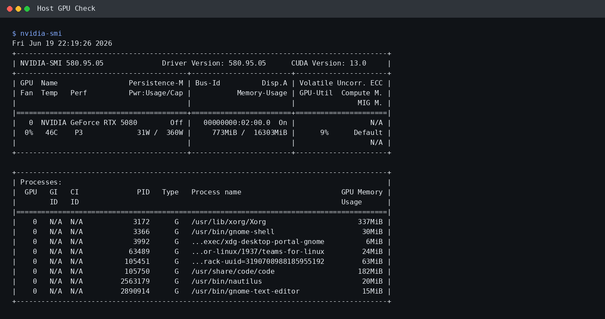
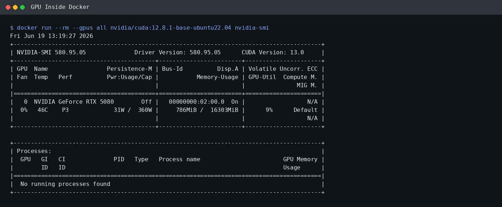

# `Lecture 01: Development Environment Setup`
## Ubuntu, NVIDIA Driver, Docker, AAC 개발환경

방산개방형아키텍처

---

# `1. 오늘의 목표`

오늘은 ROS 2 코드를 작성하기 전에 개발환경을 먼저 완성한다.

수업이 끝나면 할 수 있어야 하는 것:

- Ubuntu 호스트에서 GPU와 Docker 상태를 확인한다.
- NVIDIA GPU를 Docker 컨테이너 안에서 사용할 수 있게 설정한다.
- `aac_2026` 프로젝트를 clone하고 Docker 이미지를 빌드한다.
- 컨테이너 안에서 ROS 2 workspace를 빌드하고 실행 준비를 마친다.

```text
목표: 내 노트북/워크스테이션을 AAC 개발 장비로 만든다.
```

---

# `2. 오늘 수업 내용`

<div class="flow">
  <div class="box">Ubuntu<br>기본 설정</div>
  <div class="arrow">→</div>
  <div class="box">NVIDIA<br>Driver</div>
  <div class="arrow">→</div>
  <div class="box">Docker<br>Engine</div>
  <div class="arrow">→</div>
  <div class="box orange">NVIDIA<br>Container</div>
  <div class="arrow">→</div>
  <div class="box green">AAC<br>Container</div>
</div>

오늘 가장 중요한 질문:

```text
무엇을 호스트에 설치하고,
무엇을 컨테이너 안에 넣을 것인가?
```

---

# `2-1. 캡처 샘플: Host GPU`

Host Ubuntu에서 `nvidia-smi`가 정상 출력되는 화면이다.



---

# `2-2. 캡처 샘플: GPU Container`

Docker container 안에서도 GPU가 보이는지 확인하는 화면이다.




```text
docker run --gpus all ... nvidia-smi 명령이 성공한다.
```

---

# `3. 왜 Docker를 쓰는가?`

자율주행 개발환경은 의존성이 많다.

- ROS 2 Humble
- Gazebo / Ignition
- CUDA / cuDNN
- PyTorch
- OpenCV CUDA build
- SLAM / Perception 패키지

문제:

```text
각자 PC에 직접 설치하면 버전이 조금씩 달라진다.
```

해결:

```text
무거운 개발환경은 Docker image로 고정한다.
```

---

# `4. 호스트와 컨테이너`

<div class="cols2">
<div>

## Host Ubuntu

- 실제 컴퓨터
- NVIDIA driver 설치
- Docker daemon 실행
- 프로젝트 파일 편집

</div>
<div>

## Docker Container

- ROS 2 Humble 실행
- colcon build
- Gazebo / RViz 실행
- Python/C++ 패키지 실행
- CUDA 라이브러리 사용

</div>
</div>

핵심:

```text
GPU kernel driver는 host에 있고,
CUDA/PyTorch 개발환경은 container에 있다.
```

---

# `4-1. 개발환경 구조 그림`

<div class="arch">
<div class="archcol">
  <h2>Host Ubuntu</h2>
  <div class="archbox gray">NVIDIA Driver<br><span class="tiny">GPU kernel module, nvidia-smi</span></div>
  <div class="archbox gray">Docker Engine<br><span class="tiny">container 생성/시작/재접속</span></div>
  <div class="archbox">Editor<br><span class="tiny">VS Code, terminal, browser</span></div>
</div>

<div class="archcol">
  <h2>Git Source</h2>
  <div class="archbox green">Workspace Root<br><span class="tiny">/home/${USER}/ros_ws</span></div>
  <div class="archbox green">Project Source<br><span class="tiny">src/aac_2026</span></div>
  <div class="archbox">Git 관리<br><span class="tiny">commit, branch, submodule</span></div>
  <div class="archbox">Host에서 편집<br><span class="tiny">수정 파일은 Git으로 추적</span></div>
</div>

<div class="archcol">
  <h2>AAC Container</h2>
  <div class="archbox green">Mounted Workspace<br><span class="tiny">/ros_ws = host ros_ws bind mount</span></div>
  <div class="archbox orange">ROS 2 Humble<br><span class="tiny">ros2, colcon, launch, topic</span></div>
  <div class="archbox orange">Runtime<br><span class="tiny">CUDA, Python, C++, Gazebo/RViz</span></div>
  <div class="archbox">Build Output<br><span class="tiny">/ros_ws/build, /ros_ws/install, /ros_ws/log</span></div>
</div>
</div>

핵심:

```text
소스코드는 host에 있고, container는 그 소스코드를 mount해서 실행한다.
```

---

# `5. 준비물 체크리스트`

권장 환경:

| 항목 | 권장 |
|---|---|
| OS | Ubuntu 22.04 LTS |
| GPU | NVIDIA GPU |
| RAM | 32 GB 이상 권장 |
| Disk | 여유 공간 100 GB 이상 권장 |
| Network | Docker image build 중 안정적인 인터넷 |
| Account | GitHub submodule 접근 가능 |

확인:

```bash
# 실행 위치: Host Ubuntu
lsb_release -a
uname -r
df -h
free -h
```

---

# `6. Ubuntu 설치 직후`

먼저 시스템을 최신 상태로 만든다.

```bash
# 실행 위치: Host Ubuntu
sudo apt update
sudo apt upgrade -y
sudo reboot
```

재부팅 후 확인:

```bash
# 실행 위치: Host Ubuntu
uname -r
ip link show
```

주의:

- Secure Boot가 켜져 있으면 NVIDIA driver 설치 후 서명 절차가 필요할 수 있다.
- 설치가 꼬이면 GPU 문제가 아니라 kernel module 로딩 문제일 때가 많다.

---

# `7. 기본 개발 도구 설치`

호스트에는 최소 도구만 설치한다.

```bash
# 실행 위치: Host Ubuntu
sudo apt update
sudo apt install -y \
  git curl wget ca-certificates gnupg \
  build-essential software-properties-common \
  vim tmux
```

확인:

```bash
# 실행 위치: Host Ubuntu
git --version
curl --version
```

질문:

```text
ROS 2는 왜 host에 직접 설치하지 않을까?
```

---

# `8. NVIDIA Driver 개념`

NVIDIA GPU를 쓰려면 두 층을 구분해야 한다.

| 층 | 위치 | 역할 |
|---|---|---|
| NVIDIA kernel driver | host | GPU 장치 제어 |
| CUDA runtime/library | container | CUDA 프로그램 실행 |
| PyTorch/OpenCV | container | AI/비전 코드 실행 |

중요:

```text
컨테이너가 GPU를 쓰려면 host의 nvidia-smi가 먼저 정상이어야 한다.
```

---

# `9. NVIDIA Driver 설치`

Ubuntu 공식 권장 방식은 `ubuntu-drivers` 도구를 사용하는 것이다.

먼저 후보 driver를 확인한다.

```bash
# 실행 위치: Host Ubuntu
sudo apt update
sudo ubuntu-drivers list
```

일반 데스크톱/워크스테이션:

```bash
# 실행 위치: Host Ubuntu
sudo ubuntu-drivers install
sudo reboot
```

서버/compute 중심 장비:

```bash
# 실행 위치: Host Ubuntu
sudo ubuntu-drivers list --gpgpu
sudo ubuntu-drivers install --gpgpu
sudo reboot
```

---

# `10. GPU 확인`

재부팅 후:

```bash
# 실행 위치: Host Ubuntu
nvidia-smi
```

성공하면 보이는 것:

- Driver Version
- CUDA Version
- GPU 이름
- 사용 중인 process

실패할 때 자주 보는 상황:

| 증상 | 가능한 원인 |
|---|---|
| command not found | driver/util package 미설치 |
| No devices were found | driver module 미로딩 |
| Secure Boot 관련 오류 | module signing 문제 |

---

# `11. 기존 Docker 패키지 제거`

Ubuntu 기본 저장소의 `docker.io`와 공식 Docker 패키지가 섞이면 헷갈린다.

수업에서는 Docker Desktop보다 Docker Engine을 기준으로 한다.

```bash
# 실행 위치: Host Ubuntu
for pkg in docker.io docker-compose docker-compose-v2 \
  docker-doc podman-docker containerd runc; do
  sudo apt remove -y "$pkg" 2>/dev/null || true
done
```

남아 있는 데이터는 자동 삭제되지 않는다.

```bash
# 실행 위치: Host Ubuntu
docker ps -a
docker images
```

처음 설치하는 장비라면 대부분 "없다"고 나오는 것이 정상이다.

---

# `12. Docker apt repository 등록`

공식 GPG key와 repository를 등록한다.

```bash
# 실행 위치: Host Ubuntu
sudo apt update
sudo apt install -y ca-certificates curl

sudo install -m 0755 -d /etc/apt/keyrings
sudo curl -fsSL https://download.docker.com/linux/ubuntu/gpg \
  -o /etc/apt/keyrings/docker.asc
sudo chmod a+r /etc/apt/keyrings/docker.asc
```

```bash
# 실행 위치: Host Ubuntu
sudo tee /etc/apt/sources.list.d/docker.sources <<EOF
Types: deb
URIs: https://download.docker.com/linux/ubuntu
Suites: $(. /etc/os-release && echo "${UBUNTU_CODENAME:-$VERSION_CODENAME}")
Components: stable
Architectures: $(dpkg --print-architecture)
Signed-By: /etc/apt/keyrings/docker.asc
EOF
```

---

# `13. Docker Engine 설치`

```bash
# 실행 위치: Host Ubuntu
sudo apt update
sudo apt install -y \
  docker-ce docker-ce-cli containerd.io \
  docker-buildx-plugin docker-compose-plugin
```

서비스 확인:

```bash
# 실행 위치: Host Ubuntu
sudo systemctl status docker
```

설치 확인:

```bash
# 실행 위치: Host Ubuntu
sudo docker run hello-world
docker --version
docker compose version
```

---

# `14. sudo 없이 Docker 사용`

매번 `sudo docker ...`를 치지 않도록 현재 사용자를 `docker` 그룹에 추가한다.

```bash
# 실행 위치: Host Ubuntu
sudo groupadd docker 2>/dev/null || true
sudo usermod -aG docker $USER
newgrp docker
```

확인:

```bash
# 실행 위치: Host Ubuntu
docker run hello-world
```

주의:

```text
docker 그룹은 host에서 강한 권한을 갖는다.
개인 개발 장비와 수업 장비에서는 편하지만, 운영 서버에서는 정책 확인이 필요하다.
```

---

# `15. NVIDIA Container Toolkit`

Docker가 GPU를 볼 수 있도록 NVIDIA Container Toolkit을 설치한다.

```bash
# 실행 위치: Host Ubuntu
sudo apt-get update
sudo apt-get install -y --no-install-recommends \
  ca-certificates curl gnupg2
```

```bash
# 실행 위치: Host Ubuntu
curl -fsSL https://nvidia.github.io/libnvidia-container/gpgkey \
  | sudo gpg --dearmor \
  -o /usr/share/keyrings/nvidia-container-toolkit-keyring.gpg
```

```bash
# 실행 위치: Host Ubuntu
curl -s -L https://nvidia.github.io/libnvidia-container/stable/deb/nvidia-container-toolkit.list \
  | sed 's#deb https://#deb [signed-by=/usr/share/keyrings/nvidia-container-toolkit-keyring.gpg] https://#g' \
  | sudo tee /etc/apt/sources.list.d/nvidia-container-toolkit.list
```

---

# `16. Docker Runtime 설정`

Toolkit 설치:

```bash
# 실행 위치: Host Ubuntu
sudo apt-get update
sudo apt-get install -y nvidia-container-toolkit
```

Docker runtime 설정:

```bash
# 실행 위치: Host Ubuntu
sudo nvidia-ctk runtime configure --runtime=docker
sudo systemctl restart docker
```

GPU 컨테이너 테스트:

```bash
# 실행 위치: Host Ubuntu
docker run --rm --gpus all \
  nvidia/cuda:12.8.1-base-ubuntu22.04 nvidia-smi
```

성공 기준:

```text
container 안에서도 nvidia-smi 표가 출력된다.
```

---

# `17. AAC 프로젝트 가져오기`

작업공간을 만든다.

```bash
# 실행 위치: Host Ubuntu
mkdir -p /home/${USER}/ros_ws/src
cd /home/${USER}/ros_ws/src
```

submodule까지 함께 clone한다.

```bash
# 실행 위치: Host Ubuntu
git clone --recursive https://github.com/Leedk3/aac_2026.git
cd aac_2026
git checkout main
```

submodule을 빠뜨렸다면:

```bash
# 실행 위치: Host Ubuntu
git submodule update --init --recursive
```

---

# `18. 오늘 볼 프로젝트 구조`

```text
aac_2026/
├── control/       # joystick, vehicle command
├── system/        # vehicle model, Gazebo, TF
├── operations/    # tmuxp orchestration
├── docker/        # Dockerfile, run script
├── build.sh
├── start.sh
└── stop.sh
```

오늘은 `docker/`, `build.sh`, `start.sh`의 역할을 이해한다.

---

# `19. Docker image build`

Docker image는 프로젝트 루트 전체를 build context로 사용한다.

```bash
# 실행 위치: Host Ubuntu
cd /home/${USER}/ros_ws/src/aac_2026/docker
./build_docker.sh x86
```

결과 image:

```text
aac-2026-image:x86
```

확인:

```bash
# 실행 위치: Host Ubuntu
docker images | grep aac-2026
```

주의:

```text
첫 build는 OpenCV CUDA 빌드 때문에 오래 걸릴 수 있다.
```

---

# `20. x86 Dockerfile 안에는 무엇이 있는가?`

이 프로젝트의 x86 image 기반:

```dockerfile
FROM nvidia/cuda:12.8.1-cudnn-devel-ubuntu22.04
ENV ROS_DISTRO=humble
```

포함되는 것:

- Ubuntu 22.04
- ROS 2 Humble desktop
- CUDA 12.8 / cuDNN
- PyTorch cu128
- OpenCV CUDA build
- colcon / tmuxp / Gazebo 관련 패키지

정리:

```text
host는 얇게, container는 두껍게.
```

---

# `21. 컨테이너 실행 스크립트`

`run_x86.sh`가 해주는 일:

- `/home/${USER}/ros_ws`를 container의 `/ros_ws`로 mount
- host GPU를 container에 전달
- X11 socket을 전달해서 GUI 실행 준비
- ROS/DDS 환경변수를 container로 전달

실행:

```bash
# 실행 위치: Host Ubuntu
cd /home/${USER}/ros_ws/src/aac_2026/docker
bash run_x86.sh
```

---

# `22. 왜 mount가 중요한가?`

`run_x86.sh`의 핵심 mount:

```text
host:      /home/${USER}/ros_ws
container: /ros_ws
```

의미:

<div class="flow">
  <div class="box">VS Code에서<br>host 파일 수정</div>
  <div class="arrow">→</div>
  <div class="box orange">container에서<br>colcon build</div>
  <div class="arrow">→</div>
  <div class="box green">동일 파일이<br>바로 반영</div>
</div>

다음 수업의 핵심:

```text
코드는 host에서 편집하고, 실행은 container에서 한다.
```

---

# `23. Shell 환경 설정`

`~/.bashrc`에 자주 쓰는 설정을 넣는다.

```bash
# 실행 위치: Host Ubuntu
echo "export RMW_IMPLEMENTATION=rmw_cyclonedds_cpp" >> ~/.bashrc
echo "export ROS_DOMAIN_ID=3" >> ~/.bashrc
echo "export DDS_INTERFACE=eth0" >> ~/.bashrc
```

컨테이너 진입 alias:

```bash
# 실행 위치: Host Ubuntu
echo "alias aac_enter='cd /home/${USER}/ros_ws/src/aac_2026/docker && bash run_x86.sh'" >> ~/.bashrc
```

적용:

```bash
# 실행 위치: Host Ubuntu
source ~/.bashrc
```

네트워크 인터페이스 이름은 장비마다 다르다.

```bash
# 실행 위치: Host Ubuntu
ip link show
```

---

# `24. 컨테이너 안에서 확인`

컨테이너에 들어간 뒤:

```bash
# 실행 위치: AAC Container
pwd
ls /ros_ws/src/aac_2026
echo $ROS_DISTRO
echo $ROS_DOMAIN_ID
```

ROS 2 확인:

```bash
# 실행 위치: AAC Container
ros2 --help
ros2 pkg list | head
```

GPU 확인:

```bash
# 실행 위치: AAC Container
nvidia-smi
python3 - <<'PY'
import torch
print(torch.__version__)
print(torch.cuda.is_available())
PY
```

---

# `25. ROS workspace 빌드`

컨테이너 안에서 실행한다.

```bash
# 실행 위치: AAC Container
cd /ros_ws/src/aac_2026
./build.sh
```

`build.sh`가 하는 일:

- `/opt/ros/$ROS_DISTRO/setup.bash` source
- 외부 ML repo에 `COLCON_IGNORE` 생성
- `/ros_ws`에서 `colcon build`
- install 위치를 `/ros_ws/install`로 고정

빌드 후:

```bash
# 실행 위치: AAC Container
source /ros_ws/install/setup.bash
ros2 pkg list | grep aac_vehicle
```

---

# `26. AAC Stack 실행`

빌드가 끝났다면:

```bash
# 실행 위치: AAC Container
cd /ros_ws/src/aac_2026
./start.sh
```

`start.sh`는 `tmuxp` 설정을 읽는다.

```text
operations/tmuxp_config/config.yaml
```

실행되는 대표 노드:

- `static_tf_tree`
- `aac_vehicle`
- `joy_control_node`

영상 센서, LiDAR, 인지/항법 노드는 후속 강의에서 따로 실행하고 튜닝한다.

---

# `27. 상태 확인 명령`

tmux session 접속:

```bash
# 실행 위치: AAC Container
tmux attach -t AAC_2026
```

ROS topic 확인:

```bash
# 실행 위치: AAC Container
ros2 topic list
ros2 node list
```

Gazebo/ROS 종료:

```bash
# 실행 위치: AAC Container
cd /ros_ws/src/aac_2026
./stop.sh
```

중요:

```text
Gazebo는 그냥 터미널을 닫기보다 stop.sh로 정리한다.
```

---

# `28. 실습 운영 규칙`

오늘부터 터미널은 두 종류로 생각한다.

| 위치 | 프롬프트 예시 | 하는 일 |
|---|---|---|
| Host Ubuntu | `user@pc:~$` | driver, Docker, git clone, Docker build |
| AAC Container | `user@aac-2026-container-all:/ros_ws$` | ROS 2 build, ROS 2 launch, Gazebo/RViz |

핵심 규칙:

```text
apt install, docker build, aac_enter는 host에서 한다.
colcon build, ros2 launch, ros2 topic은 container에서 한다.
```

---

# `29. 실습 0: 내 장비 정보 기록`

먼저 장비 상태를 기록한다.

```bash
# 실행 위치: Host Ubuntu
lsb_release -a
uname -r
ip link show
df -h
free -h
nvidia-smi
```

# `30. 실습 체크표`

장비별로 오늘 성공해야 하는 최소 상태:

| 단계 | 확인 명령 | 성공 기준 |
|---|---|---|
| GPU driver | `nvidia-smi` | GPU 이름과 driver version 출력 |
| Docker | `docker run hello-world` | Hello from Docker 출력 |
| GPU Docker | `docker run --gpus all ... nvidia-smi` | container 안에서 GPU 출력 |
| Source | `ls ~/ros_ws/src/aac_2026` | 프로젝트 파일 확인 |
| Image | `docker images \| grep aac-2026` | `aac-2026-image:x86` 확인 |
| ROS build | `./build.sh` | colcon build 완료 |

---

# `31. Git clone과 submodule`

AAC2026은 일부 외부 프로젝트를 submodule로 사용한다.

```bash
# 실행 위치: Host Ubuntu
mkdir -p /home/${USER}/ros_ws/src
cd /home/${USER}/ros_ws/src
git clone --recursive https://github.com/Leedk3/aac_2026.git
cd aac_2026
git checkout main
```

중요:

```text
--recursive를 빼면 navigation/WildGS-SLAM 같은 폴더가 비어 있을 수 있다.
```

---

# `32. submodule 복구`

clone할 때 `--recursive`를 빼먹었다면:

```bash
# 실행 위치: Host Ubuntu
cd /home/${USER}/ros_ws/src/aac_2026
git submodule update --init --recursive
```

폴더 상태가 꼬였을 때:

```bash
# 실행 위치: Host Ubuntu
cd /home/${USER}/ros_ws/src/aac_2026
git submodule deinit -f navigation/WildGS-SLAM
git rm -rf --cached navigation/WildGS-SLAM 2>/dev/null || true
rm -rf .git/modules/navigation/WildGS-SLAM
git submodule update --init --recursive
```

---

# `33. Docker image 선택`

장비에 맞는 image를 선택한다.

| 장비 | 명령 | 특징 |
|---|---|---|
| x86 desktop/workstation | `./build_docker.sh x86` | CUDA, PyTorch, OpenCV CUDA |
| Mac Apple Silicon | `./build_docker.sh mac` | CPU 기반, CUDA 없음 |
| Jetson | `./build_docker.sh jetson` | Jetson/edge 장비용 |

수업 기본:

```bash
# 실행 위치: Host Ubuntu
cd /home/${USER}/ros_ws/src/aac_2026/docker
./build_docker.sh x86
```

---

# `34. Docker build가 오래 걸리는 이유`

첫 build는 오래 걸릴 수 있다.

주요 원인:

- Ubuntu package 설치
- ROS 2 Humble 패키지 설치
- CUDA/PyTorch 관련 패키지 설치
- OpenCV CUDA build
- Python ML dependency 설치

확인:

```bash
# 실행 위치: Host Ubuntu
docker images | grep aac-2026
```

```text
image가 만들어졌다면 다음 수업부터는 매번 새로 build하지 않는다.
```

---

# `35. run_x86.sh가 실제로 하는 일`

`run_x86.sh`는 단순히 container를 켜는 스크립트가 아니다.

주요 역할:

- host `/home/${USER}/ros_ws`를 container `/ros_ws`로 mount
- NVIDIA GPU를 container에 전달
- X11 display와 `/tmp/.X11-unix`를 전달
- `ROS_DOMAIN_ID`, `DDS_INTERFACE`, `CYCLONEDDS_URI` 설정
- Hugging Face cache를 `.hf_home`에 유지

하드웨어 장치 전달은 이후 센서 수업에서 다시 다룬다.

---

# `36. aac_enter 상태별 동작`

`aac_enter` alias는 `run_x86.sh`를 실행한다.

```bash
# 실행 위치: Host Ubuntu
echo "alias aac_enter='cd /home/${USER}/ros_ws/src/aac_2026/docker && bash run_x86.sh'" >> ~/.bashrc
source ~/.bashrc
```

상태별 동작:

| Container 상태 | 동작 |
|---|---|
| 없음 | 새 container 생성 후 접속 |
| stopped/exited | 다시 시작 후 접속 |
| already running | 새 shell로 접속 |

확인:

```bash
# 실행 위치: Host Ubuntu
docker ps -a | grep aac-2026
```

---

# `37. Shell 환경 설정 전체`

host의 `~/.bashrc`에 기본 ROS/DDS 설정을 넣는다.

```bash
# 실행 위치: Host Ubuntu
echo "export RMW_IMPLEMENTATION=rmw_cyclonedds_cpp" >> ~/.bashrc
echo "export ROS_DOMAIN_ID=3" >> ~/.bashrc
echo "export DDS_INTERFACE=eth0" >> ~/.bashrc
echo "alias aac_enter='cd /home/${USER}/ros_ws/src/aac_2026/docker && bash run_x86.sh'" >> ~/.bashrc
echo "alias kill_sys='bash /home/${USER}/ros_ws/src/aac_2026/kill_sys.sh'" >> ~/.bashrc
source ~/.bashrc
```

네트워크 인터페이스 이름은 장비마다 다르다.

```bash
# 실행 위치: Host Ubuntu
ip link show
```

---

# `38. Container 안에서 환경 확인`

`aac_enter`로 들어간 뒤 실행한다.

```bash
# 실행 위치: AAC Container
pwd
ls /ros_ws/src/aac_2026
echo $ROS_DISTRO
echo $ROS_DOMAIN_ID
echo $RMW_IMPLEMENTATION
echo $CYCLONEDDS_URI
```

ROS 2와 GPU 확인:

```bash
# 실행 위치: AAC Container
ros2 --help
nvidia-smi
python3 - <<'PY'
import torch
print(torch.__version__)
print(torch.cuda.is_available())
PY
```

---

# `39. 전체 패키지 빌드`

host에서 `aac_enter`로 container에 들어간 뒤 실행한다.

```bash
# 실행 위치: Host Ubuntu에서 시작, 이후 AAC Container
aac_enter
# aac_enter 이후부터는 AAC Container
cd /ros_ws/src/aac_2026
./build.sh
```

빌드 후 확인:

```bash
# 실행 위치: AAC Container
source /ros_ws/install/setup.bash
ros2 pkg list | grep aac_vehicle
ros2 pkg list | grep joy_control_node
ros2 pkg list | grep static_tf_tree
```

---

# `40. 특정 패키지만 빌드`

host에서 `aac_enter`로 container에 들어간 뒤 실행한다.

수업 중에는 전체 build보다 특정 패키지 build가 빠를 때가 많다.

```bash
# 실행 위치: Host Ubuntu에서 시작, 이후 AAC Container
aac_enter
# aac_enter 이후부터는 AAC Container
cd /ros_ws
src/aac_2026/perception/setup_colcon_ignores.sh
colcon build --packages-up-to example_cpp_node
source /ros_ws/install/setup.bash
```

예시:

```bash
# 실행 위치: AAC Container
colcon build --packages-select joy_control_node
colcon build --packages-select aac_vehicle
colcon build --packages-select static_tf_tree
```

---

# `41. build.sh가 하는 일`

파일:

```text
build.sh
```

핵심 내용:

```bash
# 실행 위치: AAC Container
. /opt/ros/$ROS_DISTRO/setup.bash
cd /ros_ws/src/aac_2026
./perception/setup_colcon_ignores.sh

cd /ros_ws
colcon build --base-paths src/* "$@" \
  --cmake-args \
  -DCMAKE_BUILD_TYPE=Debug \
  -DCMAKE_INSTALL_PREFIX=/ros_ws/install
```

---

# `42. COLCON_IGNORE가 필요한 이유`

`perception/`과 `navigation/`에는 ROS package가 아닌 외부 ML repo가 있다.

예시:

```text
navigation/WildGS-SLAM
perception/BiSeNet
perception/PIDNet
perception/sam3
```

`colcon`이 이 폴더를 ROS package로 착각하면 build가 실패하거나 오래 걸린다.

```text
setup_colcon_ignores.sh는 이런 외부 repo에 COLCON_IGNORE를 만든다.
```

---

# `43. AAC Stack 실행`

빌드가 끝났다면 stack을 실행한다.

```bash
# 실행 위치: AAC Container
cd /ros_ws/src/aac_2026
./start.sh
```

`start.sh`:

```bash
# 실행 위치: AAC Container
tmuxp load operations/tmuxp_config/config.yaml
```

tmux session 이름:

```text
AAC_2026
```

---

# `44. tmuxp가 실행하는 pane`

현재 `operations/tmuxp_config/config.yaml` 기준:

| Pane | Command |
|---|---|
| Static TF | `ros2 launch static_tf_tree static_tf_tree.launch.py` |
| Vehicle/Gazebo | `ros2 launch aac_vehicle spawn_vehicle.launch.py` |
| Joystick | `ros2 launch joy_control_node joy_control.launch.py` |

오늘은 tmux가 여러 프로세스를 한 번에 묶어 실행한다는 구조만 확인한다.
센서, 인지, 항법 pane의 의미와 파라미터는 후속 강의에서 다룬다.

---

# `45. tmux 사용법`

tmux session 접속:

```bash
# 실행 위치: AAC Container
tmux attach -t AAC_2026
```

자주 쓰는 키:

| 동작 | 키 |
|---|---|
| session에서 빠져나오기 | `Ctrl-b` 다음 `d` |
| pane 이동 | `Ctrl-b` 다음 방향키 |
| pane 확대/축소 | `Ctrl-b` 다음 `z` |

주의:

```text
터미널 창을 그냥 닫으면 Gazebo/ROS process가 남을 수 있다.
```

---

# `46. Stack 상태 확인`

다른 terminal에서 container에 한 번 더 들어간다.

```bash
# 실행 위치: Host Ubuntu
aac_enter
```

확인 명령:

```bash
# 실행 위치: AAC Container
ros2 topic list
ros2 node list
```

오늘은 topic과 node 목록이 출력되는지만 확인한다.

---

# `47. 안전하게 종료`

stack 종료는 `stop.sh`를 사용한다.

```bash
# 실행 위치: AAC Container
cd /ros_ws/src/aac_2026
./stop.sh
```

`stop.sh`의 순서:

1. tmux pane마다 `Ctrl-C` 전송
2. 잠시 대기
3. tmux session 종료
4. 남은 Gazebo/ROS process 정리

검증용 harness:

```bash
# 실행 위치: AAC Container
operations/harnesses/tmux_shutdown_harness.sh
operations/harnesses/tmux_shutdown_harness.sh --live
```

---

# `48. Mac에서 GUI를 쓸 때`

Mac Docker Desktop은 Linux VM 안에서 container를 실행한다.

그래서 Linux처럼 `/tmp/.X11-unix` socket mount가 잘 동작하지 않는다.

한 번만 설정:

```bash
# 실행 위치: Mac Host
brew install --cask xquartz
```

XQuartz 설정:

```text
Preferences -> Security -> Allow connections from network clients
```

XQuartz 재시작 후:

```bash
# 실행 위치: Mac Host에서 시작, 이후 AAC Container
xhost +localhost
aac_enter
# aac_enter 이후부터는 AAC Container
rviz2
```

---

# `49. 자주 나는 오류`

| 증상 | 확인 |
|---|---|
| `docker: permission denied` | `docker` 그룹 추가 후 logout/login |
| `nvidia-smi` host 실패 | NVIDIA driver부터 재확인 |
| container GPU 실패 | `nvidia-ctk`, Docker restart 확인 |
| `Cannot connect to X server` | `DISPLAY`, `/tmp/.X11-unix`, `xhost` 확인 |
| submodule 폴더가 비어 있음 | `git submodule update --init --recursive` |
| colcon이 외부 ML repo를 빌드함 | `perception/setup_colcon_ignores.sh` 확인 |

---

# `50. 디버깅 순서`

문제가 생기면 아래 순서로 좁힌다.

```text
1. host OS
2. NVIDIA driver
3. Docker Engine
4. NVIDIA Container Toolkit
5. AAC Docker image
6. AAC container
7. ROS workspace build
8. ROS launch/topic
```

```text
뒤 단계가 안 되면 앞 단계가 이미 정상인지 먼저 본다.
```

---

# `51. 수업 중 제출할 로그`

학생은 아래 결과를 캡처하거나 텍스트로 제출한다.

```text
1. lsb_release -a
2. nvidia-smi
3. docker --version
4. docker run hello-world
5. docker run --rm --gpus all nvidia/cuda:12.8.1-base-ubuntu22.04 nvidia-smi
6. docker images | grep aac-2026
7. aac_enter 후 pwd, echo $ROS_DISTRO
8. ./build.sh 마지막 20줄
9. ros2 pkg list | grep aac_vehicle
```

---

# `52. 오늘의 최종 미션`

최종 목표:

```text
AAC 개발환경을 만들고, container 안에서 ROS 2 workspace가 build되는 상태를 만든다.
```

성공 기준:

```bash
# 실행 위치: Host Ubuntu에서 시작, 이후 AAC Container
aac_enter
# aac_enter 이후부터는 AAC Container
cd /ros_ws/src/aac_2026
./build.sh
source /ros_ws/install/setup.bash
ros2 pkg list | grep aac_vehicle
```

선택 성공 기준:

```bash
# 실행 위치: AAC Container
./start.sh
ros2 node list | head
./stop.sh
```

---

# `53. 다음 강의로 넘기는 내용`

오늘 다루지 않는 것:

```text
카메라 장치 연결
LiDAR 장치 연결
센서별 udev rule
센서별 ROS topic 확인
센서 파라미터 튜닝
```

이 내용은 Gazebo 센서 모델링과 실차 센서 셋업 강의에서 다시 다룬다.

---

# `54. 참고 문서`

- Docker Engine Ubuntu install: https://docs.docker.com/engine/install/ubuntu/
- Docker Linux post-install: https://docs.docker.com/engine/install/linux-postinstall/
- Docker bind mounts: https://docs.docker.com/engine/storage/bind-mounts/
- Ubuntu NVIDIA driver install: https://ubuntu.com/server/docs/how-to/graphics/install-nvidia-drivers/
- NVIDIA Container Toolkit: https://docs.nvidia.com/datacenter/cloud-native/container-toolkit/latest/install-guide.html
- ROS 2 Humble installation: https://docs.ros.org/en/humble/Installation.html
- Project README: `src/aac_2026/README.md`
