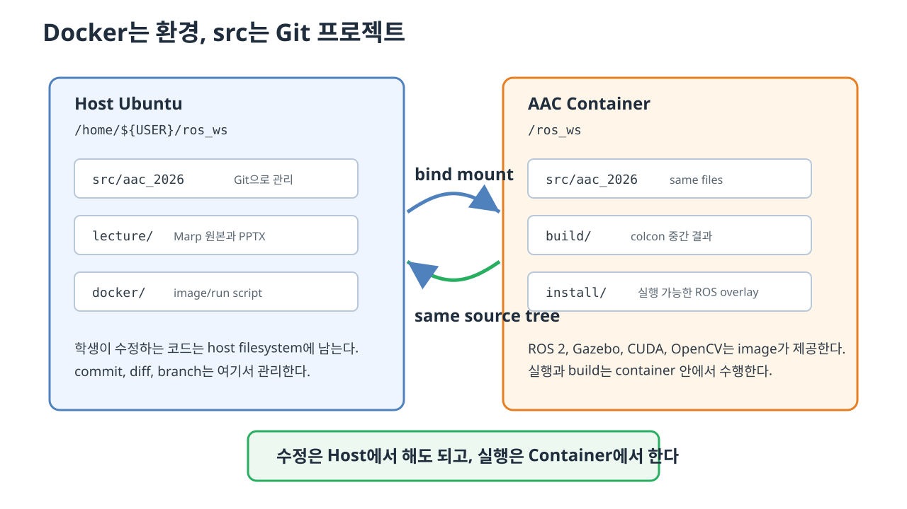
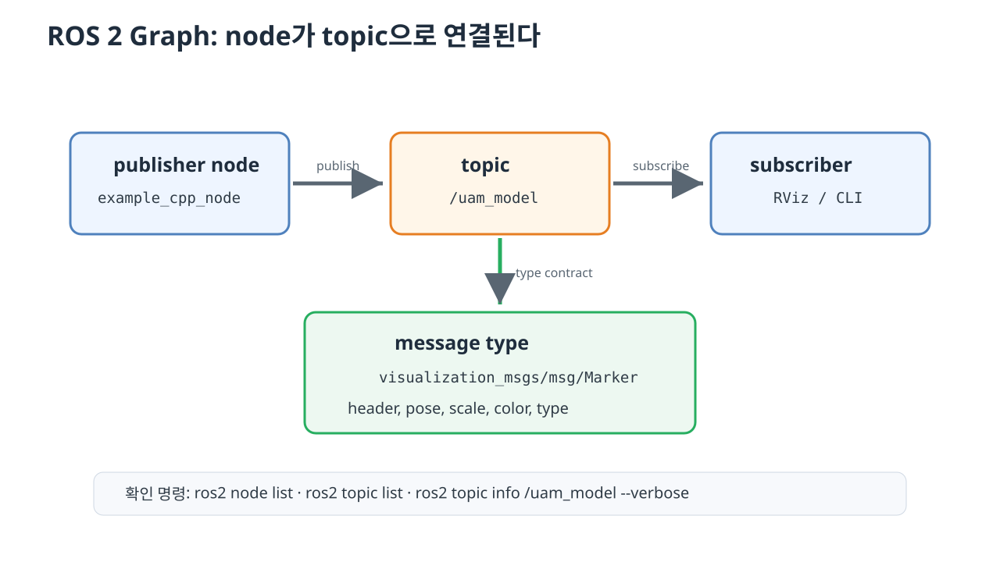
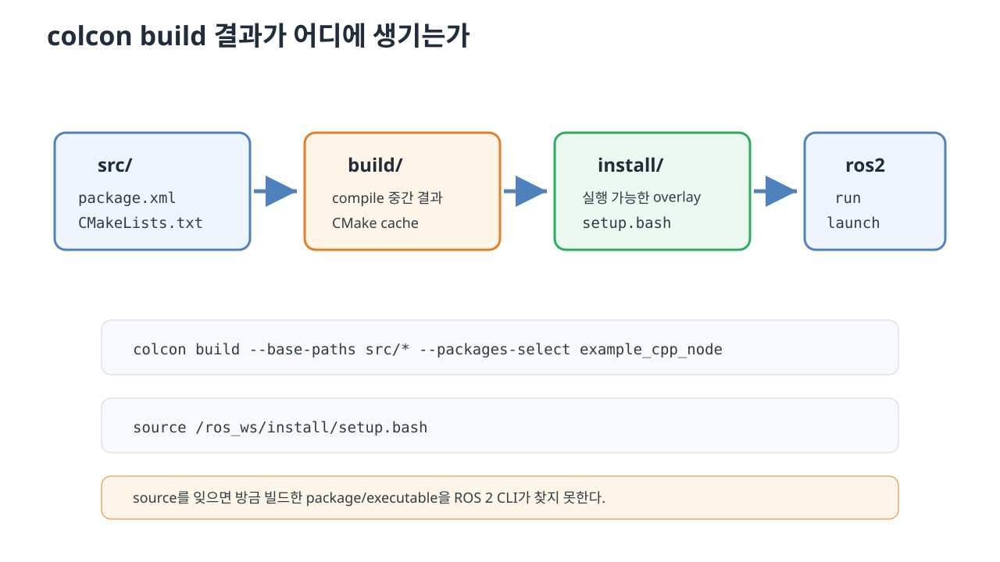

# `Lecture 02: ROS 2 Development Ecosystem`
## Docker 밖의 source, Docker 안의 ROS 2 개발환경

방산개방형아키텍처

---

# `1. 오늘의 목표`

오늘은 ROS 2 개발환경을 "외우는 명령어 묶음"이 아니라 하나의 생태계로 이해한다.

- `src`, `build`, `install`, `log`의 역할을 설명한다.
- ROS 2 node, topic, message, parameter, launch의 관계를 확인한다.
- `example_cpp_node`를 코드 레벨로 읽고 build/run/launch한다.
- `ros2 topic`, `ros2 node`, `ros2 interface`, `ros2 param`으로 시스템을 관찰한다.

```text
목표: ROS 2 패키지를 어디서 고치고, 어디서 빌드하고, 어떻게 실행하는지 안다.
```

---

# `2. 오늘의 큰 그림`

<div class="flow">
  <div class="box">Host<br>Git source</div>
  <div class="arrow">→</div>
  <div class="box orange">Docker<br>ROS 2 env</div>
  <div class="arrow">→</div>
  <div class="box">colcon<br>build</div>
  <div class="arrow">→</div>
  <div class="box green">ros2<br>run/launch</div>
</div>

핵심 질문:

```text
코드는 host에 남아 있는데,
왜 실행은 container 안에서 하는가?
```

---

# `3. 실습 운영 방식`

이 수업은 시험이나 점수 기반 평가가 없는 실습 중심 수업이다.

오늘의 확인 방식:

- 명령을 실행해보고 출력이 무엇을 의미하는지 말해본다.
- topic과 node 이름을 보고 데이터 흐름을 추적한다.
- 코드에서 입력, 출력, 바꿔볼 값을 표시한다.
- 막히면 어디 단계에서 실패했는지 좁힌다.

```text
틀리지 않는 것이 목표가 아니라, 관찰하고 복구하는 것이 목표다.
```

---

# `4. Host와 Container의 역할`

| 구분 | 위치 | 역할 |
|---|---|---|
| Host Ubuntu | `/home/${USER}/ros_ws/src/aac_2026` | Git source 관리 |
| AAC Container | `/ros_ws/src/aac_2026` | ROS 2 build/run |
| Docker image | `aac-2026-image:x86` | 재현 가능한 dependency |
| Docker volume mount | host workspace ↔ `/ros_ws` | 코드 공유 |

학생이 기억할 문장:

```text
Docker는 환경이고, src는 프로젝트다.
```

---

# `4-1. 그림: Host와 Container`



---

# `5. Container 들어가기`

Host에서 alias를 사용해 container에 들어간다.

```bash
# 실행 위치: Host Ubuntu에서 시작, 이후 AAC Container
aac_enter
# aac_enter 이후부터는 AAC Container
pwd
echo $ROS_DISTRO
```

기대 결과:

```text
pwd        -> /ros_ws
ROS_DISTRO -> humble
```

---

# `6. Source가 Mount되는지 확인`

Host와 container가 같은 파일을 보는지 확인한다.

```bash
# 실행 위치: AAC Container
cd /ros_ws/src/aac_2026
git status --short
ls
```

Host에서도 같은 repository를 볼 수 있다.

```bash
# 실행 위치: Host Ubuntu
cd /home/${USER}/ros_ws/src/aac_2026
git status --short
```

---

# `7. ROS 2 Workspace 구조`

```text
/ros_ws
├── src/
│   └── aac_2026/
│       ├── control/
│       ├── system/
│       ├── perception/
│       ├── navigation/
│       └── example_cpp_node/
├── build/
├── install/
└── log/
```

| 폴더 | 의미 |
|---|---|
| `src` | 사람이 수정하는 코드 |
| `build` | colcon이 만든 중간 산출물 |
| `install` | ROS 2가 실행할 수 있도록 설치된 결과 |
| `log` | build/test 로그 |

---

# `8. Workspace 상태 확인`

```bash
# 실행 위치: AAC Container
cd /ros_ws
ls -d src build install log 2>/dev/null || true
```

아직 build 전이면 `build`, `install`, `log`가 없을 수 있다.

```text
없는 것이 오류는 아니다.
colcon build를 실행하면 생성된다.
```

---

# `9. ROS 2 Graph`

ROS 2 시스템은 실행 중인 node들이 topic으로 연결된 graph다.

```text
node A ── publish ──> topic ── subscribe ──> node B
```

예:

```text
joy_node -> /joy -> joy_control_node -> /ackermann_drive -> aac_vehicle
```

오늘은 작은 예제 node로 이 구조를 먼저 손에 익힌다.

---

# `9-1. 그림: ROS 2 Graph`



---

# `10. Node 확인 명령`

아직 아무 node도 실행하지 않았다면 목록이 비어 있을 수 있다.

```bash
# 실행 위치: AAC Container
ros2 node list
```

node를 실행한 뒤에는 다시 확인한다.

```bash
# 실행 위치: AAC Container
ros2 node info /example_cpp_node
```

`node info`는 publisher, subscriber, service, action 정보를 보여준다.

---

# `11. Topic 확인 명령`

```bash
# 실행 위치: AAC Container
ros2 topic list
ros2 topic info /uam_model
ros2 topic hz /uam_model
```

메시지를 한 번만 보고 싶을 때:

```bash
# 실행 위치: AAC Container
ros2 topic echo /uam_model --once
```

---

# `12. Message Type 확인`

topic에는 반드시 message type이 있다.

```bash
# 실행 위치: AAC Container
ros2 topic type /uam_model
ros2 interface show visualization_msgs/msg/Marker
```

학생이 봐야 할 것:

- `header`
- `pose`
- `scale`
- `color`
- `type`

---

# `13. Package 목록 보기`

```bash
# 실행 위치: AAC Container
source /ros_ws/install/setup.bash
ros2 pkg list | grep example_cpp_node
ros2 pkg list | grep joy_control_node
ros2 pkg list | grep aac_vehicle
```

만약 아무것도 나오지 않으면:

```text
아직 build가 안 됐거나 install/setup.bash를 source하지 않았다.
```

---

# `14. Build 기본`

프로젝트 전체 build:

```bash
# 실행 위치: AAC Container
cd /ros_ws/src/aac_2026
./build.sh
```

특정 패키지만 build:

```bash
# 실행 위치: AAC Container
cd /ros_ws
src/aac_2026/perception/setup_colcon_ignores.sh
colcon build --base-paths src/* --packages-select example_cpp_node
source install/setup.bash
```

---

# `14-1. 그림: colcon build pipeline`



---

# `15. 왜 setup_colcon_ignores.sh가 필요한가`

AAC repository에는 ROS 2 패키지가 아닌 외부 ML repository도 있다.

```text
navigation/WildGS-SLAM
perception/BiSeNet
perception/PIDNet
perception/sam3
```

`colcon`이 이 폴더들을 ROS package로 착각하지 않도록 `COLCON_IGNORE`를 만든다.

```bash
# 실행 위치: AAC Container
cd /ros_ws/src/aac_2026
./perception/setup_colcon_ignores.sh
```

---

# `16. Package 구조: example_cpp_node`

```text
example_cpp_node/
├── CMakeLists.txt
├── package.xml
├── include/example_cpp_node/example_cpp.h
├── src/example_cpp_node.cpp
├── src/example_cpp.cpp
├── config/config.yaml
└── launch/deploy.launch.py
```

역할:

- `package.xml`: 의존성 선언
- `CMakeLists.txt`: build target 선언
- `src/`: 실행 코드
- `config/`: parameter
- `launch/`: 실행 조합

---

# `17. main 함수 읽기`

`example_cpp_node/src/example_cpp_node.cpp`

```cpp
int main(int argc, char **argv)
{
    rclcpp::init(argc, argv);
    auto node = std::make_shared<ExampleCPP>("example_cpp_node");
    rclcpp::spin(node);
    rclcpp::shutdown();
    return 0;
}
```

읽는 순서:

1. ROS 2 초기화
2. node 객체 생성
3. callback이 돌도록 spin
4. 종료 처리

---

# `18. Node 생성자 읽기`

`example_cpp_node/src/example_cpp.cpp`

```cpp
ExampleCPP::ExampleCPP(const std::string& node_name) : Node(node_name)
{
  this->Timer = this->create_wall_timer(
    100ms, std::bind(&ExampleCPP::TimerCallback, this));
  this->pubUAMmodel = this->create_publisher<
    visualization_msgs::msg::Marker>("/uam_model", rclcpp::SensorDataQoS());
  this->subOdom = this->create_subscription<nav_msgs::msg::Odometry>(
    "/Odometry/simple_flight", rclcpp::SensorDataQoS(),
    std::bind(&ExampleCPP::odomCallback, this, std::placeholders::_1));
  getParams();
}
```

---

# `19. 생성자에서 확인할 것`

| 코드 | 의미 |
|---|---|
| `create_wall_timer(100ms, ...)` | 10 Hz 주기 callback |
| `create_publisher<Marker>` | `/uam_model` publish |
| `create_subscription<Odometry>` | odometry topic subscribe |
| `getParams()` | YAML/parameter 읽기 |

학생 질문:

```text
이 node의 입력 topic과 출력 topic은 무엇인가?
```

---

# `20. Timer Callback`

```cpp
void ExampleCPP::TimerCallback()
{
  geometry_msgs::msg::Pose post_buf;
  post_buf.position.x = 0.0;
  post_buf.orientation.w = 1.0;

  pubUAMmodel->publish(MeshMarker(post_buf));
  RCLCPP_INFO_THROTTLE(
    this->get_logger(), *this->get_clock(), 100,
    "dt: %f [msec]", m_dt);
}
```

핵심:

- 주기적으로 메시지를 만든다.
- publisher로 topic에 내보낸다.
- 로그는 throttle로 너무 많이 찍지 않는다.

---

# `21. Parameter 읽기`

```cpp
void ExampleCPP::getParams()
{
  this->declare_parameter<double>("example_param", double(0.0));
  this->m_example_param =
    this->get_parameter("example_param").as_double();
}
```

parameter 파일:

```yaml
/**:
  ros__parameters:
    example_param: 0.0
```

parameter는 코드 수정 없이 node 동작을 바꾸기 위한 입력이다.

---

# `22. package.xml 읽기`

```xml
<depend>geometry_msgs</depend>
<depend>visualization_msgs</depend>
<depend>nav_msgs</depend>
<depend>sensor_msgs</depend>
<depend>std_msgs</depend>
```

`package.xml`은 이 패키지가 어떤 ROS interface와 library에 의존하는지 알려준다.

확인 명령:

```bash
# 실행 위치: AAC Container
ros2 pkg xml example_cpp_node | head -40
```

---

# `23. CMakeLists.txt 읽기`

```cmake
ament_auto_add_library(example_cpp SHARED
  src/example_cpp.cpp)

ament_auto_add_executable(example_cpp_exe
  src/example_cpp_node.cpp)

target_link_libraries(example_cpp_exe
  example_cpp)
```

해석:

- node 로직은 library로 빌드한다.
- `main()`은 executable로 빌드한다.
- executable이 library를 link한다.

---

# `24. ros2 run`

패키지와 실행 파일 이름을 직접 지정한다.

```bash
# 실행 위치: AAC Container
cd /ros_ws
source install/setup.bash
ros2 run example_cpp_node example_cpp_exe
```

다른 terminal에서 확인:

```bash
# 실행 위치: Host Ubuntu에서 시작, 이후 AAC Container
aac_enter
# aac_enter 이후부터는 AAC Container
source /ros_ws/install/setup.bash
ros2 node list
ros2 topic list | grep uam_model
```

---

# `25. ros2 launch`

launch file은 여러 node, parameter, remapping을 묶는다.

```bash
# 실행 위치: AAC Container
cd /ros_ws
source install/setup.bash
ros2 launch example_cpp_node deploy.launch.py
```

launch file의 핵심:

```python
Node(
    package="example_cpp_node",
    executable="example_cpp_exe",
    parameters=[LaunchConfiguration('example_cpp_node_param_file')],
)
```

---

# `26. launch argument`

`deploy.launch.py`는 parameter file 경로를 launch argument로 받는다.

```bash
# 실행 위치: AAC Container
ros2 launch example_cpp_node deploy.launch.py \
  example_cpp_node_param_file:=/ros_ws/src/aac_2026/example_cpp_node/config/config.yaml
```

장점:

- 같은 executable을 다른 설정으로 실행할 수 있다.
- 수업에서는 source tree의 YAML을 직접 수정하고 다시 실행해볼 수 있다.

---

# `27. Parameter 확인`

node 실행 중 다른 terminal에서:

```bash
# 실행 위치: AAC Container
ros2 param list /example_cpp_node
ros2 param get /example_cpp_node example_param
```

parameter가 보이지 않으면:

```text
node 이름이 다르거나, node가 이미 종료됐거나, setup.bash를 source하지 않았다.
```

---

# `28. Topic 데이터 읽기`

```bash
# 실행 위치: AAC Container
ros2 topic echo /uam_model --once
```

관찰 포인트:

- `header.frame_id`
- `type`
- `pose`
- `scale`
- `color`

이 데이터가 RViz에서 cube marker로 보일 수 있다.

---

# `29. Topic 주기 확인`

```bash
# 실행 위치: AAC Container
ros2 topic hz /uam_model
```

기대:

```text
Timer가 100ms이면 대략 10 Hz 근처가 나온다.
```

실제 시스템에서는 CPU 부하, QoS, timer jitter 때문에 완전히 정확하지 않을 수 있다.

---

# `30. 수동 Publish 실습`

ROS 2 CLI로 topic을 직접 publish할 수 있다.

```bash
# 실행 위치: AAC Container
ros2 topic pub --once /Odometry/simple_flight nav_msgs/msg/Odometry \
  "{pose: {pose: {position: {x: 1.0, y: 2.0, z: 0.0}}}}"
```

목적:

```text
subscriber callback이 받을 수 있는 입력 메시지를 CLI로 만들어본다.
```

---

# `31. QoS를 왜 신경 쓰는가`

`example_cpp_node`는 `rclcpp::SensorDataQoS()`를 사용한다.

```cpp
create_publisher<visualization_msgs::msg::Marker>(
  "/uam_model", rclcpp::SensorDataQoS());
```

QoS는 통신의 약속이다.

| 항목 | 의미 |
|---|---|
| reliability | 반드시 받을지, 최신 데이터 위주로 받을지 |
| history/depth | queue를 얼마나 유지할지 |
| durability | 늦게 붙은 subscriber가 과거 데이터를 받을지 |

---

# `32. ROS 2 CLI로 QoS 확인`

```bash
# 실행 위치: AAC Container
ros2 topic info /uam_model --verbose
```

확인할 것:

- Publisher count
- Subscription count
- Reliability
- Durability
- History depth

센서 데이터는 보통 오래된 데이터를 쌓기보다 최신 데이터를 보는 쪽이 자연스럽다.

---

# `33. rqt_graph`

node와 topic 연결을 그림으로 볼 수 있다.

```bash
# 실행 위치: AAC Container
rqt_graph
```

<div class="capture">
<strong>[CAPTURE SLOT]</strong><br>
대상: `rqt_graph`에서 `example_cpp_node`, `/uam_model`, `/Odometry/simple_flight`가 보이는 화면<br>
확인: publish/subscription 방향을 학생이 직접 설명한다.
</div>

---

# `34. RViz에서 Marker 보기`

RViz를 실행한다.

```bash
# 실행 위치: AAC Container
rviz2
```

RViz에서:

```text
Fixed Frame: base_link
Add -> Marker
Topic: /uam_model
```

GUI가 안 뜨면 Lecture01의 X11/DISPLAY 설정을 다시 확인한다.

---

# `35. 코드 수정 실습`

`TimerCallback()`에서 cube 위치나 색을 바꿔본다.

예:

```cpp
marker.color.r = 1.0;
marker.color.g = 0.2;
marker.color.b = 0.2;
marker.scale.x = 0.5;
```

수정 후:

```bash
# 실행 위치: AAC Container
cd /ros_ws
colcon build --base-paths src/* --packages-select example_cpp_node
source install/setup.bash
ros2 run example_cpp_node example_cpp_exe
```

---

# `36. Build 후 source를 잊으면`

새 executable이나 package가 안 보일 수 있다.

```bash
# 실행 위치: AAC Container
source /opt/ros/$ROS_DISTRO/setup.bash
source /ros_ws/install/setup.bash
ros2 pkg executables example_cpp_node
```

기억할 순서:

```text
코드 수정 -> colcon build -> source install/setup.bash -> run/launch
```

---

# `37. ros2 run vs ros2 launch`

| 명령 | 쓸 때 |
|---|---|
| `ros2 run` | node 하나를 빠르게 실행 |
| `ros2 launch` | parameter, remapping, 여러 node를 함께 실행 |
| `./start.sh` | AAC stack 전체를 tmux로 실행 |

수업 초반:

```text
작게는 ros2 run,
패키지 단위는 ros2 launch,
시스템 단위는 start.sh.
```

---

# `38. Remapping 개념`

node 코드에는 `/uam_model`이 박혀 있어도 launch에서 topic 이름을 바꿀 수 있다.

```python
remappings=[
  ("in_inspva", "novatel_bottom/inspva"),
]
```

AAC에서는 Gazebo bridge에서 remapping을 적극 사용한다.

```text
/model/aac_vehicle/odometry -> /odom
/lidar/scan -> /scan
```

---

# `39. AAC Stack에서 연결 확인`

전체 stack을 실행한 뒤 graph를 본다.

```bash
# 실행 위치: AAC Container
cd /ros_ws/src/aac_2026
./start.sh
```

다른 terminal:

```bash
# 실행 위치: Host Ubuntu에서 시작, 이후 AAC Container
aac_enter
# aac_enter 이후부터는 AAC Container
ros2 node list
ros2 topic list
```

---

# `40. tmux 확인`

```bash
# 실행 위치: AAC Container
tmux attach -t AAC_2026
```

자주 쓰는 키:

| 동작 | 키 |
|---|---|
| session에서 빠져나오기 | `Ctrl-b` 다음 `d` |
| pane 이동 | `Ctrl-b` 다음 방향키 |
| pane 확대/축소 | `Ctrl-b` 다음 `z` |

종료:

```bash
# 실행 위치: AAC Container
cd /ros_ws/src/aac_2026
./stop.sh
```

---

# `41. 흔한 실패와 복구`

| 증상 | 확인 |
|---|---|
| package가 안 보임 | `source /ros_ws/install/setup.bash` |
| build가 외부 ML repo에서 실패 | `perception/setup_colcon_ignores.sh` |
| topic이 안 보임 | node가 실행 중인지 `ros2 node list` |
| `ros2 launch`가 config를 못 찾음 | install된 share 경로와 source 경로 구분 |
| GUI가 안 뜸 | `DISPLAY`, X11 mount, `xhost` |

---

# `42. 디버깅 순서`

```text
1. container에 들어왔는가?
2. /ros_ws/src/aac_2026가 보이는가?
3. build가 성공했는가?
4. install/setup.bash를 source했는가?
5. node가 실행 중인가?
6. topic type이 기대와 같은가?
7. publisher/subscriber count가 1 이상인가?
```

---

# `43. 실습 체크포인트`

오늘 끝날 때 학생이 스스로 확인할 것:

```text
example_cpp_node를 build했다.
ros2 run으로 실행했다.
ros2 launch로 실행했다.
/uam_model topic type을 확인했다.
/uam_model 메시지를 echo했다.
rqt_graph에서 node/topic 연결을 봤다.
```

---

# `44. 캡처 후보`

<div class="capture">
<strong>[CAPTURE SLOT]</strong><br>
대상: `ros2 node info /example_cpp_node` 출력<br>
실행 위치: AAC Container<br>
확인: Publishers와 Subscribers가 코드와 일치한다.
</div>

<div class="capture">
<strong>[CAPTURE SLOT]</strong><br>
대상: `rqt_graph` 또는 RViz Marker 화면<br>
실행 위치: AAC Container<br>
확인: `/uam_model`이 publish되고 시각적으로 확인된다.
</div>

---

# `45. 다음 강의로 연결`

다음 강의에서는 실제 입력 장치인 joystick을 연결한다.

```text
/dev/input/js0
  -> joy_node
  -> /joy
  -> joy_control_node
  -> /ackermann_drive
```

오늘 배운 것 중 그대로 이어지는 것:

- node
- topic
- message type
- parameter YAML
- launch file
- topic echo/hz/info

---

# `46. 참고 문서`

- ROS 2 Humble Tutorials: https://docs.ros.org/en/humble/Tutorials.html
- ROS 2 C++ publisher/subscriber: https://docs.ros.org/en/humble/Tutorials/Beginner-Client-Libraries/Writing-A-Simple-Cpp-Publisher-And-Subscriber.html
- ROS 2 launch files: https://docs.ros.org/en/humble/Tutorials/Intermediate/Launch/Creating-Launch-Files.html
- ROS 2 launch substitutions: https://docs.ros.org/en/humble/Tutorials/Intermediate/Launch/Using-Substitutions.html
- Project README: `src/aac_2026/README.md`
- Example package: `src/aac_2026/example_cpp_node`
