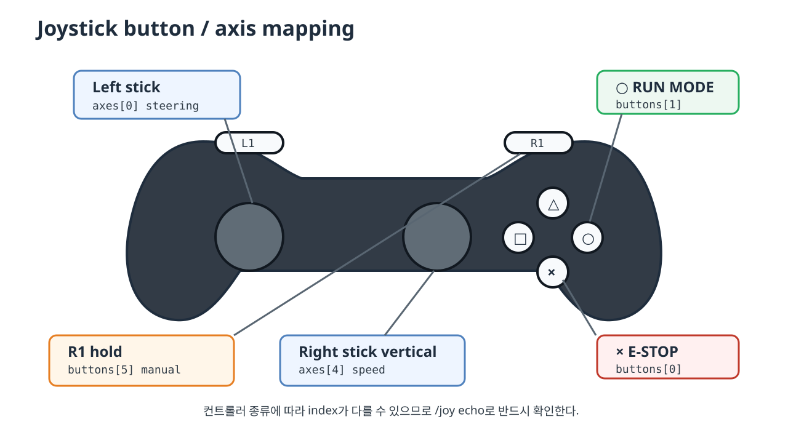
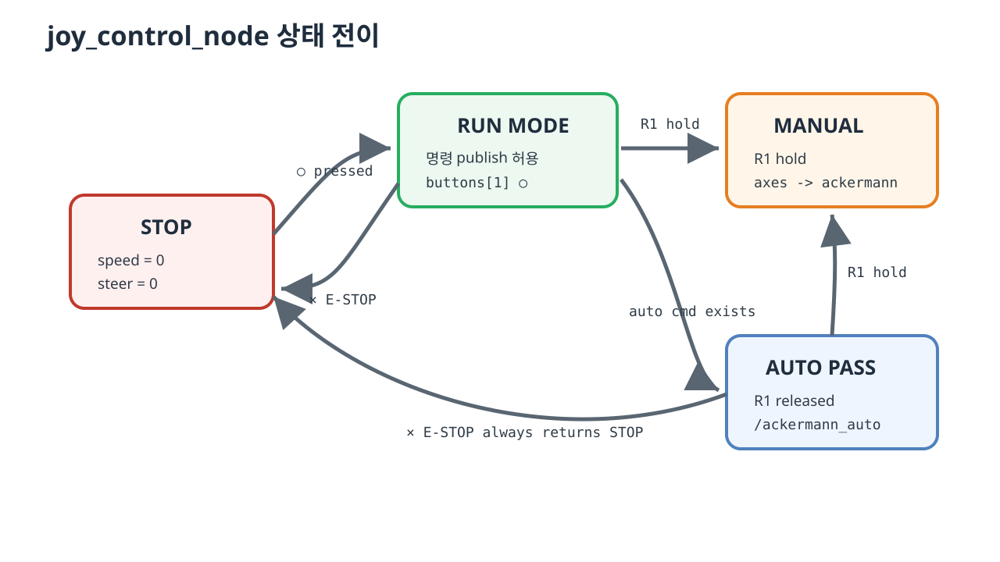
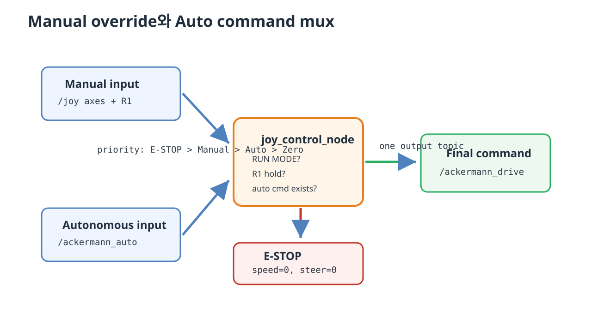

# `Lecture 03: Joystick Control Node`
## `/joy`를 `/ackermann_drive`로 바꾸는 안전한 입력 노드

방산개방형아키텍처

---

# `1. 오늘의 목표`

오늘은 joystick 입력이 실제 차량 명령으로 변환되는 과정을 코드 레벨로 읽는다.

- host에서 joystick device를 확인한다.
- container에서 `joy_node`와 `joy_control_node`를 실행한다.
- `/joy` 메시지를 보고 button/axis index를 이해한다.
- RUN MODE, E-STOP, manual/auto pass-through 상태를 코드로 추적한다.
- `/ackermann_drive`가 어떤 값으로 publish되는지 확인한다.

---

# `2. 오늘의 데이터 흐름`

<div class="flow">
  <div class="box">Joystick<br>/dev/input/js0</div>
  <div class="arrow">→</div>
  <div class="box orange">joy_node<br>/joy</div>
  <div class="arrow">→</div>
  <div class="box green">joy_control_node<br>/ackermann_drive</div>
  <div class="arrow">→</div>
  <div class="box">Vehicle<br>Gazebo/Real</div>
</div>

핵심:

```text
조이스틱은 곧바로 차량을 움직이지 않는다.
중간 node가 안전 상태와 명령 제한을 적용한다.
```

---

# `2-1. 그림: Joystick 버튼 맵`



---

# `3. 오늘의 안전 원칙`

실차를 다루기 전에도 안전 상태를 코드로 먼저 습관화한다.

| 상태 | 의미 |
|---|---|
| STOP | 기본 상태, 속도 0, 조향 0 |
| RUN MODE | 명령 publish 허용 |
| E-STOP | 즉시 STOP으로 전환 |
| Manual | R1 hold 중 joystick axis 사용 |
| Auto pass-through | `/ackermann_auto`를 `/ackermann_drive`로 전달 |

---

# `3-1. 그림: RUN/E-STOP 상태 전이`



---

# `4. 수업 확인 방식`

이 강의도 시험/평가 없이 실습 체크포인트로 진행한다.

오늘의 체크포인트:

```text
/dev/input/js0를 확인한다.
/joy topic을 echo한다.
button/axis index를 찾는다.
/ackermann_drive가 40 Hz 근처로 publish되는지 본다.
E-STOP을 눌렀을 때 speed=0, steer=0인지 확인한다.
```

---

# `5. Host에서 장치 확인`

joystick은 Linux host의 `/dev/input/js*`로 잡힌다.

```bash
# 실행 위치: Host Ubuntu
ls -l /dev/input/js*
```

장치 이름 확인:

```bash
# 실행 위치: Host Ubuntu
cat /proc/bus/input/devices | grep -A4 -i joystick
```

장치가 없으면 USB 연결, Bluetooth pair, 권한을 먼저 확인한다.

---

# `6. Docker가 joystick을 전달하는 방식`

`docker/run_x86.sh`는 joystick device를 찾아 container에 넘긴다.

```bash
# 실행 위치: Host Ubuntu
cd /home/${USER}/ros_ws/src/aac_2026
grep -n "JS_DEVICES\\|/dev/input/js\\|SDL_VIDEODRIVER" docker/run_x86.sh
```

중요한 것:

- `--device /dev/input/jsN`
- `--group-add input`
- `SDL_VIDEODRIVER=offscreen`

---

# `7. Container에서 장치 확인`

```bash
# 실행 위치: Host Ubuntu에서 시작, 이후 AAC Container
aac_enter
# aac_enter 이후부터는 AAC Container
ls -l /dev/input/js*
echo $SDL_VIDEODRIVER
```

기대:

```text
/dev/input/js0가 보인다.
SDL_VIDEODRIVER=offscreen 이다.
```

---

# `8. joy_control_node 패키지 구조`

```text
control/joy_control_node/
├── CMakeLists.txt
├── package.xml
├── include/joy_control_node/joy_control.h
├── src/joy_control.cpp
├── src/joy_control_node.cpp
├── config/joy_control_params.yaml
└── launch/joy_control.launch.py
```

핵심 파일:

- `joy_control.cpp`: 상태 머신과 변환 로직
- `joy_control_params.yaml`: 속도/조향 제한
- `joy_control.launch.py`: `joy_node` + `joy_control_node`

---

# `9. Build`

```bash
# 실행 위치: AAC Container
cd /ros_ws
src/aac_2026/perception/setup_colcon_ignores.sh
colcon build --base-paths src/* --packages-select joy_control_node
source install/setup.bash
```

확인:

```bash
# 실행 위치: AAC Container
ros2 pkg executables joy_control_node
ros2 pkg prefix joy_control_node
```

---

# `10. Launch 실행`

```bash
# 실행 위치: AAC Container
source /ros_ws/install/setup.bash
ros2 launch joy_control_node joy_control.launch.py
```

joystick index가 다르면:

```bash
# 실행 위치: AAC Container
ros2 launch joy_control_node joy_control.launch.py joy_id:=1
```

launch는 `joy_node`와 `joy_control_node`를 함께 실행한다.

---

# `11. 다른 Terminal에서 확인`

```bash
# 실행 위치: Host Ubuntu에서 시작, 이후 AAC Container
aac_enter
# aac_enter 이후부터는 AAC Container
source /ros_ws/install/setup.bash
ros2 node list
ros2 topic list | grep -E "joy|ackermann"
```

기대 topic:

```text
/joy
/ackermann_drive
/ackermann_auto
```

---

# `12. /joy 메시지 보기`

```bash
# 실행 위치: AAC Container
ros2 topic echo /joy --once
```

메시지 구조:

```text
axes:    [float, float, ...]
buttons: [int, int, ...]
```

button은 보통 0/1, axis는 보통 -1.0~1.0 범위다.

---

# `13. Button Mapping`

`joy_control.h`의 주석 기준:

| 입력 | index | 기능 |
|---|---:|---|
| Cross | `buttons[0]` | E-STOP |
| Circle | `buttons[1]` | RUN MODE |
| R1 | `buttons[5]` | manual joystick control hold |
| Left stick horizontal | `axes[0]` | steering |
| Right stick vertical | `axes[4]` | speed |

컨트롤러 종류에 따라 index가 다를 수 있으므로 반드시 echo로 확인한다.

---

# `14. /ackermann_drive 보기`

```bash
# 실행 위치: AAC Container
ros2 topic echo /ackermann_drive
```

다른 terminal:

```bash
# 실행 위치: AAC Container
ros2 topic hz /ackermann_drive
```

`joy_control_node`는 timer가 25 ms이므로 약 40 Hz를 목표로 한다.

---

# `15. Message Type`

```bash
# 실행 위치: AAC Container
ros2 topic type /ackermann_drive
ros2 interface show ackermann_msgs/msg/AckermannDriveStamped
```

주요 필드:

```text
header
drive.speed
drive.steering_angle
```

차량 제어에서 최소로 필요한 값은 속도와 조향각이다.

---

# `16. 코드: main`

`src/joy_control_node.cpp`

```cpp
int main(int argc, char ** argv)
{
  rclcpp::init(argc, argv);
  auto node = std::make_shared<JoyControl>("joy_control_node");
  rclcpp::spin(node);
  rclcpp::shutdown();
  return 0;
}
```

Lecture02의 `example_cpp_node`와 같은 구조다.

---

# `17. 코드: publisher/subscriber`

`src/joy_control.cpp`

```cpp
pub_ackermann_ = create_publisher<ackermann_msgs::msg::AckermannDriveStamped>(
  "/ackermann_drive", rclcpp::QoS(10));

sub_joy_ = create_subscription<sensor_msgs::msg::Joy>(
  "/joy", rclcpp::QoS(10),
  std::bind(&JoyControl::joyCallback, this, std::placeholders::_1));

sub_auto_cmd_ = create_subscription<ackermann_msgs::msg::AckermannDriveStamped>(
  "/ackermann_auto", rclcpp::QoS(10),
  std::bind(&JoyControl::autoCallback, this, std::placeholders::_1));
```

---

# `18. 입력과 출력`

| 방향 | Topic | Type | 의미 |
|---|---|---|---|
| Sub | `/joy` | `sensor_msgs/Joy` | joystick raw input |
| Sub | `/ackermann_auto` | `AckermannDriveStamped` | 자율주행 planner 명령 |
| Pub | `/ackermann_drive` | `AckermannDriveStamped` | 최종 차량 명령 |

중요:

```text
/ackermann_auto와 /ackermann_drive를 분리해서 node가 자기 출력을 다시 입력으로 받지 않게 한다.
```

---

# `19. 코드: parameter`

```cpp
declare_parameter<double>("maximum_speed",          1.5);
declare_parameter<double>("maximum_steering_angle", 0.524);
declare_parameter<bool>  ("reverse_angle",          true);
```

YAML:

```yaml
joy_control_node:
  ros__parameters:
    maximum_speed: 1.5
    maximum_steering_angle: 0.524
    reverse_angle: false
```

`0.524 rad`는 약 30도다.

---

# `20. Parameter 확인`

node 실행 중:

```bash
# 실행 위치: AAC Container
ros2 param list /joy_control_node
ros2 param get /joy_control_node maximum_speed
ros2 param get /joy_control_node maximum_steering_angle
ros2 param get /joy_control_node reverse_angle
```

수정할 파일:

```text
control/joy_control_node/config/joy_control_params.yaml
```

---

# `21. Timer 구조`

```cpp
timer_ = create_wall_timer(
  25ms, std::bind(&JoyControl::timerCallback, this));
```

이 node는 joystick callback에서 바로 publish하지 않는다.

대신:

```text
joyCallback: 최신 joystick 상태 저장
timerCallback: 현재 상태를 보고 40 Hz로 최종 명령 publish
```

장점: 입력 주기가 흔들려도 출력 주기를 일정하게 만들 수 있다.

---

# `22. 코드: STOP에서 RUN으로`

```cpp
if (buttons.at(1) == 1 && !run_mode_) {
  run_mode_ = true;
  RCLCPP_INFO(get_logger(), "RUN MODE enabled");
}
```

`buttons[1]`을 누르면 RUN MODE가 켜진다.

학생 확인:

```bash
# 실행 위치: AAC Container
ros2 topic echo /ackermann_drive
```

RUN MODE 전에는 speed와 steering이 0이어야 한다.

---

# `23. 코드: E-STOP`

```cpp
else if (buttons.at(0) == 1 && run_mode_) {
  run_mode_ = false;
  ackermann_cmd_.drive.speed = 0.0f;
  ackermann_cmd_.drive.steering_angle = 0.0f;
  pub_ackermann_->publish(ackermann_cmd_);
  RCLCPP_WARN(get_logger(), "E-STOP");
  return;
}
```

E-STOP은:

- run mode를 끈다.
- 속도와 조향을 0으로 만든다.
- 즉시 publish하고 callback을 끝낸다.

---

# `24. 코드: Manual Mode`

```cpp
if (buttons.at(5) == 1) {
  ackermann_cmd_.drive.speed =
    static_cast<float>(maximum_speed_ * axes.at(4));
  ackermann_cmd_.drive.steering_angle =
    static_cast<float>(reverse * maximum_steering_angle_ * axes.at(0));
}
```

해석:

- R1을 누르고 있을 때만 joystick axis를 사용한다.
- 속도 = 최대속도 × right stick vertical
- 조향 = 최대조향각 × left stick horizontal

---

# `25. 코드: Auto Pass-through`

```cpp
else if (has_auto_cmd_) {
  ackermann_cmd_.drive.speed = auto_cmd_.drive.speed;
  ackermann_cmd_.drive.steering_angle =
    static_cast<float>(reverse) * auto_cmd_.drive.steering_angle;
}
```

R1을 놓으면:

```text
자율주행 명령이 있으면 통과
없으면 speed=0, steer=0
```

이 구조 덕분에 joystick node가 manual override와 auto command mux 역할을 한다.

---

# `25-1. 그림: Manual/Auto Mux`



---

# `26. Hardware 없이 테스트하기`

실제 joystick이 없어도 `/joy`를 CLI로 publish할 수 있다.

RUN MODE 켜기:

```bash
# 실행 위치: AAC Container
ros2 topic pub --once /joy sensor_msgs/msg/Joy \
  "{axes: [0.0, 0.0, 0.0, 0.0, 0.0], buttons: [0, 1, 0, 0, 0, 0]}"
```

주의: axes/buttons 배열 길이가 코드에서 접근하는 index보다 짧으면 node가 예외를 낼 수 있다.

---

# `27. Manual 명령 publish`

R1 hold, steering 0.4, speed axis 0.6:

```bash
# 실행 위치: AAC Container
ros2 topic pub --once /joy sensor_msgs/msg/Joy \
  "{axes: [0.4, 0.0, 0.0, 0.0, 0.6], buttons: [0, 0, 0, 0, 0, 1]}"
```

다른 terminal에서:

```bash
# 실행 위치: AAC Container
ros2 topic echo /ackermann_drive --once
```

---

# `28. E-STOP 테스트`

```bash
# 실행 위치: AAC Container
ros2 topic pub --once /joy sensor_msgs/msg/Joy \
  "{axes: [0.0, 0.0, 0.0, 0.0, 0.0], buttons: [1, 0, 0, 0, 0, 0]}"
```

기대:

```text
run mode가 false로 바뀐다.
/ackermann_drive speed=0, steering_angle=0이 publish된다.
```

---

# `29. Auto Command 테스트`

`/ackermann_auto`를 수동으로 넣어본다.

```bash
# 실행 위치: AAC Container
ros2 topic pub --rate 5 /ackermann_auto \
  ackermann_msgs/msg/AckermannDriveStamped \
  "{drive: {speed: 0.7, steering_angle: 0.2}}"
```

조건:

```text
RUN MODE가 켜져 있고 R1을 누르고 있지 않으면 auto command가 통과한다.
```

---

# `30. Launch 파일 읽기`

`launch/joy_control.launch.py`

```python
joy_node = Node(
    package='joy',
    executable='joy_node',
    name='joy_node',
    parameters=[{
        'device_id': joy_id,
        'deadzone': 0.3,
        'autorepeat_rate': 20.0,
    }],
    additional_env={'SDL_VIDEODRIVER': 'offscreen'},
)
```

핵심: hardware driver와 control node를 함께 띄운다.

---

# `31. deadzone`

`deadzone: 0.3`은 작은 stick 떨림을 무시한다.

너무 작으면:

```text
가만히 둬도 차량이 조금씩 움직일 수 있다.
```

너무 크면:

```text
stick을 많이 움직여야 반응한다.
```

수정 위치:

```text
control/joy_control_node/launch/joy_control.launch.py
```

---

# `32. 최대속도 튜닝`

```yaml
maximum_speed: 1.5
maximum_steering_angle: 0.524
reverse_angle: false
```

수업 실습에서는 처음에 낮은 속도를 쓴다.

```yaml
maximum_speed: 0.5
```

수정 후:

```bash
# 실행 위치: AAC Container
cd /ros_ws
colcon build --base-paths src/* --packages-select joy_control_node
source install/setup.bash
ros2 launch joy_control_node joy_control.launch.py
```

---

# `33. reverse_angle`

조이스틱을 왼쪽으로 밀었는데 차량이 오른쪽으로 돈다면:

```yaml
reverse_angle: true
```

또는:

```yaml
reverse_angle: false
```

실습:

```text
왼쪽 stick을 왼쪽으로 움직였을 때 steering_angle 부호가 어떻게 바뀌는지 echo로 확인한다.
```

---

# `34. Gazebo와 연결`

차량 stack을 띄운 뒤 joystick 명령을 넣는다.

```bash
# 실행 위치: AAC Container
cd /ros_ws/src/aac_2026
./start.sh
```

다른 terminal에서:

```bash
# 실행 위치: Host Ubuntu에서 시작, 이후 AAC Container
aac_enter
# aac_enter 이후부터는 AAC Container
ros2 topic echo /ackermann_drive
ros2 topic echo /odom --once
```

---

# `35. rqt_graph로 보기`

```bash
# 실행 위치: AAC Container
rqt_graph
```

확인할 흐름:

```text
/joy -> /joy_control_node -> /ackermann_drive -> vehicle node
```

<div class="capture">
<strong>[CAPTURE SLOT]</strong><br>
대상: rqt_graph에서 joystick 제어 흐름<br>
확인: `/joy`, `/ackermann_auto`, `/ackermann_drive` 연결을 표시한다.
</div>

---

# `36. rosbag으로 입력 기록`

문제 재현을 위해 joystick과 출력 명령을 기록할 수 있다.

```bash
# 실행 위치: AAC Container
mkdir -p /ros_ws/bag
ros2 bag record -o /ros_ws/bag/joy_test /joy /ackermann_drive
```

재생:

```bash
# 실행 위치: AAC Container
ros2 bag play /ros_ws/bag/joy_test
```

---

# `37. 흔한 실패`

| 증상 | 확인 |
|---|---|
| `/dev/input/js0` 없음 | host 연결, Bluetooth pair |
| container 안에 js 장치 없음 | `aac_enter` 재실행, `run_x86.sh` device 전달 |
| `joy_node`가 장치를 못 찾음 | `joy_id`, `SDL_VIDEODRIVER=offscreen` |
| `/ackermann_drive`가 0만 나옴 | RUN MODE 버튼, R1 hold, axis index |
| 조향 방향 반대 | `reverse_angle` |

---

# `38. 디버깅 순서`

```text
1. Host에서 /dev/input/js*가 보이는가?
2. Container에서 /dev/input/js*가 보이는가?
3. /joy가 publish되는가?
4. buttons/axes index가 예상과 같은가?
5. RUN MODE가 켜졌는가?
6. R1 hold/manual 조건을 만족하는가?
7. /ackermann_drive가 publish되는가?
8. 차량 node가 /ackermann_drive를 subscribe하는가?
```

---

# `39. 실습 체크포인트`

```text
Host에서 joystick device를 확인했다.
Container에서 joystick device를 확인했다.
/joy 메시지를 echo했다.
RUN/E-STOP button index를 찾았다.
/ackermann_drive type과 값을 확인했다.
maximum_speed를 낮춰 재실행했다.
auto command pass-through를 CLI로 테스트했다.
```

---

# `40. 영상 슬롯`

```text
[VIDEO SLOT]
목적: joystick 버튼을 누를 때 /joy와 /ackermann_drive가 동시에 변하는 장면
추천 길이: 30-60초
삽입 위치: pptx export 후 수동 삽입
```

---

# `41. 다음 강의로 연결`

다음 강의에서는 `/ackermann_drive`가 Gazebo 차량 모델에 적용되는 과정을 본다.

```text
/ackermann_drive
  -> vehicle_state_publisher
  -> /ackermann_cmd
  -> ros_gz_bridge
  -> Gazebo AckermannSteering plugin
  -> /odom
```

오늘은 입력 node, 다음은 차량 모델이다.

---

# `42. 참고 문서`

- ROS 2 joy package: https://index.ros.org/p/joy/
- ROS 2 topic CLI tutorials: https://docs.ros.org/en/humble/Tutorials/Beginner-CLI-Tools/Understanding-ROS2-Topics/Understanding-ROS2-Topics.html
- ROS 2 parameters: https://docs.ros.org/en/humble/Tutorials/Beginner-Client-Libraries/Using-Parameters-In-A-Class-CPP.html
- Project README: `src/aac_2026/README.md`
- Package README: `src/aac_2026/control/joy_control_node/README.md`
- Source: `src/aac_2026/control/joy_control_node/src/joy_control.cpp`
