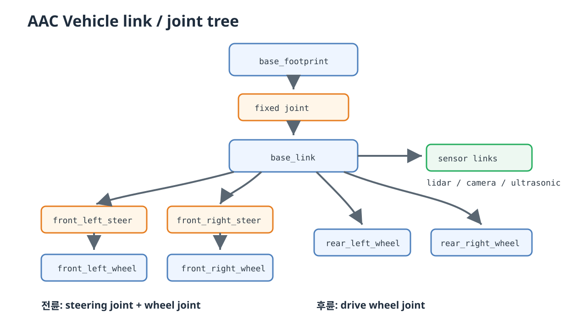
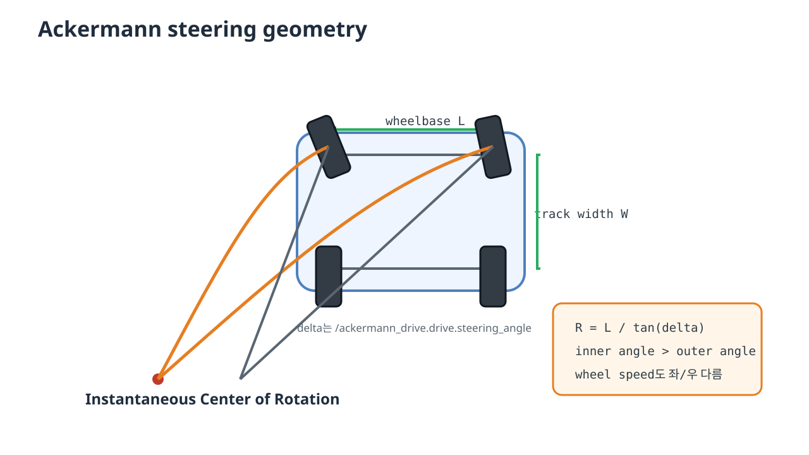
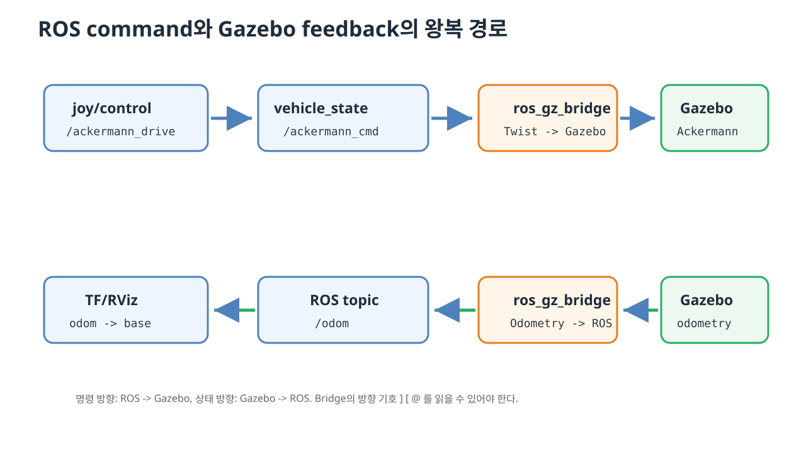

# `Lecture 04: Gazebo Vehicle Modeling`
## URDF/Xacro, Ackermann 기구학, Gazebo bridge

방산개방형아키텍처

---

# `1. 오늘의 목표`

오늘은 joystick 명령이 Gazebo 차량 움직임으로 바뀌는 경로를 읽는다.

- `aac_vehicle` 패키지 구조를 이해한다.
- URDF/Xacro의 link, joint, inertia, visual, collision을 구분한다.
- Ackermann 차량 파라미터를 설명한다.
- `spawn_vehicle.launch.py`가 Gazebo, robot_state_publisher, bridge를 띄우는 과정을 본다.
- `/ackermann_drive` → `/ackermann_cmd` → Gazebo plugin → `/odom` 흐름을 확인한다.

---

# `2. 오늘의 큰 그림`

<div class="flow">
  <div class="box">ROS<br>/ackermann_drive</div>
  <div class="arrow">→</div>
  <div class="box orange">vehicle_state<br>/ackermann_cmd</div>
  <div class="arrow">→</div>
  <div class="box">ros_gz_bridge</div>
  <div class="arrow">→</div>
  <div class="box green">Gazebo<br>Ackermann</div>
</div>

돌아오는 데이터:

```text
Gazebo odometry -> ros_gz_bridge -> /odom -> TF/RViz/debug
```

---

# `3. 실습 운영 방식`

이 강의는 차량 모델을 직접 바꿔보는 실습이다.

확인 방식:

- Gazebo에 차량이 spawn되는지 본다.
- `/ackermann_drive`를 CLI로 publish해 움직임을 만든다.
- `/odom`, `/joint_states`, TF를 확인한다.
- wheelbase, track width, steering limit을 어디서 바꾸는지 표시한다.

---

# `4. 패키지 구조`

```text
system/aac_vehicle/
├── urdf/aac_vehicle.urdf.xacro
├── urdf/sensors.urdf.xacro
├── config/vehicle_params.yaml
├── config/sensor_config.yaml
├── launch/spawn_vehicle.launch.py
├── launch/slam_mapping.launch.py
├── src/vehicle_state_publisher.cpp
├── src/gazebo_ground_truth_publisher.cpp
└── src/odom_tf_publisher.cpp
```

오늘은 차량 모델과 Gazebo 실행에 집중한다.

---

# `5. Build`

```bash
# 실행 위치: AAC Container
cd /ros_ws
src/aac_2026/perception/setup_colcon_ignores.sh
colcon build --base-paths src/* --packages-select aac_vehicle simple_gazebo_track static_tf_tree
source install/setup.bash
```

확인:

```bash
# 실행 위치: AAC Container
ros2 pkg prefix aac_vehicle
ros2 pkg executables aac_vehicle
```

---

# `6. Gazebo 차량 실행`

```bash
# 실행 위치: AAC Container
source /ros_ws/install/setup.bash
ros2 launch aac_vehicle spawn_vehicle.launch.py
```

새 terminal에서 확인:

```bash
# 실행 위치: Host Ubuntu에서 시작, 이후 AAC Container
aac_enter
# aac_enter 이후부터는 AAC Container
ros2 topic list | grep -E "ackermann|odom|joint"
ros2 node list
```

---

# `7. Launch 파일 구성`

`spawn_vehicle.launch.py`가 실행하는 것:

| 구성 | 역할 |
|---|---|
| `robot_state_publisher` | URDF에서 TF 발행 |
| `gz_sim` | Gazebo world 실행 |
| `ros_gz_sim create` | `/robot_description`으로 차량 spawn |
| `ros_gz_bridge parameter_bridge` | Gazebo topic ↔ ROS topic |
| `gazebo_ground_truth_publisher` | Gazebo pose를 `/odom_gt`로 변환 |
| `odom_tf_publisher` | `/odom`을 TF로 발행 |
| `vehicle_state_publisher_exe` | `/ackermann_drive`를 `/ackermann_cmd`로 변환 |

---

# `8. World 파일`

launch에서 사용하는 world:

```python
world_file = os.path.join(
    track_pkg_share, 'worlds', 'simple_track.world')
```

실제 위치 확인:

```bash
# 실행 위치: AAC Container
ros2 pkg prefix simple_gazebo_track
find /ros_ws/install -path "*simple_track.world" | head
```

world는 도로 texture, track model, physics 환경을 제공한다.

---

# `9. Gazebo resource path`

track model을 Gazebo가 찾도록 환경변수를 설정한다.

```python
SetEnvironmentVariable(
    name='GZ_SIM_RESOURCE_PATH',
    value=[track_model_path, ':', track_pkg_share, ':',
           EnvironmentVariable('GZ_SIM_RESOURCE_PATH', default_value='')],
)
```

확인:

```bash
# 실행 위치: AAC Container
echo $GZ_SIM_RESOURCE_PATH
echo $IGN_GAZEBO_RESOURCE_PATH
```

---

# `10. URDF와 Xacro`

URDF는 robot description XML이고, Xacro는 반복과 파라미터를 넣기 위한 전처리 언어다.

```text
aac_vehicle.urdf.xacro
  -> xacro.process_file(...)
  -> robot_description
  -> robot_state_publisher
  -> Gazebo spawn
```

명령으로 생성 결과 확인:

```bash
# 실행 위치: AAC Container
ros2 run xacro xacro /ros_ws/src/aac_2026/system/aac_vehicle/urdf/aac_vehicle.urdf.xacro | head -40
```

---

# `11. 차량 좌표계`

AAC 차량 모델은 ROS 관례를 따른다.

```text
base_link:
  +X forward
  +Y left
  +Z up
```

차량 기준:

```text
front axle: x = +0.40
rear axle:  x = -0.40
left wheel: y = +0.23
right wheel:y = -0.23
```

---

# `12. 주요 차량 제원`

`aac_vehicle.urdf.xacro`

```xml
<xacro:property name="wheelbase" value="0.80"/>
<xacro:property name="track_width" value="0.46"/>
<xacro:property name="wheel_radius" value="0.08"/>
<xacro:property name="chassis_length" value="0.99"/>
<xacro:property name="chassis_width" value="0.55"/>
<xacro:property name="max_steering_angle" value="0.524"/>
```

주의:

```text
URDF 값과 vehicle_params.yaml 값을 함께 맞춰야 한다.
```

---

# `13. vehicle_params.yaml`

```yaml
vehicle_state_publisher:
  ros__parameters:
    wheelbase: 0.80
    track_width: 0.46
    wheel_radius: 0.08
    max_steering_angle: 0.524
    max_speed: 3.0
    publish_rate: 20.0
```

이 파일은 ROS node의 계산과 제한값에 들어간다.

---

# `14. Link와 Joint`

URDF의 기본 구조:

```text
base_footprint
└── base_link
    ├── front_left_steering_link
    │   └── front_left_wheel
    ├── front_right_steering_link
    │   └── front_right_wheel
    ├── rear_left_wheel
    └── rear_right_wheel
```

front wheel은 steering link를 한 번 거쳐 wheel이 달린다.

---

# `14-1. 그림: 차량 Link/Joint Tree`



---

# `15. base_footprint와 base_link`

```xml
<link name="base_footprint"/>

<joint name="base_footprint_joint" type="fixed">
  <parent link="base_footprint"/>
  <child  link="base_link"/>
  <origin xyz="0 0 ${wheel_radius}" rpy="0 0 0"/>
</joint>
```

의미:

- `base_footprint`: 지면 기준 frame
- `base_link`: 차체 중심, wheel center 높이

---

# `16. Wheel Macro`

```xml
<xacro:macro name="wheel_link" params="name">
  <link name="${name}">
    <visual>
      <geometry>
        <cylinder radius="${wheel_radius}" length="${wheel_width}"/>
      </geometry>
    </visual>
    <collision>...</collision>
    <xacro:cylinder_inertia m="${wheel_mass}"
                            r="${wheel_radius}"
                            h="${wheel_width}"/>
  </link>
</xacro:macro>
```

macro를 쓰면 네 바퀴 정의를 반복하지 않아도 된다.

---

# `17. Steering Joint`

```xml
<joint name="front_left_steering_joint" type="revolute">
  <parent link="base_link"/>
  <child  link="front_left_steering_link"/>
  <origin xyz="${wheelbase/2} ${track_width/2} 0" rpy="0 0 0"/>
  <axis xyz="0 0 1"/>
  <limit lower="${-max_steering_angle}"
         upper="${max_steering_angle}"/>
</joint>
```

조향축은 Z축 회전이다.

---

# `18. Wheel Joint`

```xml
<joint name="front_left_wheel_joint" type="continuous">
  <parent link="front_left_steering_link"/>
  <child  link="front_left_wheel"/>
  <axis xyz="0 1 0"/>
</joint>
```

바퀴 회전축은 Y축이다.

```text
차량 전진 X, 좌측 Y, 위 Z라면
바퀴가 굴러가는 회전축은 좌우 방향인 Y축이다.
```

---

# `19. Visual과 Collision`

| 태그 | 역할 |
|---|---|
| `<visual>` | 화면에 보이는 모양 |
| `<collision>` | 물리 충돌에 쓰이는 모양 |
| `<inertial>` | 질량, 관성 |

실습에서 색과 형태를 바꿀 때는 `visual`부터 바꾼다.

물리 안정성이 흔들릴 때는 `collision`, `mass`, `inertia`를 의심한다.

---

# `20. Gazebo Ackermann Plugin`

현재 URDF는 Gazebo AckermannSteering plugin을 사용한다.

```xml
<plugin filename="ignition-gazebo-ackermann-steering-system"
        name="ignition::gazebo::systems::AckermannSteering">
  <left_joint>rear_left_wheel_joint</left_joint>
  <right_joint>rear_right_wheel_joint</right_joint>
  <left_steering_joint>front_left_steering_joint</left_steering_joint>
  <right_steering_joint>front_right_steering_joint</right_steering_joint>
  <topic>/ackermann_cmd</topic>
</plugin>
```

---

# `21. Ackermann 기구학`

Ackermann 차량은 좌우 앞바퀴 조향각이 같지 않다.

```text
R = L / tan(delta)
inner wheel  -> 더 큰 조향각
outer wheel  -> 더 작은 조향각
```

| 기호 | 의미 |
|---|---|
| `L` | wheelbase |
| `W` | track width |
| `delta` | 평균 조향각 |
| `R` | 회전 반경 |

---

# `21-1. 그림: Ackermann 기구학`



---

# `22. 차량 node의 역할`

`vehicle_state_publisher.cpp`

```cpp
sub_ackermann_ = create_subscription<ackermann_msgs::msg::AckermannDriveStamped>(
  "/ackermann_drive", rclcpp::QoS(10),
  std::bind(&VehicleStatePublisher::ackermannCallback, this, _1));

pub_ackermann_cmd_ = create_publisher<geometry_msgs::msg::Twist>(
  "/ackermann_cmd", rclcpp::QoS(10));
```

ROS control message를 Gazebo plugin이 받는 `Twist` topic으로 바꾼다.

---

# `23. Clamp`

```cpp
ackermann_cmd_.drive.steering_angle = static_cast<float>(
  std::clamp(static_cast<double>(ackermann_cmd_.drive.steering_angle),
             -max_steering_angle_, max_steering_angle_));
ackermann_cmd_.drive.speed = static_cast<float>(
  std::clamp(static_cast<double>(ackermann_cmd_.drive.speed),
             -max_speed_, max_speed_));
```

node는 물리 한계를 넘는 명령을 잘라낸다.

```text
planner가 실수해도 차량 node가 마지막 방어선을 제공한다.
```

---

# `24. /ackermann_cmd publish`

```cpp
geometry_msgs::msg::Twist cmd;
cmd.linear.x  = speed;
cmd.angular.z = delta;
pub_ackermann_cmd_->publish(cmd);
```

여기서 `angular.z`는 각속도가 아니라 steering angle로 사용된다.

주의:

```text
일반 Twist 의미와 Gazebo plugin 입력 의미가 다르므로 launch/URDF 주석을 함께 확인한다.
```

---

# `25. Bridge 설정`

`spawn_vehicle.launch.py`

```python
'/ackermann_cmd@geometry_msgs/msg/Twist]ignition.msgs.Twist',
'/model/aac_vehicle/odometry@nav_msgs/msg/Odometry[ignition.msgs.Odometry',
'/world/simple_track_world/model/aac_vehicle/joint_state'
'@sensor_msgs/msg/JointState[ignition.msgs.Model',
```

기호:

```text
] : ROS -> Gazebo
[ : Gazebo -> ROS
@ : 양방향
```

---

# `26. Bridge remapping`

```python
remappings=[
    ('/model/aac_vehicle/odometry', '/odom'),
    ('/world/simple_track_world/model/aac_vehicle/joint_state', '/joint_states'),
]
```

학생이 보는 ROS topic:

```text
/odom
/joint_states
/ackermann_cmd
```

Gazebo 내부 topic 이름을 그대로 외우지 않아도 된다.

---

# `26-1. 그림: ROS-Gazebo 왕복 경로`



---

# `27. 명령 직접 보내기`

Gazebo 차량이 실행 중인 상태에서:

```bash
# 실행 위치: AAC Container
ros2 topic pub --rate 5 /ackermann_drive \
  ackermann_msgs/msg/AckermannDriveStamped \
  "{drive: {speed: 1.0, steering_angle: 0.25}}"
```

정지:

```bash
# 실행 위치: AAC Container
ros2 topic pub --once /ackermann_drive \
  ackermann_msgs/msg/AckermannDriveStamped \
  "{drive: {speed: 0.0, steering_angle: 0.0}}"
```

---

# `28. Odometry 확인`

```bash
# 실행 위치: AAC Container
ros2 topic echo /odom --once
ros2 topic hz /odom
```

ground truth:

```bash
# 실행 위치: AAC Container
ros2 topic echo /odom_gt --once
```

`/odom`은 plugin odometry, `/odom_gt`는 Gazebo world pose 기반 비교용이다.

---

# `29. TF 확인`

```bash
# 실행 위치: AAC Container
ros2 run tf2_tools view_frames
```

출력 파일:

```text
frames.pdf
```

RViz:

```bash
# 실행 위치: AAC Container
rviz2
```

Fixed Frame은 `map` 또는 `odom`으로 시작한다.

---

# `30. robot_state_publisher`

`robot_state_publisher`는 URDF와 `/joint_states`를 받아 link TF를 만든다.

```text
URDF fixed joints + joint_states
  -> TF tree
```

확인:

```bash
# 실행 위치: AAC Container
ros2 topic echo /joint_states --once
ros2 topic echo /tf --once
```

---

# `31. 차량 크기 수정 실습`

예: wheelbase를 0.80에서 0.90으로 바꾸고 싶다면 두 곳을 함께 본다.

```text
system/aac_vehicle/urdf/aac_vehicle.urdf.xacro
system/aac_vehicle/config/vehicle_params.yaml
```

수정 후:

```bash
# 실행 위치: AAC Container
cd /ros_ws
colcon build --base-paths src/* --packages-select aac_vehicle
source install/setup.bash
ros2 launch aac_vehicle spawn_vehicle.launch.py
```

---

# `32. 조향각 수정 실습`

```xml
<xacro:property name="max_steering_angle" value="0.524"/>
```

```yaml
max_steering_angle: 0.524
```

같이 맞춰야 하는 이유:

```text
URDF joint limit은 Gazebo 물리 한계,
YAML max_steering_angle은 ROS node command clamp다.
```

---

# `33. 색상 수정 실습`

front hood 색상:

```xml
<material name="hood_orange">
  <color rgba="0.92 0.42 0.00 1.0"/>
</material>
```

색상은 디버깅 정보다.

```text
앞/뒤가 헷갈리지 않게 전방 hood를 눈에 띄게 둔다.
```

---

# `34. Spawn 위치`

`spawn_vehicle.launch.py`

```python
spawn_x = '0.0'
spawn_y = '-6.5'
spawn_z = '0.15'
```

실습:

```text
spawn_y를 바꿔 트랙의 다른 위치에서 시작하게 한다.
```

수정 후 launch를 재실행한다.

---

# `35. 전체 stack으로 실행`

```bash
# 실행 위치: AAC Container
cd /ros_ws/src/aac_2026
./start.sh
```

tmux 접속:

```bash
# 실행 위치: AAC Container
tmux attach -t AAC_2026
```

차량/Gazebo pane에서 spawn 성공 로그를 확인한다.

---

# `36. 안전하게 종료`

```bash
# 실행 위치: AAC Container
cd /ros_ws/src/aac_2026
./stop.sh
```

`Ctrl-C`를 pane마다 보내고, 남은 Gazebo/ROS process를 정리한다.

검증:

```bash
# 실행 위치: AAC Container
ps aux | grep -E "gz sim|ign gazebo|ros_gz" | grep -v grep || true
```

---

# `37. 캡처 후보`

<div class="capture">
<strong>[CAPTURE SLOT]</strong><br>
대상: Gazebo에 spawn된 AAC 차량 화면<br>
확인: 전방 hood, 네 바퀴, 조향 link 방향이 보인다.
</div>

<div class="capture">
<strong>[CAPTURE SLOT]</strong><br>
대상: `/ackermann_drive` publish 후 `/odom`이 변하는 terminal<br>
확인: 명령과 상태 feedback 관계를 보여준다.
</div>

---

# `38. 흔한 실패`

| 증상 | 확인 |
|---|---|
| Gazebo world가 안 열림 | X11, GPU, `GZ_SIM_RESOURCE_PATH` |
| 차량이 spawn 안 됨 | `/robot_description`, xacro 오류 |
| 명령을 줘도 안 움직임 | `/ackermann_drive`, `/ackermann_cmd`, bridge |
| RViz TF가 끊김 | `/joint_states`, `/tf`, `robot_state_publisher` |
| 차량이 튀거나 흔들림 | collision, mass, inertia, spawn_z |

---

# `39. 디버깅 순서`

```text
1. Gazebo process가 실행 중인가?
2. /robot_description이 발행됐는가?
3. model spawn 로그가 성공인가?
4. /ackermann_drive가 publish되는가?
5. vehicle_state_publisher가 /ackermann_cmd를 publish하는가?
6. bridge가 /ackermann_cmd를 Gazebo로 넘기는가?
7. /odom이 돌아오는가?
8. TF tree가 연결되어 있는가?
```

---

# `40. 실습 체크포인트`

```text
spawn_vehicle.launch.py를 실행했다.
Gazebo에서 차량을 확인했다.
/ackermann_drive를 CLI로 publish했다.
/odom과 /odom_gt를 확인했다.
URDF의 wheelbase/track_width 위치를 찾았다.
vehicle_params.yaml의 clamp 파라미터를 찾았다.
TF tree를 생성했다.
```

---

# `41. 다음 강의로 연결`

다음 강의에서는 차량 모델에 센서를 붙인다.

```text
base_link
  -> lidar_link
  -> camera_front_link
  -> camera_rear_link
  -> ultrasonic_*_link
```

센서는 차량 모델의 일부이면서, ROS topic을 만드는 데이터 source다.

---

# `42. 참고 문서`

- Gazebo ROS 2 integration: https://gazebosim.org/docs/fortress/ros2_integration/
- ros_gz_bridge: https://docs.ros.org/en/humble/p/ros_gz_bridge/
- SDFormat sensor/model specification: https://sdformat.org/spec
- ROS 2 robot_state_publisher: https://docs.ros.org/en/humble/p/robot_state_publisher/
- Project package: `src/aac_2026/system/aac_vehicle`
- Source: `src/aac_2026/system/aac_vehicle/urdf/aac_vehicle.urdf.xacro`
