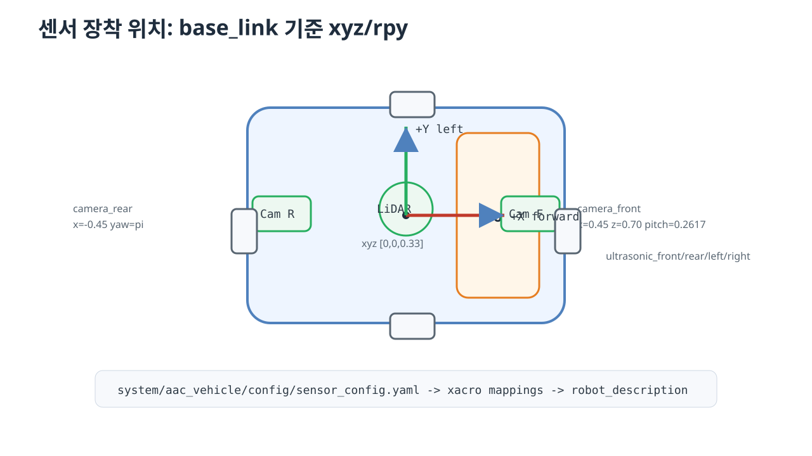
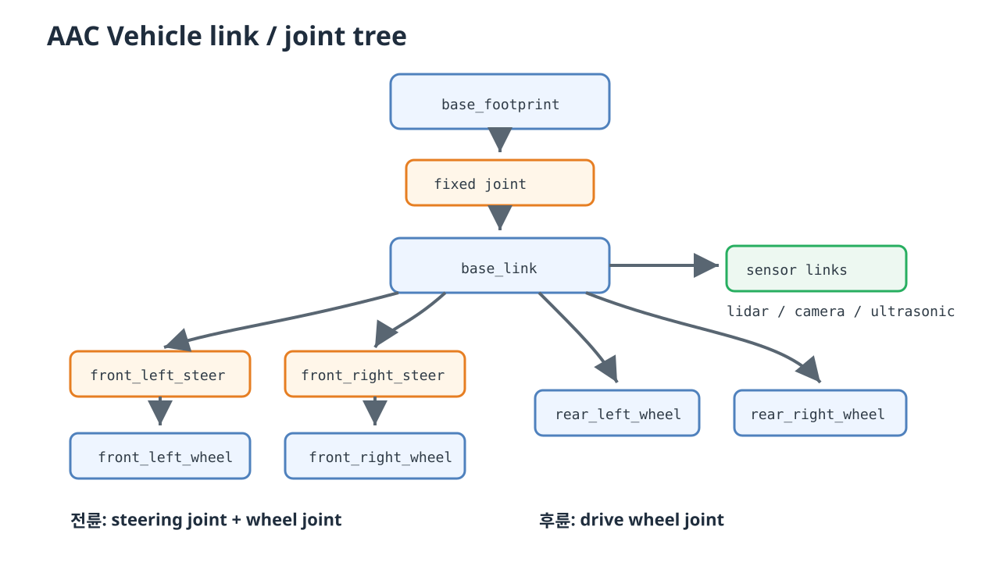
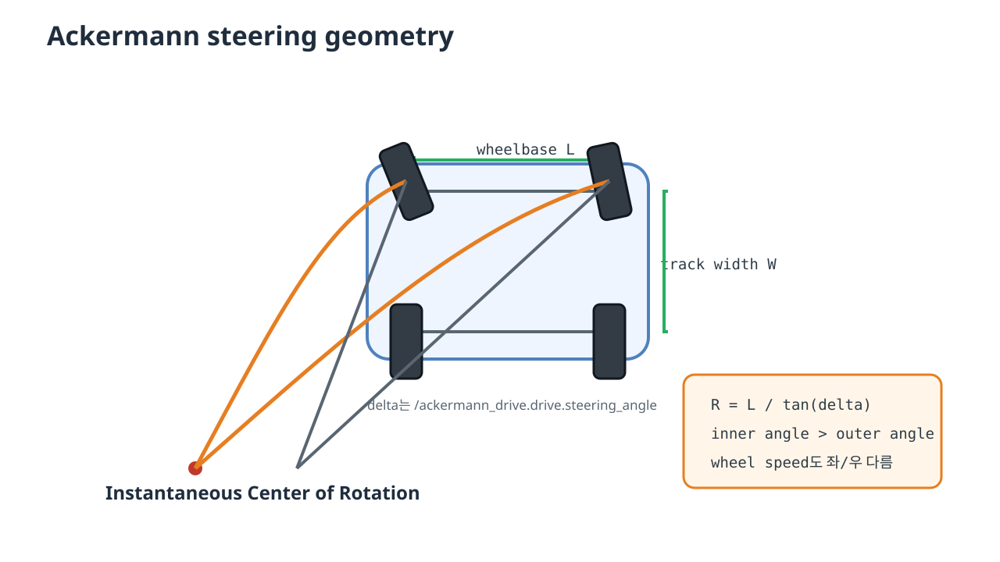
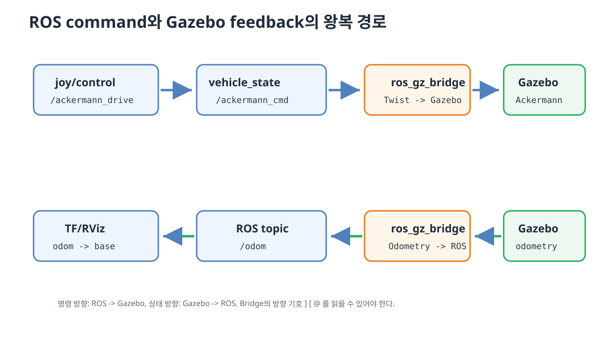
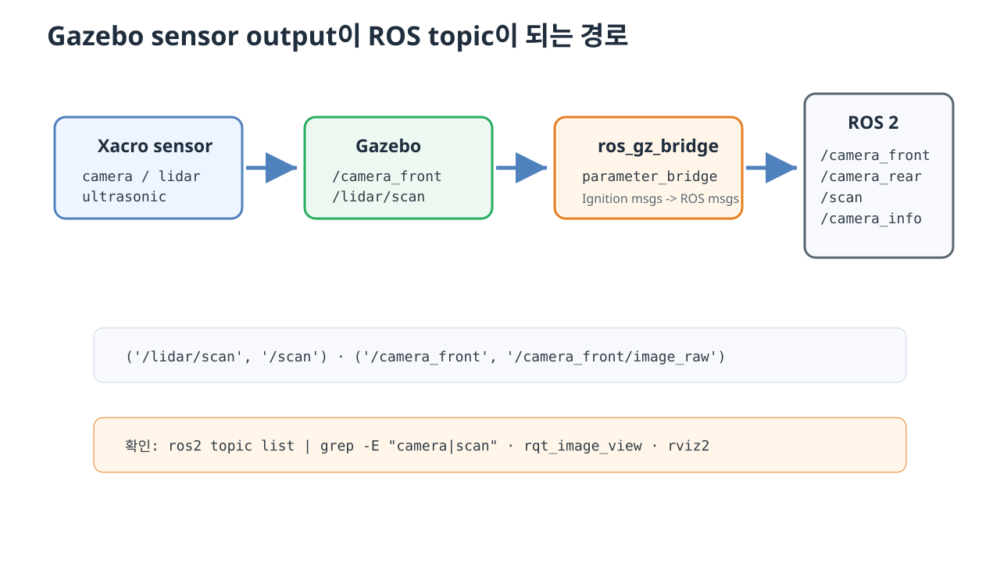
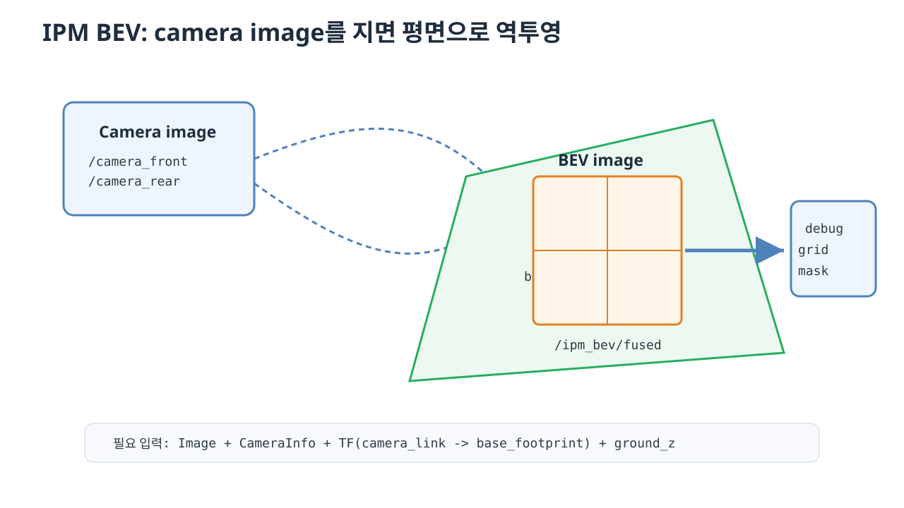

# `Lecture 04: Gazebo Vehicle + Sensor Implementation`
## AAC2026에서 차량, 센서, Gazebo bridge가 실제로 연결되는 방식

방산개방형아키텍처

---

# `1. 오늘의 목표`

이번 통합 강의는 차량 모델링과 센서 모델링을 따로 외우지 않는다.

수업 목표:

- `spawn_vehicle.launch.py`가 전체 구현을 어떻게 묶는지 읽는다.
- `aac_vehicle.urdf.xacro`와 `sensors.urdf.xacro`의 역할을 구분한다.
- `/ackermann_drive`가 Gazebo 차량 움직임으로 바뀌는 실제 경로를 이해한다.
- Gazebo camera/LiDAR/ultrasonic topic이 ROS topic으로 bridge되는 구조를 이해한다.
- IPM BEV가 센서 구현 위에서 어떻게 동작하는지 연결한다.

---

# `2. 오늘의 큰 그림`

<div class="flow">
  <div class="box">Config<br>YAML</div>
  <div class="arrow">→</div>
  <div class="box orange">Xacro<br>Robot Description</div>
  <div class="arrow">→</div>
  <div class="box">Gazebo<br>Model + Sensors</div>
  <div class="arrow">→</div>
  <div class="box green">ROS Topics<br>Control/Perception</div>
</div>

오늘의 관점:

```text
어떻게 "구현되어 있는가"를 읽는다.
새 기능을 만드는 것보다 기존 구현의 연결 관계를 이해한다.
```

---

# `3. 핵심 파일 지도`

```text
system/aac_vehicle/
├── launch/spawn_vehicle.launch.py       # 전체 bringup
├── urdf/aac_vehicle.urdf.xacro          # 차체, 바퀴, Ackermann plugin
├── urdf/sensors.urdf.xacro              # camera, LiDAR, ultrasonic
├── config/vehicle_params.yaml           # 차량 node 파라미터
├── config/sensor_config.yaml            # 센서 장착 위치
├── src/vehicle_state_publisher.cpp      # /ackermann_drive -> /ackermann_cmd
├── src/gazebo_ground_truth_publisher.cpp
└── src/odom_tf_publisher.cpp
```

추가로 `perception/ipm_bev_node`가 camera topic과 TF를 사용한다.

---

# `4. 실행은 하나의 launch에서 시작된다`

대표 실행:

```bash
# 실행 위치: AAC Container
source /ros_ws/install/setup.bash
ros2 launch aac_vehicle spawn_vehicle.launch.py
```

이 launch가 묶는 것:

```text
world load
robot_description 생성
Gazebo model spawn
ros_gz_bridge
odometry/ground truth node
vehicle command node
```

---

# `5. spawn_vehicle.launch.py의 책임`

| 코드 블록 | 실제 역할 |
|---|---|
| package share 탐색 | world, model, config 경로 찾기 |
| `sensor_config.yaml` load | 센서 장착 위치를 xacro argument로 전달 |
| `xacro.process_file()` | URDF XML 생성 |
| `robot_state_publisher` | `/robot_description`, TF 발행 |
| `gz_sim.launch.py` | Gazebo world 실행 |
| `ros_gz_sim create` | Gazebo에 차량 spawn |
| `parameter_bridge` | Gazebo topic과 ROS topic 연결 |
| vehicle/odom nodes | 제어와 상태 변환 |

---

# `6. 코드: package 경로와 world`

```python
pkg_share = get_package_share_directory('aac_vehicle')
gz_sim_pkg = get_package_share_directory('ros_gz_sim')
track_pkg_share = get_package_share_directory('simple_gazebo_track')

world_file = os.path.join(track_pkg_share, 'worlds', 'simple_track.world')
track_model_path = os.path.join(track_pkg_share, 'models')
```

읽을 포인트:

```text
Gazebo world는 simple_gazebo_track package에서 가져온다.
차량 모델 구현은 aac_vehicle package에 있다.
```

---

# `7. 코드: Gazebo resource path`

```python
SetEnvironmentVariable(
    name='GZ_SIM_RESOURCE_PATH',
    value=[
        track_model_path, ':',
        track_pkg_share, ':',
        EnvironmentVariable('GZ_SIM_RESOURCE_PATH', default_value=''),
    ],
)
```

Gazebo가 model, texture, world resource를 찾을 수 있도록 경로를 추가한다.

```text
world를 열었는데 texture/model이 안 보이면 resource path를 먼저 의심한다.
```

---

# `8. 센서 설정은 YAML에서 시작된다`

`system/aac_vehicle/config/sensor_config.yaml`

```yaml
lidar:
  xyz: [0.0, 0.0, 0.33]
  rpy: [0.0, 0.0, 0.0]

camera_front:
  xyz: [0.45, 0.0, 0.70]
  rpy: [0.0, 0.2617, 0.0]
```

좌표 기준:

```text
base_link: x+ forward, y+ left, z+ up
```

---

# `9. 코드: sensor_config를 xacro argument로 변환`

```python
sensor_mappings = {}
for sensor, params in sensor_cfg.items():
    x, y, z = params['xyz']
    roll, pitch, yaw = params['rpy']
    sensor_mappings[f'{sensor}_x'] = str(x)
    sensor_mappings[f'{sensor}_y'] = str(y)
    sensor_mappings[f'{sensor}_z'] = str(z)
    sensor_mappings[f'{sensor}_roll'] = str(roll)
    sensor_mappings[f'{sensor}_pitch'] = str(pitch)
    sensor_mappings[f'{sensor}_yaw'] = str(yaw)
```

YAML key가 그대로 `$(arg camera_front_x)` 같은 xacro argument가 된다.

---

# `10. 그림: 센서 장착 위치`



---

# `11. 코드: xacro를 robot_description으로`

```python
xacro_file = os.path.join(pkg_share, 'urdf', 'aac_vehicle.urdf.xacro')
robot_description = xacro.process_file(
    xacro_file,
    mappings=sensor_mappings,
).toxml()
```

핵심:

```text
차량 URDF와 센서 URDF는 launch 시점에 하나의 robot_description으로 합쳐진다.
```

---

# `12. robot_state_publisher`

```python
robot_state_publisher = Node(
    package='robot_state_publisher',
    executable='robot_state_publisher',
    parameters=[{
        'robot_description': robot_description,
        'use_sim_time': use_sim_time,
    }],
    output='screen'
)
```

역할:

- fixed joint TF 발행
- joint state를 사용한 wheel/steering TF 발행
- Gazebo spawn용 `/robot_description` 제공

---

# `13. 차량 URDF의 시작`

`aac_vehicle.urdf.xacro`

```xml
<robot xmlns:xacro="http://www.ros.org/wiki/xacro" name="aac_vehicle">

  <xacro:include filename="$(find aac_vehicle)/urdf/sensors.urdf.xacro"/>

  <xacro:property name="wheelbase" value="0.80"/>
  <xacro:property name="track_width" value="0.46"/>
  <xacro:property name="wheel_radius" value="0.08"/>
  <xacro:property name="max_steering_angle" value="0.524"/>
```

차량 URDF가 센서 URDF를 include한다.

---

# `14. 그림: 차량 Link/Joint Tree`



---

# `15. base_footprint와 base_link`

```xml
<link name="base_footprint"/>

<joint name="base_footprint_joint" type="fixed">
  <parent link="base_footprint"/>
  <child  link="base_link"/>
  <origin xyz="0 0 ${wheel_radius}" rpy="0 0 0"/>
</joint>
```

해석:

```text
base_footprint는 지면 기준,
base_link는 wheel center 높이의 차체 기준 frame이다.
```

---

# `16. 전륜 조향 joint`

```xml
<joint name="front_left_steering_joint" type="revolute">
  <parent link="base_link"/>
  <child  link="front_left_steering_link"/>
  <origin xyz="${wheelbase/2} ${track_width/2} 0" rpy="0 0 0"/>
  <axis xyz="0 0 1"/>
  <limit lower="${-max_steering_angle}"
         upper="${max_steering_angle}"
         effort="10.0" velocity="2.0"/>
</joint>
```

Z축 회전 joint가 조향각을 표현한다.

---

# `17. 바퀴 회전 joint`

```xml
<joint name="front_left_wheel_joint" type="continuous">
  <parent link="front_left_steering_link"/>
  <child  link="front_left_wheel"/>
  <origin xyz="0 0 0" rpy="0 0 0"/>
  <axis xyz="0 1 0"/>
</joint>
```

좌표계가 `x forward, y left, z up`이므로 바퀴 회전축은 Y축이다.

---

# `18. Gazebo Ackermann plugin`

```xml
<plugin filename="ignition-gazebo-ackermann-steering-system"
        name="ignition::gazebo::systems::AckermannSteering">
  <left_joint>rear_left_wheel_joint</left_joint>
  <right_joint>rear_right_wheel_joint</right_joint>
  <left_steering_joint>front_left_steering_joint</left_steering_joint>
  <right_steering_joint>front_right_steering_joint</right_steering_joint>
  <topic>/ackermann_cmd</topic>
</plugin>
```

Gazebo 안에서는 이 plugin이 조향과 구동 joint를 움직인다.

---

# `19. 그림: Ackermann 기구학`



---

# `20. vehicle_state_publisher의 입출력`

`vehicle_state_publisher.cpp`

```cpp
sub_ackermann_ = create_subscription<ackermann_msgs::msg::AckermannDriveStamped>(
  "/ackermann_drive", rclcpp::QoS(10),
  std::bind(&VehicleStatePublisher::ackermannCallback,
            this, std::placeholders::_1));

pub_ackermann_cmd_ = create_publisher<geometry_msgs::msg::Twist>(
  "/ackermann_cmd", rclcpp::QoS(10));
```

입력은 ROS Ackermann message, 출력은 Gazebo plugin용 Twist다.

---

# `21. 코드: command clamp`

```cpp
ackermann_cmd_.drive.steering_angle = static_cast<float>(
  std::clamp(static_cast<double>(ackermann_cmd_.drive.steering_angle),
             -max_steering_angle_, max_steering_angle_));
ackermann_cmd_.drive.speed = static_cast<float>(
  std::clamp(static_cast<double>(ackermann_cmd_.drive.speed),
             -max_speed_, max_speed_));
```

`vehicle_params.yaml`의 물리 제한을 마지막 방어선으로 적용한다.

---

# `22. 코드: Gazebo plugin으로 보낼 Twist`

```cpp
const double speed = ackermann_cmd_.drive.speed;
const double delta = ackermann_cmd_.drive.steering_angle;

geometry_msgs::msg::Twist cmd;
cmd.linear.x  = speed;
cmd.angular.z = delta;
pub_ackermann_cmd_->publish(cmd);
```

주의:

```text
여기서 angular.z는 일반적인 yaw rate가 아니라 steering angle 의미로 쓰인다.
```

---

# `23. ros_gz_bridge의 방향`

`spawn_vehicle.launch.py`

```python
arguments=[
    '/ackermann_cmd@geometry_msgs/msg/Twist]ignition.msgs.Twist',
    '/model/aac_vehicle/odometry@nav_msgs/msg/Odometry[ignition.msgs.Odometry',
    '/world/simple_track_world/model/aac_vehicle/joint_state'
    '@sensor_msgs/msg/JointState[ignition.msgs.Model',
]
```

기호:

```text
] : ROS -> Gazebo
[ : Gazebo -> ROS
@ : 양방향
```

---

# `24. 그림: ROS-Gazebo 왕복 경로`



---

# `25. Bridge remapping`

```python
remappings=[
    ('/model/aac_vehicle/odometry', '/odom'),
    ('/world/simple_track_world/model/aac_vehicle/joint_state', '/joint_states'),
    ('/lidar/scan', '/scan'),
    ('/camera_front', '/camera_front/image_raw'),
    ('/camera_rear', '/camera_rear/image_raw'),
]
```

학생이 보는 ROS topic 이름은 remapping 이후 이름이다.

---

# `26. 센서 URDF: LiDAR`

`sensors.urdf.xacro`

```xml
<link name="lidar_link"/>
<joint name="lidar_joint" type="fixed">
  <parent link="base_link"/>
  <child  link="lidar_link"/>
  <origin xyz="$(arg lidar_x) $(arg lidar_y) $(arg lidar_z)"
          rpy="$(arg lidar_roll) $(arg lidar_pitch) $(arg lidar_yaw)"/>
</joint>

<sensor name="lidar" type="gpu_lidar">
  <topic>/lidar/scan</topic>
  <update_rate>5.5</update_rate>
</sensor>
```

---

# `27. 센서 URDF: Camera`

```xml
<link name="camera_front_link"/>
<joint name="camera_front_joint" type="fixed">
  <parent link="base_link"/>
  <child  link="camera_front_link"/>
  <origin xyz="$(arg camera_front_x) $(arg camera_front_y) $(arg camera_front_z)"
          rpy="$(arg camera_front_roll) $(arg camera_front_pitch) $(arg camera_front_yaw)"/>
</joint>

<sensor name="camera_front" type="camera">
  <topic>/camera_front</topic>
  <update_rate>30</update_rate>
</sensor>
```

camera topic은 bridge/remap 후 `/camera_front/image_raw`가 된다.

---

# `28. 센서 URDF: Ultrasonic`

```xml
<xacro:macro name="ultrasonic_sensor" params="name x y z roll pitch yaw">
  <link name="${name}_link"/>
  <joint name="${name}_joint" type="fixed">
    <parent link="base_link"/>
    <child  link="${name}_link"/>
    <origin xyz="${x} ${y} ${z}" rpy="${roll} ${pitch} ${yaw}"/>
  </joint>
  <sensor name="${name}" type="gpu_lidar">
    <topic>/${name}/scan</topic>
  </sensor>
</xacro:macro>
```

초음파는 1-ray `gpu_lidar`로 구현되어 `LaserScan.ranges[0]`을 거리로 쓴다.

---

# `29. 그림: Gazebo Sensor Topic Bridge`



---

# `30. Gazebo sensor topic이 ROS에서 보이는 이름`

| Gazebo side | ROS side |
|---|---|
| `/lidar/scan` | `/scan` |
| `/camera_front` | `/camera_front/image_raw` |
| `/camera_rear` | `/camera_rear/image_raw` |
| `/camera_info` | `/camera_info` |
| `/ultrasonic_front/scan` | `/ultrasonic_front/scan` |

확인 명령:

```bash
# 실행 위치: AAC Container
ros2 topic list | grep -E "camera|scan|ultrasonic"
```

---

# `31. ground truth publisher`

Gazebo dynamic pose는 TFMessage 형태로 들어온다.

```python
'/world/simple_track_world/dynamic_pose/info'
'@tf2_msgs/msg/TFMessage[ignition.msgs.Pose_V'
```

`gazebo_ground_truth_publisher.cpp`는 그중 `aac_vehicle` pose를 찾아 `/odom_gt`로 낸다.

```text
/gazebo/dynamic_pose -> /odom_gt
```

실험에서 `/odom`과 `/odom_gt`를 비교할 수 있다.

---

# `32. odom_tf_publisher`

```python
gazebo_odom_tf = Node(
    package='aac_vehicle',
    executable='odom_tf_publisher',
    parameters=[{
        'input_topic': '/odom',
        'odom_frame': 'odom',
        'base_frame': 'base_footprint',
    }],
)
```

Gazebo odometry를 TF로 바꿔 `odom -> base_footprint`를 만든다.

---

# `33. IPM BEV는 센서 구현 위에 올라간다`

`perception/ipm_bev_node/config/ipm_bev.yaml`

```yaml
front_image_topic: /camera_front/image_raw
rear_image_topic: /camera_rear/image_raw
front_camera_info_topic: /camera_info
rear_camera_info_topic: /camera_info
base_frame: base_footprint
front_camera_frame: camera_front_link
rear_camera_frame: camera_rear_link
```

IPM은 camera topic만 보는 것이 아니라 TF와 CameraInfo도 함께 필요하다.

---

# `34. 그림: IPM BEV Projection`



---

# `35. ipm_bev_node의 출력`

```yaml
front_bev_topic: /ipm_bev/front
rear_bev_topic: /ipm_bev/rear
fused_bev_topic: /ipm_bev/fused
valid_mask_topic: /ipm_bev/valid_mask
source_mask_topic: /ipm_bev/source_mask
debug_bev_topic: /ipm_bev/debug
```

영상 항법 강의에서 사용하는 핵심 입력은:

```text
/ipm_bev/fused
```

---

# `36. 전체 구현 흐름`

```text
sensor_config.yaml
  -> xacro mappings
  -> aac_vehicle.urdf.xacro includes sensors.urdf.xacro
  -> robot_description
  -> robot_state_publisher + Gazebo spawn
  -> ros_gz_bridge
  -> /camera_front/image_raw, /scan, /odom, /joint_states
  -> vehicle_state_publisher, ipm_bev_node, localization/SLAM
```

이 한 줄이 오늘 강의의 핵심이다.

---

# `37. 실제 확인 명령: topic`

Gazebo 실행 후:

```bash
# 실행 위치: AAC Container
ros2 topic list | grep -E "ackermann|odom|joint|camera|scan|ipm"
```

대표 topic:

```text
/ackermann_drive
/ackermann_cmd
/odom
/odom_gt
/joint_states
/camera_front/image_raw
/scan
```

---

# `38. 실제 확인 명령: TF`

```bash
# 실행 위치: AAC Container
ros2 run tf2_ros tf2_echo base_link camera_front_link
ros2 run tf2_ros tf2_echo base_link lidar_link
```

TF tree 파일:

```bash
# 실행 위치: AAC Container
ros2 run tf2_tools view_frames
```

학생이 확인할 것:

```text
sensor_config.yaml의 xyz/rpy가 TF에 반영됐는가?
```

---

# `39. 실제 확인 명령: command to motion`

```bash
# 실행 위치: AAC Container
ros2 topic pub --rate 5 /ackermann_drive \
  ackermann_msgs/msg/AckermannDriveStamped \
  "{drive: {speed: 1.0, steering_angle: 0.25}}"
```

다른 terminal:

```bash
# 실행 위치: AAC Container
ros2 topic echo /ackermann_cmd --once
ros2 topic echo /odom --once
```

---

# `40. 구현을 읽을 때 자주 헷갈리는 지점`

| 헷갈리는 지점 | 정리 |
|---|---|
| `/ackermann_drive`와 `/ackermann_cmd` | 전자는 ROS 제어 명령, 후자는 Gazebo plugin 입력 |
| `base_link`와 `base_footprint` | 차체 기준과 지면 기준 |
| sensor_config와 sensors.urdf | YAML은 값, Xacro는 구조 |
| Gazebo topic과 ROS topic | bridge/remapping 이후 이름을 봐야 함 |
| `/odom`과 `/odom_gt` | plugin odom과 Gazebo ground truth |

---

# `41. 구현 디버깅 순서`

```text
1. sensor_config.yaml 값이 launch에서 읽히는가?
2. xacro가 robot_description으로 생성되는가?
3. robot_state_publisher가 TF를 발행하는가?
4. Gazebo model이 spawn되는가?
5. bridge가 Gazebo topic을 ROS topic으로 넘기는가?
6. /ackermann_drive가 /ackermann_cmd로 변환되는가?
7. /odom, /joint_states, camera, scan topic이 보이는가?
8. downstream node가 remap된 ROS topic 이름을 보고 있는가?
```

---

# `42. 실습 체크포인트`

시험/평가가 아니라 구현 이해 확인용 체크포인트다.

```text
spawn_vehicle.launch.py가 실행하는 node 목록을 설명한다.
sensor_config.yaml 값이 xacro argument로 들어가는 과정을 설명한다.
/ackermann_drive와 /ackermann_cmd의 차이를 설명한다.
camera_front_link와 lidar_link가 어디서 만들어지는지 찾는다.
Gazebo topic과 ROS topic remapping을 한 가지 이상 설명한다.
IPM BEV가 필요로 하는 topic/TF/CameraInfo를 말한다.
```

---

# `43. 다음 강의로 연결`

이 통합 강의 이후에는 센서 구현 자체보다 센서 데이터를 쓰는 알고리즘으로 넘어간다.

```text
Camera/Gazebo/IPM 구현
  -> /ipm_bev/fused
  -> image_match_node
  -> /visual_localization/opencv/pose

LiDAR/Gazebo 구현
  -> /scan
  -> slam_mapping.launch.py
  -> /map, TF
```

---

# `44. 참고 문서`

- Gazebo ROS 2 integration: https://gazebosim.org/docs/fortress/ros2_integration/
- ros_gz_bridge: https://docs.ros.org/en/humble/p/ros_gz_bridge/
- SDFormat sensor spec: https://sdformat.org/spec
- ROS 2 robot_state_publisher: https://docs.ros.org/en/humble/p/robot_state_publisher/
- Project files: `system/aac_vehicle`, `perception/ipm_bev_node`
