# `Lecture 05: Vision-based Navigation`
## ROS Image Topic + Image Matching + Visual Localization

방산개방형아키텍처

---

# `1. 오늘의 목표`

오늘은 카메라 영상이 자율주행 시스템 안에서 pose 추정으로 바뀌는 과정을 본다.

- ROS 2에서 `sensor_msgs/Image` topic을 다루는 방법을 익힌다.
- `/camera_front/image_raw`, `/camera_rear/image_raw`, `/ipm_bev/fused`를 확인한다.
- SIFT, ORB 같은 전통적 feature matching 개념을 이해한다.
- Image Matching WebUI가 제공하는 딥러닝 matcher 흐름을 소개한다.
- `navigation/image_match_node`가 OpenCV, EfficientLoFTR, MINIMA를 어떻게 ROS node로 통합했는지 코드로 읽는다.

---

# `2. 수업 확인 방식`

이 수업은 시험/평가가 없는 실습 중심 수업이다.

확인은 점수가 아니라 다음 체크포인트로 한다.

```text
1. image topic이 publish되는지 확인할 수 있는가?
2. rqt_image_view로 카메라/BEV/debug image를 볼 수 있는가?
3. feature matching 결과에서 match_count와 inlier_ratio를 설명할 수 있는가?
4. config를 바꾸면 backend와 topic 출력이 어떻게 달라지는지 말할 수 있는가?
```

---

# `3. 오늘의 전체 흐름`

<div class="flow">
  <div class="box">Gazebo<br>Camera</div>
  <div class="arrow">→</div>
  <div class="box orange">ROS Image<br>Topic</div>
  <div class="arrow">→</div>
  <div class="box green">IPM BEV<br>Projection</div>
  <div class="arrow">→</div>
  <div class="box">Image<br>Matching</div>
  <div class="arrow">→</div>
  <div class="box gray">Pose<br>Estimate</div>
</div>

핵심 질문:

```text
"차량 주변 영상이 전역 지도 위 어느 위치와 가장 잘 맞는가?"
```

---

# `3-1. 본 강의의 목적`

이번 강의의 목적은 단순히 "이미지를 맞춰보자"가 아니다.

우리가 풀고 싶은 문제는 다음이다.

```text
Global coordinate map 안에서
현재 차량의 local coordinate frame이
어디에 있고 어떤 방향을 보고 있는가?
```

즉, 추정하고 싶은 값은 `map -> base_footprint` pose다.

```text
T_map_base = [x_map, y_map, yaw_map]
```

---

# `3-2. Global 좌표계와 Local 좌표계`

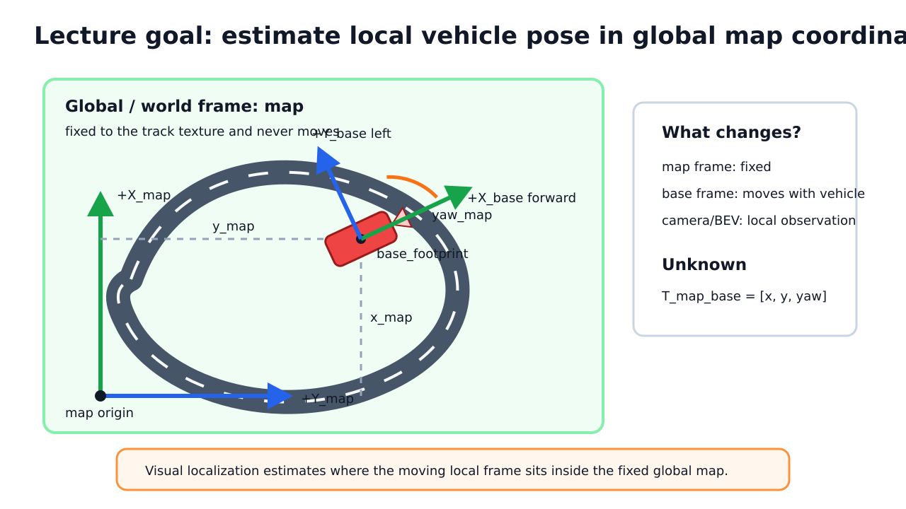

---

# `3-3. Local Observation을 Global Map에 놓기`

차량 카메라는 local frame 기준으로 주변을 본다.

```text
camera image
  -> IPM
  -> BEV image in local vehicle coordinates
```

전역 지도는 움직이지 않는 global frame 기준이다.

```text
track.png
  -> map image pixel
  -> map/world coordinates
```

따라서 visual localization은 local BEV image를 global map image 위에 정렬하는 문제다.

---

# `3-4. Homography Matrix가 연결하는 것`

BEV image와 map image는 둘 다 "지면 평면을 위에서 본 이미지"로 볼 수 있다.

평면 사이의 projective transform은 3x3 homography로 표현한다.

```text
p_map ~ H_map_bev * p_bev
```

이 식의 의미:

```text
local BEV image의 한 pixel 위치를
global map image의 대응 pixel 위치로 보낸다.
```

여기서 아직 world meter 좌표가 아니라 image pixel 좌표끼리의 변환이다.

---

# `3-4-1. Homography Notation`

| 기호 | 의미 | 단위/좌표계 |
|---|---|---|
| `u_bev`, `v_bev` | BEV image pixel 좌표 | pixel |
| `u_map`, `v_map` | map image pixel 좌표 | pixel |
| `p_bev` | BEV pixel의 homogeneous coordinate | `[u, v, 1]^T` |
| `p_map` | map pixel의 homogeneous coordinate | `[u, v, 1]^T` |
| `H_map_bev` | BEV pixel을 map pixel로 보내는 homography | 3x3 matrix |
| `s`, `lambda` | homogeneous scale factor | arbitrary scale |

이미지 좌표는 보통 왼쪽 위가 origin이고, `u`는 오른쪽, `v`는 아래쪽으로 증가한다.

---

# `3-4-2. Homogeneous Coordinate`

2D pixel 좌표 `[u, v]`를 3-vector로 확장한다.

```text
p_bev = [u_bev, v_bev, 1]^T
p_map = [u_map, v_map, 1]^T
```

왜 3-vector를 쓰는가?

```text
translation, rotation, scale, perspective distortion을
하나의 matrix multiplication으로 표현하기 위해서다.
```

`[u, v, 1]^T`와 `[s*u, s*v, s]^T`는 같은 image point를 의미한다.

---

# `3-4-3. Homography Matrix 전개`

```text
              [h11 h12 h13]
H_map_bev  =  [h21 h22 h23]
              [h31 h32 h33]
```

```text
[u'_map]   [h11 h12 h13] [u_bev]
[v'_map] = [h21 h22 h23] [v_bev]
[w'_map]   [h31 h32 h33] [  1  ]
```

전개하면:

```text
u'_map = h11*u_bev + h12*v_bev + h13
v'_map = h21*u_bev + h22*v_bev + h23
w'_map = h31*u_bev + h32*v_bev + h33
```

---

# `3-4-4. Dehomogenization`

matrix multiplication 결과는 아직 homogeneous coordinate다.

```text
p'_map = [u'_map, v'_map, w'_map]^T
```

실제 map pixel 좌표는 마지막 성분으로 나누어 얻는다.

```text
u_map = u'_map / w'_map
v_map = v'_map / w'_map
```

즉, 코드에서 `cv2.perspectiveTransform()`이 하는 일은 다음과 같다.

```text
[u_bev, v_bev] -> H 적용 -> [u_map, v_map]
```

---

# `3-4-5. Homography를 어떻게 구하나`

matcher가 여러 correspondence를 만든다.

```text
(u_bev_i, v_bev_i)  <->  (u_map_i, v_map_i)
```

이 대응점들로 `H_map_bev`를 추정한다.

```python
homography, inlier_mask = cv2.findHomography(
    bev_points,
    map_points,
    cv2.RANSAC,
    ransac_reproj_threshold,
)
```

RANSAC은 잘못된 correspondence를 outlier로 버리고, 같은 평면 변환으로 설명되는 점들을 inlier로 남긴다.

---

# `3-5. Homography와 Pose의 차이`

Homography 자체는 "차량 pose"가 아니라 image plane 사이의 변환이다.

```text
H_map_bev:
  BEV image pixel -> map image pixel

T_map_base:
  vehicle local frame -> map/world frame
```

AAC2026 코드에서는 다음 두 점을 BEV에서 map으로 보낸다.

```text
vehicle center point  -> map position x, y
vehicle forward point -> map heading yaw
```

그래서 `H_map_bev`를 바로 제어에 쓰지 않고, `T_map_base = [x, y, yaw]`로 바꿔야 한다.

---

# `3-5-1. Pose를 얻기 위한 두 점`

AAC2026 코드는 BEV image 안에서 두 점을 고른다.

```text
center_bev:
  차량 중심점
  local metric coordinate = (x_base=0, y_base=0)

forward_bev:
  차량 앞쪽 probe point
  local metric coordinate = (x_base=d, y_base=0)
```

`d`는 `forward_probe_distance`이고 기본값은 `1.0 m`다.

이 두 점을 homography로 map image에 투영한다.

---

# `3-5-2. BEV Metric Point를 BEV Pixel로`

`image_match_node`의 BEV 범위:

```text
x_base in [bev_x_min, bev_x_max]
y_base in [bev_y_min, bev_y_max]
```

metric 좌표를 image pixel로 바꾼다.

```text
u_bev = (bev_y_max - y_base)
        / (bev_y_max - bev_y_min) * (width - 1)

v_bev = (bev_x_max - x_base)
        / (bev_x_max - bev_x_min) * (height - 1)
```

왜 `x_base`가 `v_bev`에 들어가는가?

```text
BEV image의 위쪽이 차량 앞쪽 +X_base이기 때문이다.
```

---

# `3-5-3. 두 점을 Map Pixel로 Projection`

BEV pixel 두 점:

```text
p_center_bev  = [u_c_bev, v_c_bev, 1]^T
p_forward_bev = [u_f_bev, v_f_bev, 1]^T
```

homography 적용:

```text
p_center_map  ~ H_map_bev * p_center_bev
p_forward_map ~ H_map_bev * p_forward_bev
```

dehomogenization 후:

```text
center_uv  = [u_c_map, v_c_map]
forward_uv = [u_f_map, v_f_map]
```

---

# `3-5-4. Map Pixel을 World Meter로`

map image pixel은 다시 world/map metric 좌표로 바뀐다.

```text
(u_map, v_map)
  -> normalized image coordinate
  -> swap xy if needed
  -> flip x/y if needed
  -> scale to map bounds
  -> (x_map, y_map)
```

AAC2026 기본 map bounds:

```text
map_x_min = -6.0, map_x_max = 6.0
map_y_min = -8.0, map_y_max = 8.0
```

`track.png`의 texture 방향과 Gazebo world 방향이 달라서 `map_swap_xy`, `map_flip_x`, `map_flip_y`가 필요하다.

---

# `3-5-5. Position과 Yaw 계산`

center point가 차량 위치가 된다.

```text
center_world = (x_c, y_c)
forward_world = (x_f, y_f)

x_map = x_c
y_map = y_c
```

heading은 center에서 forward point로 향하는 방향이다.

```text
yaw_map = atan2(y_f - y_c, x_f - x_c)
```

최종적으로 얻는 pose:

```text
T_map_base = [x_map, y_map, yaw_map]
```

---

# `4. 그림: ROS Image Topic Flow`

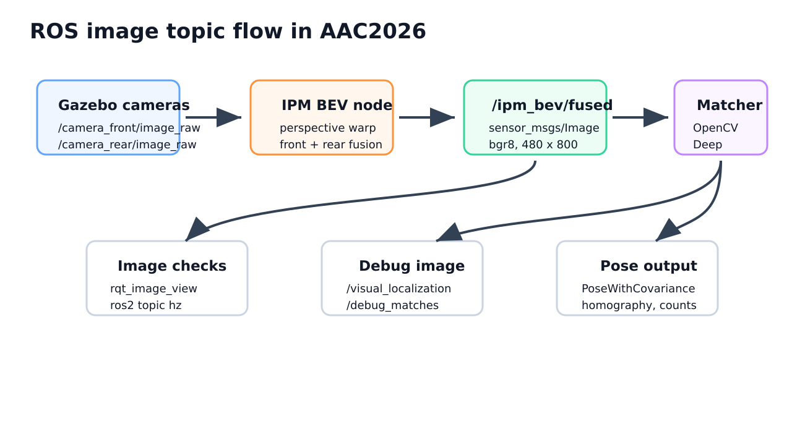

---

# `5. 우리 시뮬레이터 환경`

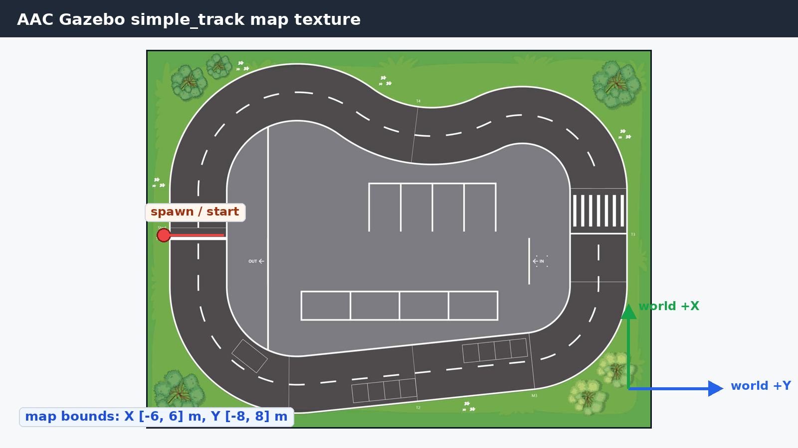

---

# `6. 지도 이미지와 BEV 이미지`

지도는 Gazebo track texture다.

```text
system/simple_gazebo_track/models/simple_track/materials/textures/track.png
```

BEV는 차량 전후방 카메라를 지면 평면으로 역투영한 영상이다.

```text
/camera_front/image_raw + /camera_rear/image_raw
  -> ipm_bev_node
  -> /ipm_bev/fused
```

---

# `7. 먼저 컨테이너 진입`

Host에서 Docker 컨테이너를 실행한다.

```bash
# 실행 위치: Host Ubuntu
cd ~/ros_ws/src/aac_2026/docker
./run_x86.sh
```

컨테이너 안으로 들어온 뒤부터는 `/ros_ws` 기준으로 작업한다.

```bash
# 실행 위치: AAC Container
cd /ros_ws/src/aac_2026
pwd
```

---

# `8. 관련 패키지 빌드`

이번 강의에 필요한 핵심 패키지:

```text
system/aac_vehicle
perception/ipm_bev_node
navigation/image_match_node
system/static_tf_tree
```

```bash
# 실행 위치: AAC Container
cd /ros_ws/src/aac_2026
./perception/setup_colcon_ignores.sh
cd /ros_ws
colcon build --base-paths src/* \
  --packages-select aac_vehicle ipm_bev_node image_match_node static_tf_tree
source install/setup.bash
```

---

# `9. 전체 스택 실행`

`start.sh`는 `operations/tmuxp_config/config.yaml`을 읽고 여러 node를 동시에 띄운다.

```bash
# 실행 위치: AAC Container
cd /ros_ws/src/aac_2026
./start.sh
```

현재 tmux session에서 같이 실행되는 주요 pane:

```text
static_tf_tree
aac_vehicle spawn_vehicle.launch.py
joy_control_node
ipm_bev_node
image_match_node opencv.launch.py
slam_mapping.launch.py
```

---

# `10. tmux 세션 확인`

실행 후 다른 터미널에서 컨테이너로 다시 들어와 tmux를 확인한다.

```bash
# 실행 위치: AAC Container
tmux ls
tmux attach -t AAC_2026
```

종료할 때:

```bash
# 실행 위치: AAC Container
cd /ros_ws/src/aac_2026
./stop.sh
```

---

# `11. Image Topic 첫 확인`

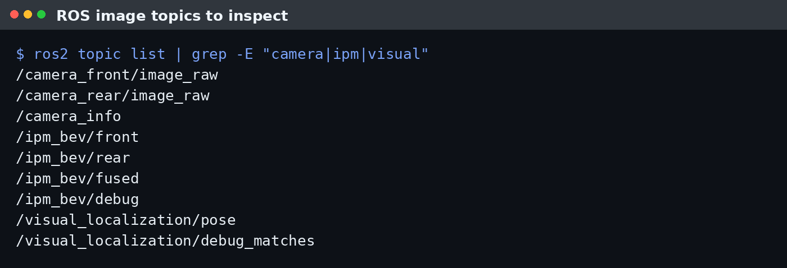

---

# `12. 직접 확인 명령`

```bash
# 실행 위치: AAC Container
source /opt/ros/$ROS_DISTRO/setup.bash
source /ros_ws/install/setup.bash
ros2 topic list | grep -E "camera|ipm|visual"
```

성공 신호:

```text
/camera_front/image_raw
/camera_rear/image_raw
/ipm_bev/fused
/visual_localization/opencv/debug_matches
```

---

# `13. sensor_msgs/Image 구조`

`sensor_msgs/Image`는 압축되지 않은 image matrix다.

| field | 의미 |
|---|---|
| `header.stamp` | 영상 획득 시각 |
| `header.frame_id` | camera optical frame 또는 publish frame |
| `height`, `width` | row/column |
| `encoding` | `bgr8`, `rgb8`, `mono8`, `rgba8` 등 |
| `step` | row 한 줄의 byte 수 |
| `data` | 실제 pixel byte array |

---

# `14. Image Message 확인`

```bash
# 실행 위치: AAC Container
ros2 interface show sensor_msgs/msg/Image
```

토픽 metadata만 빠르게 볼 때:

```bash
# 실행 위치: AAC Container
ros2 topic echo /camera_front/image_raw --once --field header
ros2 topic echo /camera_front/image_raw --once --field encoding
```

실제 `data`는 너무 크므로 일반적으로 echo하지 않는다.

---

# `15. Image Topic 주파수 확인`

```bash
# 실행 위치: AAC Container
ros2 topic hz /camera_front/image_raw
ros2 topic hz /ipm_bev/fused
```

학생이 봐야 할 것:

```text
camera topic이 일정한 rate로 들어오는가?
BEV topic은 camera보다 느릴 수 있다.
0 Hz면 node가 안 떴거나 QoS/bridge 문제가 있을 수 있다.
```

---

# `16. rqt_image_view로 보기`

```bash
# 실행 위치: AAC Container
rqt_image_view /camera_front/image_raw
```

BEV 확인:

```bash
# 실행 위치: AAC Container
rqt_image_view /ipm_bev/debug
rqt_image_view /ipm_bev/fused
```

`rqt_image_view`는 image_transport 기반 GUI image viewer다.

---

# `17. Gazebo Bridge 코드`

`system/aac_vehicle/launch/spawn_vehicle.launch.py` 일부:

```python
arguments=[
    '/camera_front@sensor_msgs/msg/Image[ignition.msgs.Image',
    '/camera_rear@sensor_msgs/msg/Image[ignition.msgs.Image',
    '/camera_info@sensor_msgs/msg/CameraInfo[ignition.msgs.CameraInfo',
],
remappings=[
    ('/camera_front', '/camera_front/image_raw'),
    ('/camera_rear', '/camera_rear/image_raw'),
],
```

Gazebo의 image transport가 ROS 2 image topic으로 들어오는 경계다.

---

# `18. 카메라 topic이 안 보일 때`

```bash
# 실행 위치: AAC Container
ros2 node list | grep -E "gazebo|bridge|aac_vehicle"
ros2 topic info -v /camera_front/image_raw
ros2 topic echo /camera_info --once
```

점검 순서:

```text
1. Gazebo가 실행 중인가?
2. ros_gz_bridge node가 살아 있는가?
3. /camera_info가 publish되는가?
4. rqt_image_view가 같은 ROS_DOMAIN_ID에서 실행 중인가?
```

---

# `19. IPM BEV Node의 역할`

IPM은 Inverse Perspective Mapping이다.

```text
카메라 영상 pixel
  -> CameraInfo intrinsic
  -> camera TF
  -> base_footprint 지면 평면
  -> top-down BEV image pixel
```

AAC2026에서는 전방/후방 카메라를 각각 BEV로 만들고 합성한다.

---

# `19-1. IPM의 수학적 의미`

카메라 이미지는 3D 세계를 2D image plane으로 투영한 결과다.

핀홀 카메라 모델:

```text
p_img ~ K * P_cam

p_img = [u, v, 1]^T
K = camera intrinsic matrix
P_cam = [X_cam, Y_cam, Z_cam]^T
```

IPM은 이 과정을 지면 평면 가정으로 되돌린다.

```text
image pixel ray + ground plane z = ground_z
  -> ground point in base_footprint
  -> BEV pixel
```

---

# `19-2. Pixel Ray 관점`

개념적으로는 image pixel에서 camera ray를 만들고 지면과 만나는 점을 찾는다.

```text
r_cam = inv(K) * [u, v, 1]^T
r_base = R_base_cam * r_cam
C_base = camera origin in base_footprint

lambda = (ground_z - C_base.z) / r_base.z
P_base = C_base + lambda * r_base
```

`P_base = [x, y, ground_z]`가 차량 local frame에서 본 지면 점이다.

---

# `19-3. 실제 구현 관점`

현재 `ipm_bev_node`는 매 frame마다 모든 camera pixel을 역투영하지 않는다.

대신 처음에 다음 lookup table을 만든다.

```text
for each BEV pixel(row, col):
  1. row, col -> ground point P_base(x, y, ground_z)
  2. P_base -> P_camera using TF
  3. P_camera -> image pixel(u, v) using camera intrinsics K
  4. map_x(row,col)=u, map_y(row,col)=v

cv::remap(camera_image, map_x, map_y) -> BEV image
```

이 방식이 빠르고 반복 실행에 유리하다.

---

# `19-4. 그림: IPM Projection Math`

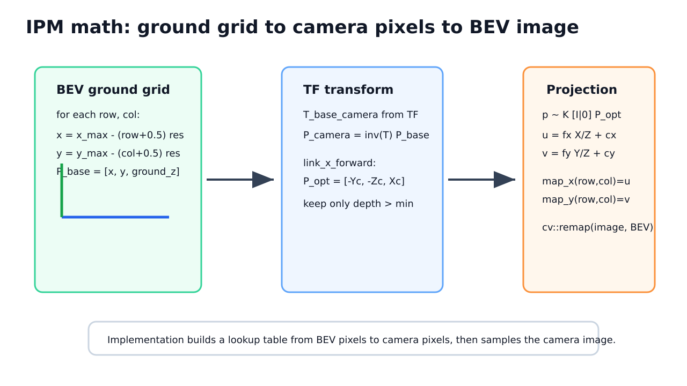

---

# `19-5. BEV Pixel과 Local Metric 좌표`

`ipm_bev_node` 설정:

```yaml
x_min: -10.0
x_max: 10.0
y_min: -6.0
y_max: 6.0
resolution: 0.025
ground_z: 0.0
```

BEV image 방향:

```text
top    = vehicle front  = +X_base
left   = vehicle left   = +Y_base
bottom = vehicle rear   = -X_base
```

---

# `19-6. BEV Grid 수식`

코드의 row/col은 local metric 좌표로 바뀐다.

```text
bev_rows = ceil((x_max - x_min) / resolution)
bev_cols = ceil((y_max - y_min) / resolution)

x_base(row) = x_max - (row + 0.5) * resolution
y_base(col) = y_max - (col + 0.5) * resolution
P_base      = [x_base, y_base, ground_z]
```

즉, BEV image 한 픽셀은 `resolution` meter 간격의 local ground point 중심이다.

---

# `19-7. 실제 코드: buildProjectionMap`

`perception/ipm_bev_node/src/ipm_bev_node.cpp`

```cpp
for (int row = 0; row < bev_rows_; ++row) {
  const double x = xFromRow(row);
  for (int col = 0; col < bev_cols_; ++col) {
    const double y = yFromCol(col);
    const tf2::Vector3 point_base(x, y, ground_z_);
    const tf2::Vector3 point_camera = camera_from_base * point_base;
    ...
    optical_points.push_back(point_optical);
    bev_indices.push_back(row * bev_cols_ + col);
  }
}
cv::projectPoints(optical_points, ..., camera_matrix, distortion, image_points);
```

---

# `19-8. 실제 코드: remap`

projection map이 만들어진 뒤에는 image sampling만 한다.

```cpp
cv::Mat IpmBevNode::remapCamera(
  const CameraState & camera,
  const sensor_msgs::msg::Image::ConstSharedPtr & image_msg)
{
  cv::Mat bev;
  cv::remap(
    cv_image->image, bev, camera.map_x, camera.map_y,
    cv::INTER_LINEAR, cv::BORDER_CONSTANT);
  bev.setTo(cv::Scalar(0, 0, 0), camera.valid_mask == 0);
  return bev;
}
```

그래서 runtime에서는 TF와 CameraInfo가 바뀌지 않는 한 빠르게 BEV를 만들 수 있다.

---

# `20. 그림: BEV-to-map Pipeline`

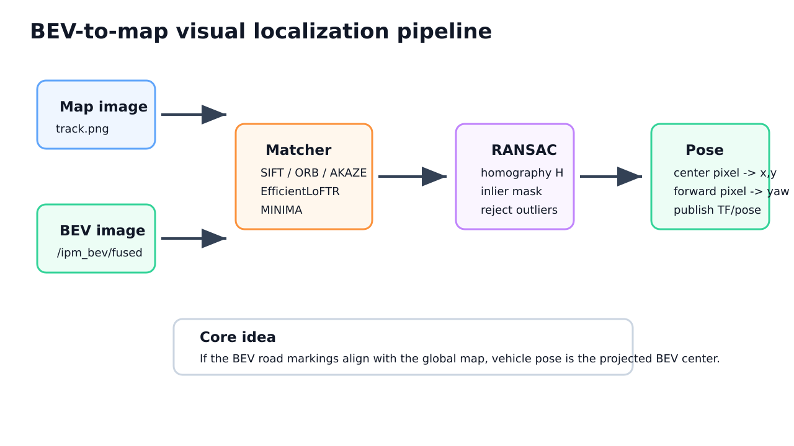

---

# `21. IPM BEV 설정`

`perception/ipm_bev_node/config/ipm_bev.yaml`

```yaml
front_image_topic: /camera_front/image_raw
rear_image_topic: /camera_rear/image_raw
front_camera_info_topic: /camera_info
rear_camera_info_topic: /camera_info

base_frame: base_footprint
front_camera_frame: camera_front_link
rear_camera_frame: camera_rear_link
camera_frame_convention: link_x_forward

x_min: -10.0
x_max: 10.0
y_min: -6.0
y_max: 6.0
resolution: 0.025
```

---

# `22. IPM BEV 출력`

| Topic | Encoding | 의미 |
|---|---|---|
| `/ipm_bev/front` | `bgr8` | 전방 카메라 IPM |
| `/ipm_bev/rear` | `bgr8` | 후방 카메라 IPM |
| `/ipm_bev/fused` | `bgr8` | 전후방 합성 BEV |
| `/ipm_bev/valid_mask` | `mono8` | 관측 가능한 영역 |
| `/ipm_bev/source_mask` | `mono8` | front/rear 출처 |
| `/ipm_bev/debug` | `bgr8` | grid와 footprint 포함 |

---

# `23. IPM BEV 단독 실행`

전체 스택이 아니라 IPM만 다시 띄울 때:

```bash
# 실행 위치: AAC Container
source /opt/ros/$ROS_DISTRO/setup.bash
source /ros_ws/install/setup.bash
ros2 launch ipm_bev_node deploy.launch.py
```

확인:

```bash
# 실행 위치: AAC Container
rqt_image_view /ipm_bev/debug
ros2 topic hz /ipm_bev/fused
ros2 topic echo /ipm_bev/fused --once --field header
```

---

# `24. Vision-based Navigation이란`

여기서의 영상 항법은 SLAM 전체가 아니라 전역 지도와 현재 관측 영상의 정합이다.

```text
known map image + current BEV image
  -> image correspondences
  -> homography
  -> vehicle center projection
  -> map-frame pose
```

중요한 가정:

```text
도로 표면이 거의 평면이다.
BEV가 지도 texture와 비슷한 관측을 만든다.
차선/도로 경계 같은 반복 패턴이 충분히 보인다.
```

---

# `25. Matching Debug 예시`

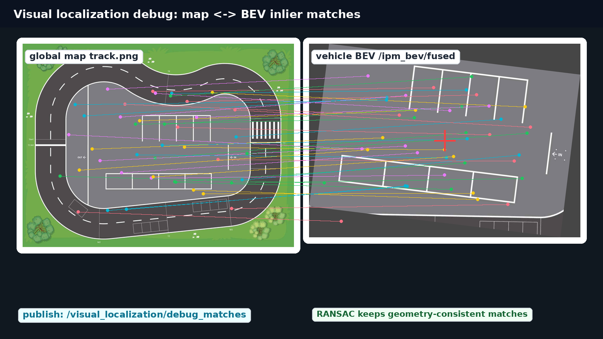

---

# `26. image_match_node 패키지`

```text
navigation/image_match_node/
├── README.md
├── launch/
│   ├── opencv.launch.py
│   ├── efficientloftr.launch.py
│   └── minima.launch.py
├── config/
│   ├── opencv_gazebo.yaml
│   ├── efficientloftr_gazebo.yaml
│   └── minima_gazebo.yaml
├── opencv_node/
├── efficientloftr_node/
└── minima_node/
```

하나의 ROS topic contract 위에서 backend만 바꿔 비교할 수 있게 설계되어 있다.

---

# `27. Backend Landscape`

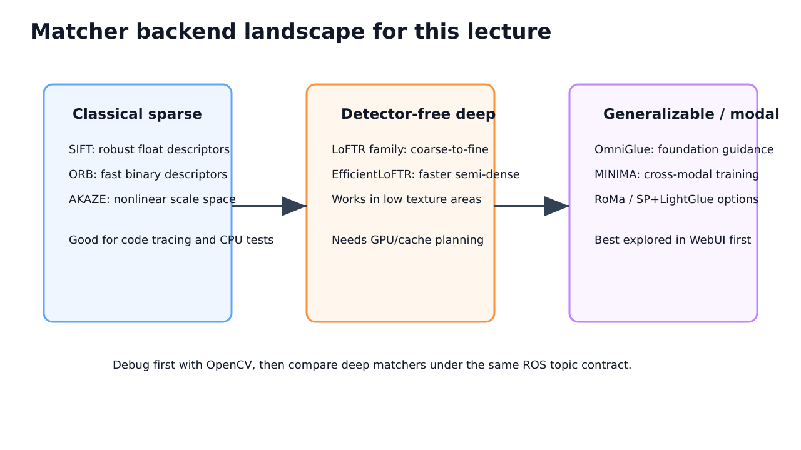

---

# `28. 전통적 Feature Matching`

전통적 pipeline:

```text
1. keypoint detection
2. descriptor extraction
3. descriptor nearest-neighbor matching
4. ratio test / cross check
5. RANSAC homography
6. pose projection
```

장점:

```text
가중치가 필요 없다.
CPU에서도 디버깅이 쉽다.
각 단계의 실패 원인을 추적하기 좋다.
```

---

# `29. SIFT / ORB 시각화`

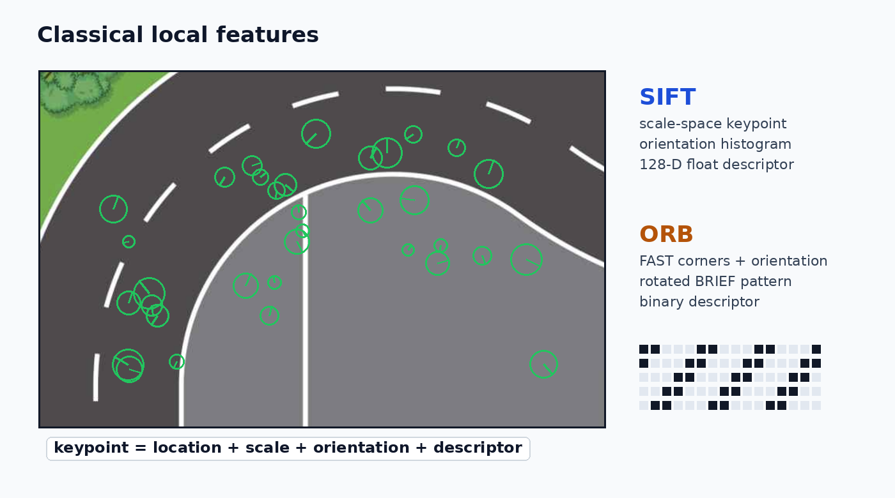

---

# `30. SIFT 개념`

SIFT는 Scale-Invariant Feature Transform이다.

핵심:

```text
scale-space에서 keypoint 후보를 찾는다.
keypoint 주변 gradient 방향으로 orientation을 부여한다.
16x16 주변을 4x4 cell로 나누고 orientation histogram을 만든다.
결과 descriptor는 보통 128-D float vector다.
```

왜 좋은가:

```text
scale 변화와 회전에 비교적 강하다.
도로 texture, lane boundary, parking line처럼 선명한 구조에서 안정적이다.
```

---

# `31. ORB 개념`

ORB는 Oriented FAST and Rotated BRIEF다.

핵심:

```text
FAST로 corner를 빠르게 찾는다.
Harris score로 좋은 점을 고른다.
patch intensity centroid로 orientation을 추정한다.
BRIEF binary test pattern을 orientation에 맞춰 회전한다.
descriptor는 binary vector라 Hamming distance로 빠르게 비교한다.
```

SIFT보다 빠르지만 큰 scale 변화와 반복 패턴에는 더 민감할 수 있다.

---

# `32. Descriptor Matching`

OpenCV backend는 `BFMatcher.knnMatch(..., k=2)` 후 ratio test를 쓴다.

```python
pairs = self._matcher.knnMatch(
    query_descriptors, map_descriptors, k=2)
good_matches = [
    first for first, second in pairs
    if first.distance < ratio_test * second.distance
]
```

ratio test 의미:

```text
"가장 가까운 descriptor가 두 번째 후보보다 충분히 가까운가?"
```

---

# `33. Homography와 RANSAC`

BEV는 지면 평면을 보는 top-down image다.

평면 사이 image correspondence는 3x3 homography로 근사할 수 있다.

```python
homography, inlier_mask = cv2.findHomography(
    bev_points,
    map_points,
    method,
    self.ransac_reproj_threshold,
)
```

RANSAC은 잘못된 match를 outlier로 버리고 geometry가 맞는 match만 남긴다.

---

# `34. Pose Projection`

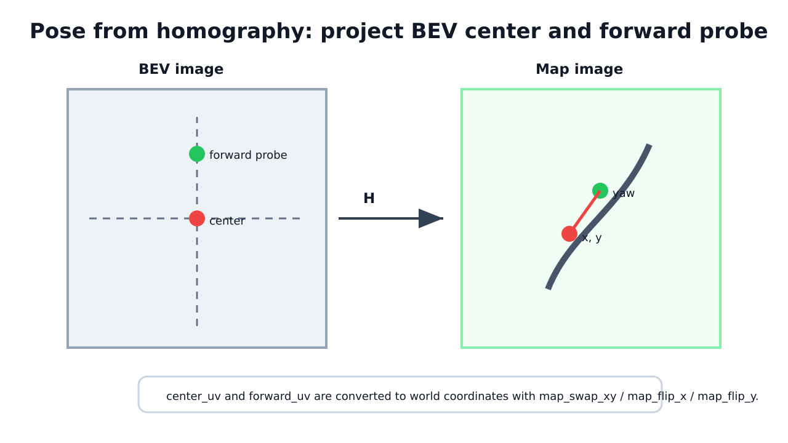

---

# `35. OpenCV Backend 설정`

`navigation/image_match_node/config/opencv_gazebo.yaml`

```yaml
image_topic: /ipm_bev/fused
feature_type: sift  # sift | orb | akaze
max_features: 6000
ratio_test: 0.72
use_clahe: true
frame_stride: 1
min_matches: 12
min_inliers: 8
min_inlier_ratio: 0.25
homography_method: usac_magsac
ransac_reproj_threshold: 5.0
enable_lane_features: true
```

---

# `36. OpenCV Detector Factory`

`opencv_node/ros_wrapper.py`

```python
def _create_detector(self):
    if self.feature_type == 'sift':
        return cv2.SIFT_create(nfeatures=self.max_features), cv2.NORM_L2
    if self.feature_type == 'orb':
        return (
            cv2.ORB_create(
                nfeatures=self.max_features,
                scaleFactor=1.2,
                nlevels=8,
                fastThreshold=12,
            ),
            cv2.NORM_HAMMING,
        )
    return cv2.AKAZE_create(), cv2.NORM_HAMMING
```

학생이 가장 먼저 바꿔볼 값은 `feature_type`이다.

---

# `37. Lane Semantic Gating`

우리 트랙은 차선과 도로 경계가 중요한 matching clue다.

OpenCV backend는 keypoint를 두 그룹으로 나눈다.

```text
lane keypoint
non-lane keypoint
```

그리고 같은 종류끼리만 descriptor matching한다.

```text
lane -> lane
non-lane -> non-lane
```

반복 패턴이 많은 track에서 엉뚱한 match를 줄이기 위한 장치다.

---

# `38. Lane Mask 코드`

`opencv_node/lane_mask.py`

```python
def extract_lane_mask(
        bgr, hsv_lower, hsv_upper, roi_y_min_ratio, roi_y_max_ratio,
        kernel_size, open_iterations, close_iterations, min_area,
        kernel_size_ratio=0.0, min_area_ratio=0.0):
    height, width = bgr.shape[:2]
    hsv = cv2.cvtColor(bgr, cv2.COLOR_BGR2HSV)
    mask = cv2.inRange(
        hsv,
        np.asarray(hsv_lower, dtype=np.uint8),
        np.asarray(hsv_upper, dtype=np.uint8),
    )
    ...
    return remove_small_components(mask, min_area)
```

HSV threshold와 morphology로 흰색 lane paint를 분리한다.

---

# `39. OpenCV Localize 흐름`

`opencv_node/ros_wrapper.py`

```python
def _localize(self, bev_bgr, source_msg):
    bev_gray = self._prepare_gray(bev_bgr)
    bev_keypoints, bev_descriptors = self._detector.detectAndCompute(
        bev_gray, None)

    if self.enable_lane_features or self.enable_chamfer_refinement:
        bev_lane_mask = self._extract_lane_mask(bev_bgr)

    if self.enable_lane_features:
        lane_labels = classify_lane_keypoints(
            bev_keypoints,
            bev_lane_mask,
            self.lane_feature_dilation_ratio,
        )
```

---

# `40. Semantic Matching 코드`

```python
(
    lane_keypoints,
    lane_descriptors,
    non_lane_keypoints,
    non_lane_descriptors,
) = partition_features(
    bev_keypoints,
    bev_descriptors,
    lane_labels,
)
raw_bev_points, raw_map_points, raw_distances = self._match_features(
    non_lane_keypoints, non_lane_descriptors,
    self._map_non_lane_keypoints, self._map_non_lane_descriptors,
    self.ratio_test,
)
lane_bev_points, lane_map_points, lane_distances = self._match_features(
    lane_keypoints, lane_descriptors,
    self._map_lane_keypoints, self._map_lane_descriptors,
    self.lane_ratio_test,
    self.lane_max_matches,
)
```

---

# `41. Pose 발행 코드`

```python
projected = cv2.perspectiveTransform(
    np.array([[bev_center, bev_forward]], dtype=np.float32),
    homography,
)[0]
center_uv, forward_uv = projected

x, y = self._map_pixel_to_world(center_uv)
forward_x, forward_y = self._map_pixel_to_world(forward_uv)
yaw = math.atan2(forward_y - y, forward_x - x)

pose_msg = self._make_pose(source_msg, x, y, yaw, inlier_ratio)
self.pose_pub.publish(pose_msg)
self.odometry_pub.publish(self._make_odometry(pose_msg))
```

BEV 중심점과 전방 probe 점 두 개로 `x`, `y`, `yaw`를 계산한다.

---

# `42. OpenCV Backend 실행`

```bash
# 실행 위치: AAC Container
source /opt/ros/$ROS_DISTRO/setup.bash
source /ros_ws/install/setup.bash
ros2 launch image_match_node opencv.launch.py
```

확인:

```bash
# 실행 위치: AAC Container
ros2 topic echo /visual_localization/opencv/pose --once
ros2 topic hz /visual_localization/opencv/pose
ros2 topic echo /visual_localization/opencv/match_count --once
rqt_image_view /visual_localization/opencv/debug_matches
```

---

# `43. OpenCV 튜닝 실습`

`navigation/image_match_node/config/opencv_gazebo.yaml` 수정:

```yaml
feature_type: orb
max_features: 2500
ratio_test: 0.75
```

다시 실행:

```bash
# 실행 위치: AAC Container
cd /ros_ws
colcon build --packages-select image_match_node
source install/setup.bash
ros2 launch image_match_node opencv.launch.py \
  config:=/ros_ws/src/aac_2026/navigation/image_match_node/config/opencv_gazebo.yaml
```

---

# `44. OpenCV 결과 해석`

| Topic | 볼 것 |
|---|---|
| `/visual_localization/opencv/match_count` | ratio test 통과 match 수 |
| `/visual_localization/opencv/lane_match_count` | lane semantic match 수 |
| `/visual_localization/opencv/lane_inlier_count` | RANSAC에서 살아남은 lane match |
| `/visual_localization/opencv/inlier_ratio` | geometry 일관성 |
| `/visual_localization/opencv/debug_matches` | 실제 대응선 |

match 수가 높아도 반복 차선 때문에 wrong place로 수렴할 수 있다.

---

# `45. Image Matching WebUI`

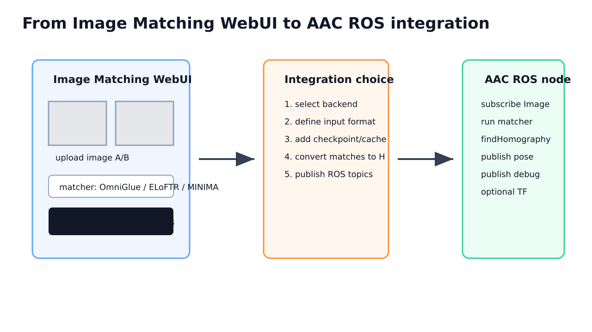

---

# `46. WebUI를 왜 쓰는가`

Image Matching WebUI는 두 이미지를 넣고 matcher를 바꿔가며 correspondence를 확인하는 GUI다.

강의에서 쓰는 방식:

```text
1. Gazebo map crop과 BEV image를 넣는다.
2. SIFT, LightGlue, OmniGlue, EfficientLoFTR, MINIMA 등을 비교한다.
3. match가 잘 나오는 backend를 ROS node 후보로 고른다.
4. inference output을 homography + pose publisher 형태로 감싼다.
```

WebUI는 실험실이고, ROS node는 실시간 시스템 통합이다.

---

# `47. WebUI 실행 예시`

네트워크와 GPU 상태에 따라 시간이 걸릴 수 있다.

```bash
# 실행 위치: Host Ubuntu
docker run --rm -it -p 7860:7860 \
  vincentqin/image-matching-webui:latest \
  python app.py --server_name "0.0.0.0" --server_port=7860
```

브라우저:

```bash
# 실행 위치: Host Ubuntu
xdg-open http://localhost:7860
```

Docker image pull이 필요한 실습은 수업 전 미리 준비해두는 것이 좋다.

---

# `48. WebUI에서 볼 Matcher들`

Image Matching WebUI는 다양한 matcher를 같은 UI로 비교하게 해준다.

| 계열 | 예시 | 수업에서 보는 포인트 |
|---|---|---|
| Classical | SIFT | feature, descriptor, ratio test |
| Sparse deep | SuperPoint + LightGlue, OmniGlue | keypoint 기반 learned matching |
| Detector-free | LoFTR, EfficientLoFTR, XoFTR | coarse-to-fine dense/semi-dense matching |
| Cross-modal/general | MINIMA, RoMa | modality gap과 robust matching |

---

# `49. OmniGlue 소개`

OmniGlue는 CVPR 2024 feature matcher다.

핵심 아이디어:

```text
foundation model guidance를 사용해 unseen domain generalization을 높인다.
keypoint position-guided attention으로 위치 정보와 appearance 정보를 다룬다.
scene, object, aerial image 등 다양한 domain에서 일반화 성능을 목표로 한다.
```

AAC2026 현재 코드에는 OmniGlue wrapper가 없다.

이번 강의에서는 WebUI에서 비교해볼 후보로 소개한다.

---

# `50. EfficientLoFTR 소개`


---

# `51. EfficientLoFTR 개념`

EfficientLoFTR는 LoFTR 계열의 detector-free matcher다.

핵심:

```text
이미지 전체 feature map에서 coarse matching을 만든다.
attention을 효율화해 token 수와 계산량을 줄인다.
fine-level matching에서 sub-pixel correspondence를 정제한다.
```

우리 프로젝트에서는 Hugging Face Transformers의
`zju-community/efficientloftr` 모델을 사용한다.

---

# `52. EfficientLoFTR Wrapper`

`efficientloftr_node/ros_wrapper.py`

```python
self.processor = AutoImageProcessor.from_pretrained(
    self.model_id,
    cache_dir=self.cache_dir or None,
    local_files_only=self.local_files_only,
    use_fast=False,
)
self.model = AutoModelForKeypointMatching.from_pretrained(
    self.model_id,
    cache_dir=self.cache_dir or None,
    local_files_only=self.local_files_only,
).eval().to(self.device)
```

모델은 git에 포함하지 않고 `.hf_home` cache에 저장한다.

---

# `53. EfficientLoFTR Inference`

```python
images = [self._map_pil, bev_pil]
inputs = self.processor(images, return_tensors='pt').to(self.device)

with torch.inference_mode():
    outputs = self.model(**inputs)

matches = self.processor.post_process_keypoint_matching(
    outputs,
    target_sizes,
    threshold=self.match_threshold,
)[0]
map_points = matches['keypoints0'].detach().cpu().numpy().astype(np.float32)
bev_points = matches['keypoints1'].detach().cpu().numpy().astype(np.float32)
```

이후는 OpenCV backend와 마찬가지로 `cv2.findHomography`를 사용한다.

---

# `54. EfficientLoFTR Cache 준비`

처음 한 번은 모델을 다운로드한다.

```bash
# 실행 위치: AAC Container
cd /ros_ws/src/aac_2026
./perception/setup_colcon_ignores.sh
cd /ros_ws
colcon build --packages-select image_match_node
source install/setup.bash
ros2 run image_match_node prepare_efficientloftr_cache
```

오프라인 확인:

```bash
# 실행 위치: AAC Container
ros2 run image_match_node prepare_efficientloftr_cache -- --local-files-only
```

---

# `55. EfficientLoFTR 실행`

```bash
# 실행 위치: AAC Container
source /opt/ros/$ROS_DISTRO/setup.bash
source /ros_ws/install/setup.bash
ros2 launch image_match_node efficientloftr.launch.py \
  config:=/ros_ws/src/aac_2026/navigation/image_match_node/config/efficientloftr_gazebo.yaml
```

확인:

```bash
# 실행 위치: AAC Container
rqt_image_view /visual_localization/debug_matches
ros2 topic echo /visual_localization/match_count --once
ros2 topic echo /visual_localization/inlier_ratio --once
```

---

# `56. MINIMA 소개`

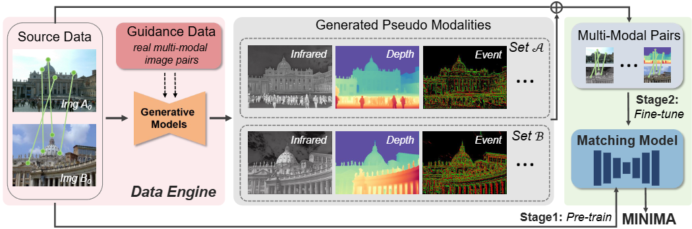

---

# `57. MINIMA 개념`

MINIMA는 Modality Invariant Image Matching이다.

핵심:

```text
cross-view와 cross-modality matching을 목표로 한다.
generative model로 다양한 pseudo modality를 만든다.
RGB, infrared, depth, event, sketch 등 modality gap에 강한 matcher를 학습한다.
```

우리 프로젝트에서는 MINIMA wrapper가 다음 method를 지원한다.

```text
loftr | roma | sp_lg
```

---

# `58. MINIMA 설정`

`navigation/image_match_node/config/minima_gazebo.yaml`

```yaml
image_topic: /ipm_bev/fused
method: sp_lg
ckpt_path: "minima_lightglue.pth"
match_thr: 0.2
device: cuda
frame_stride: 3
min_matches: 40
min_inliers: 20
min_inlier_ratio: 0.2
publish_tf: true
pose_topic: /visual_localization/pose
debug_topic: /visual_localization/debug_matches
```

---

# `59. MINIMA 가중치 준비`

```bash
# 실행 위치: AAC Container
cd /ros_ws/src/aac_2026/navigation/image_match_node/MINIMA/weights
bash download.sh
```

확인:

```bash
# 실행 위치: AAC Container
ls -lh /ros_ws/src/aac_2026/navigation/image_match_node/MINIMA/weights/
```

예상 파일:

```text
minima_loftr.ckpt
minima_roma.pth
minima_lightglue.pth
```

---

# `60. MINIMA 실행`

```bash
# 실행 위치: AAC Container
source /opt/ros/$ROS_DISTRO/setup.bash
source /ros_ws/install/setup.bash
ros2 launch image_match_node minima.launch.py \
  config:=/ros_ws/src/aac_2026/navigation/image_match_node/config/minima_gazebo.yaml
```

method를 바꿔볼 때:

```bash
# 실행 위치: AAC Container
ros2 run image_match_node minima_localization_node \
  --ros-args -p method:=loftr -p ckpt_path:=""
```

---

# `61. Deep Backend 공통 구조`

EfficientLoFTR와 MINIMA wrapper는 matcher 부분만 다르고 뒤쪽 ROS 구조는 거의 같다.

```text
subscribe /ipm_bev/fused
load map image track.png
run matcher(map, bev)
cv2.findHomography(bev_points, map_points)
project BEV center/forward
publish pose, homography, match_count, debug image
```

이것이 “model research code”를 “robot system node”로 바꾸는 지점이다.

---

# `62. 공통 출력 Topic`

| Topic | Type | 의미 |
|---|---|---|
| `/visual_localization/pose` | `PoseWithCovarianceStamped` | map 기준 차량 pose |
| `/visual_localization/debug_matches` | `sensor_msgs/Image` | 지도-BEV match 시각화 |
| `/visual_localization/homography` | `Float64MultiArray` | 3x3 homography |
| `/visual_localization/match_count` | `Int32` | threshold 통과 match 수 |
| `/visual_localization/inlier_ratio` | `Float32` | RANSAC inlier 비율 |

OpenCV backend는 비교를 위해 `/visual_localization/opencv/*` namespace를 쓴다.

---

# `63. Pose 품질 확인`

Ground truth:

```text
/odom_gt
```

Visual localization:

```text
/visual_localization/pose
/visual_localization/opencv/pose
```

확인:

```bash
# 실행 위치: AAC Container
ros2 topic echo /odom_gt --once
ros2 topic echo /visual_localization/opencv/pose --once
```

---

# `64. 좌표계 Calibration`

`simple_track.world`의 track box 크기:

```text
X: 12 m  -> [-6, 6]
Y: 16 m  -> [-8, 8]
```

`image_match_node` 설정:

```yaml
map_x_min: -6.0
map_x_max: 6.0
map_y_min: -8.0
map_y_max: 8.0
map_swap_xy: true
map_flip_x: true
map_flip_y: true
```

texture pixel 좌표와 world 좌표의 방향이 다르기 때문에 swap/flip이 필요하다.

---

# `65. Debug 이미지 해석`

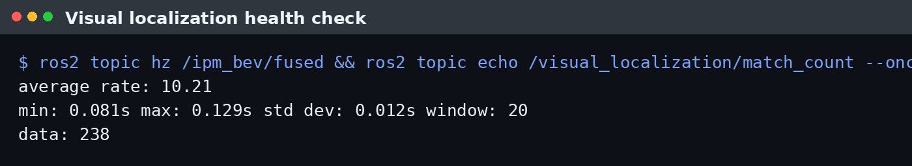

---

# `66. 실습 A: Image Topic 지도 그리기`

학생이 직접 노트에 그릴 것:

```text
/camera_front/image_raw
/camera_rear/image_raw
/camera_info
  -> ipm_bev_node
/ipm_bev/fused
  -> image_match_node
/visual_localization/... 
```

확인 명령:

```bash
# 실행 위치: AAC Container
ros2 topic list | grep -E "camera|ipm|visual"
ros2 node info /ipm_bev_node
ros2 node info /opencv_localization
```

---

# `67. 실습 B: SIFT와 ORB 비교`

1. `opencv_gazebo.yaml`에서 `feature_type`을 `sift`로 둔다.
2. `match_count`, `inlier_ratio`, debug image를 기록한다.
3. `feature_type`을 `orb`로 바꾼다.
4. 같은 항목을 다시 기록한다.

```bash
# 실행 위치: AAC Container
ros2 topic echo /visual_localization/opencv/match_count --once
ros2 topic echo /visual_localization/opencv/inlier_ratio --once
rqt_image_view /visual_localization/opencv/debug_matches
```

---

# `68. 실습 C: Backend 비교`

OpenCV:

```bash
# 실행 위치: AAC Container
ros2 launch image_match_node opencv.launch.py
```

EfficientLoFTR:

```bash
# 실행 위치: AAC Container
ros2 launch image_match_node efficientloftr.launch.py
```

MINIMA:

```bash
# 실행 위치: AAC Container
ros2 launch image_match_node minima.launch.py
```

한 번에 하나씩 실행하고 topic 이름 충돌을 피한다.

---

# `69. 흔한 실패 1: Image가 안 보임`

```bash
# 실행 위치: AAC Container
ros2 topic info -v /camera_front/image_raw
ros2 topic hz /camera_front/image_raw
rqt_image_view /camera_front/image_raw
```

점검:

```text
Gazebo bridge가 실행 중인가?
camera topic remapping이 되었는가?
GUI/X11 forwarding이 되는가?
QoS가 sensor data best effort인가?
```

---

# `70. 흔한 실패 2: BEV가 안 나옴`

```bash
# 실행 위치: AAC Container
ros2 topic echo /camera_info --once
ros2 topic hz /ipm_bev/fused
ros2 run tf2_ros tf2_echo base_footprint camera_front_link
```

점검:

```text
CameraInfo가 들어오는가?
camera frame TF가 존재하는가?
ground_z와 BEV 범위가 너무 이상하지 않은가?
front/rear timestamp 차이가 sync_tolerance_sec보다 크지 않은가?
```

---

# `71. 흔한 실패 3: Match가 많은데 Pose가 틀림`

가능한 원인:

```text
반복되는 차선/parking line이 많다.
전역 지도 전체에서 검색해서 다른 위치에 잘 맞을 수 있다.
map_swap_xy/map_flip_x/map_flip_y가 틀렸다.
BEV range와 지도 range가 서로 맞지 않는다.
```

다음 단계 아이디어:

```text
이전 pose 주변 ROI만 검색한다.
속도/조향으로 불가능한 pose jump를 reject한다.
local odom과 visual global pose를 fuse한다.
```

---

# `72. CAPTURE SLOT: 수업 중 직접 캡처`

<div class="capture">
목적: 학생들이 실제 시스템 화면을 자기 노트와 연결하도록 한다.<br>
추천 캡처: Gazebo top view, rqt_image_view /camera_front/image_raw, rqt_image_view /ipm_bev/debug, rqt_image_view /visual_localization/opencv/debug_matches<br>
성공 신호: 카메라 영상, BEV grid, 지도-BEV match line이 모두 보인다.
</div>

```bash
# 실행 위치: AAC Container
rqt_image_view /ipm_bev/debug
rqt_image_view /visual_localization/opencv/debug_matches
```

---

# `73. VIDEO SLOT`

```text
[VIDEO SLOT]
목적: Gazebo 차량이 움직일 때 /ipm_bev/fused와 debug_matches가 함께 변하는 장면
추천 길이: 45-90초
삽입 위치: PPTX export 후 이 슬라이드 뒤
```

학생들이 볼 것:

```text
차량이 움직이면 BEV 입력이 바뀐다.
matching line과 projected center도 함께 움직인다.
match_count는 장면에 따라 흔들릴 수 있다.
```

---

# `74. 오늘의 핵심 정리`

```text
ROS Image topic은 큰 byte array이므로 header, encoding, hz, viewer로 확인한다.
IPM BEV는 카메라 영상을 지도 matching이 가능한 top-down image로 바꾼다.
SIFT/ORB는 keypoint + descriptor + matching + RANSAC으로 pose를 만든다.
EfficientLoFTR/MINIMA는 matcher만 deep model로 바꾸고 ROS contract는 유지한다.
WebUI는 backend 후보를 빠르게 비교하는 실험 공간이다.
```

다음 강의에서는 LiDAR 기반 항법으로 sensor modality를 바꿔 같은 질문을 다시 본다.

---

# `75. References`

<div class="tiny">

- ROS 2 `sensor_msgs/msg/Image`: https://docs.ros2.org/latest/api/sensor_msgs/msg/Image.html
- ROS Index `rqt_image_view`: https://index.ros.org/p/rqt_image_view/
- OpenCV SIFT tutorial: https://docs.opencv.org/4.x/da/df5/tutorial_py_sift_intro.html
- OpenCV ORB tutorial: https://docs.opencv.org/4.x/d1/d89/tutorial_py_orb.html
- OpenCV Feature Matching + Homography: https://docs.opencv.org/4.x/d1/de0/tutorial_py_feature_homography.html
- Image Matching WebUI / IMCUI: https://huggingface.co/spaces/Realcat/image-matching-webui
- OmniGlue project: https://hwjiang1510.github.io/OmniGlue/
- EfficientLoFTR project: https://zju3dv.github.io/efficientloftr/
- MINIMA GitHub: https://github.com/LSXI7/MINIMA
- AAC2026 local code: `perception/ipm_bev_node`, `navigation/image_match_node`, `system/aac_vehicle`

</div>
