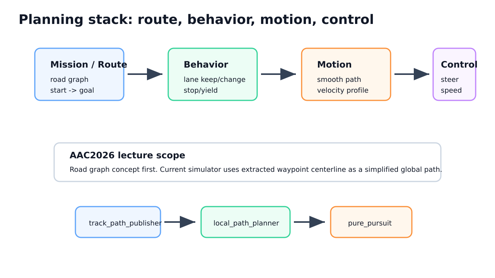
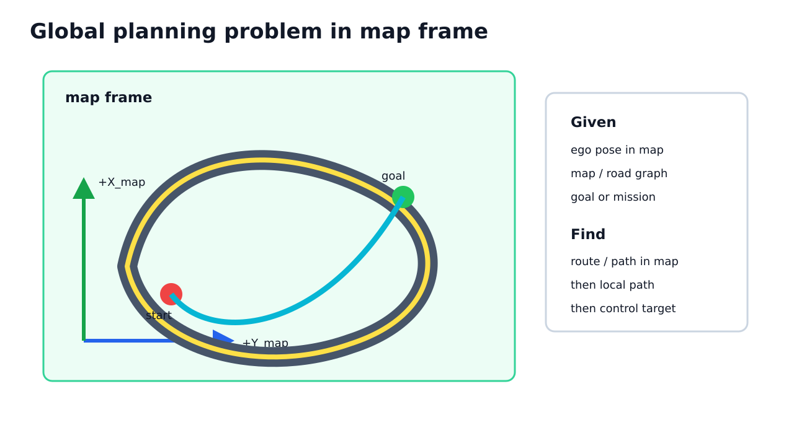
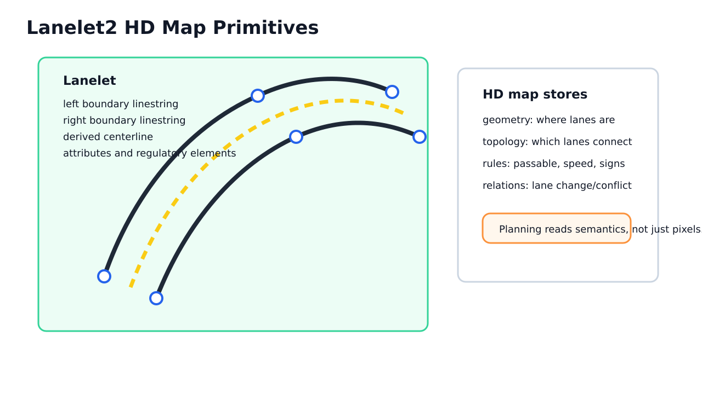
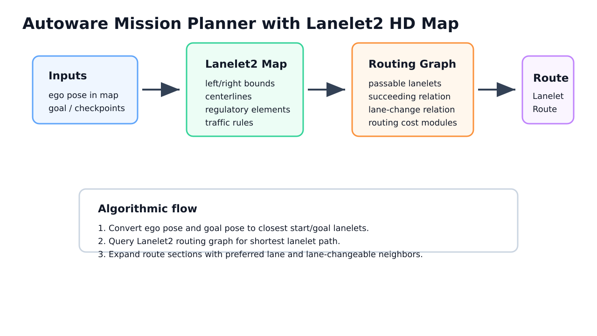
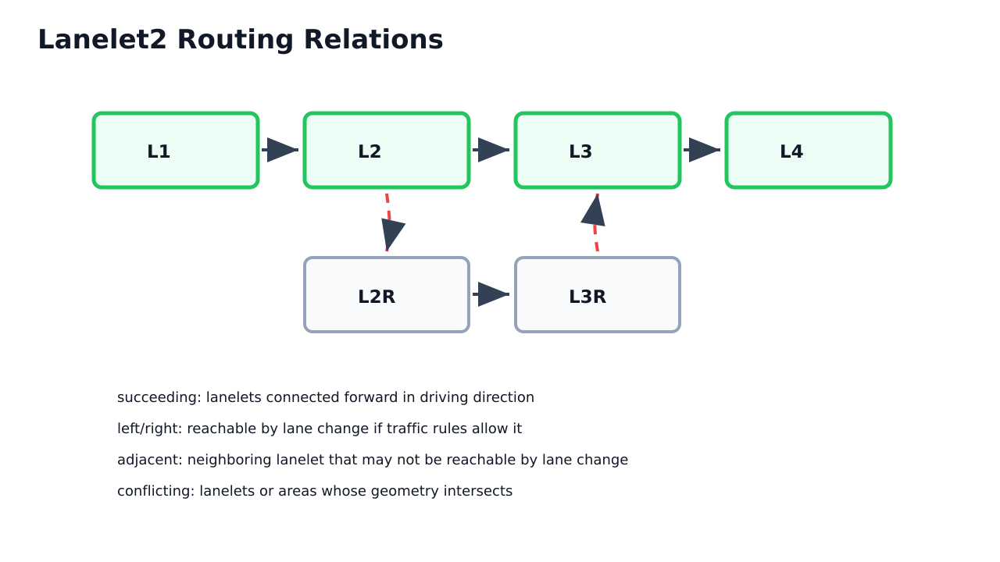
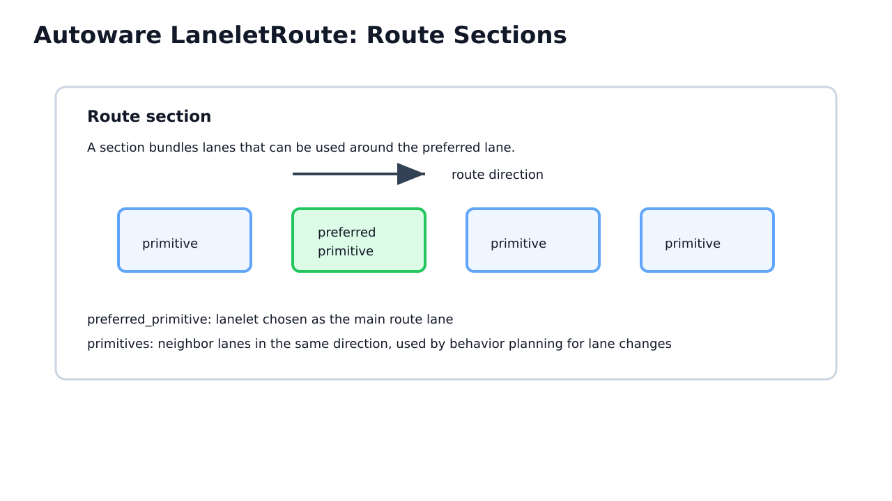
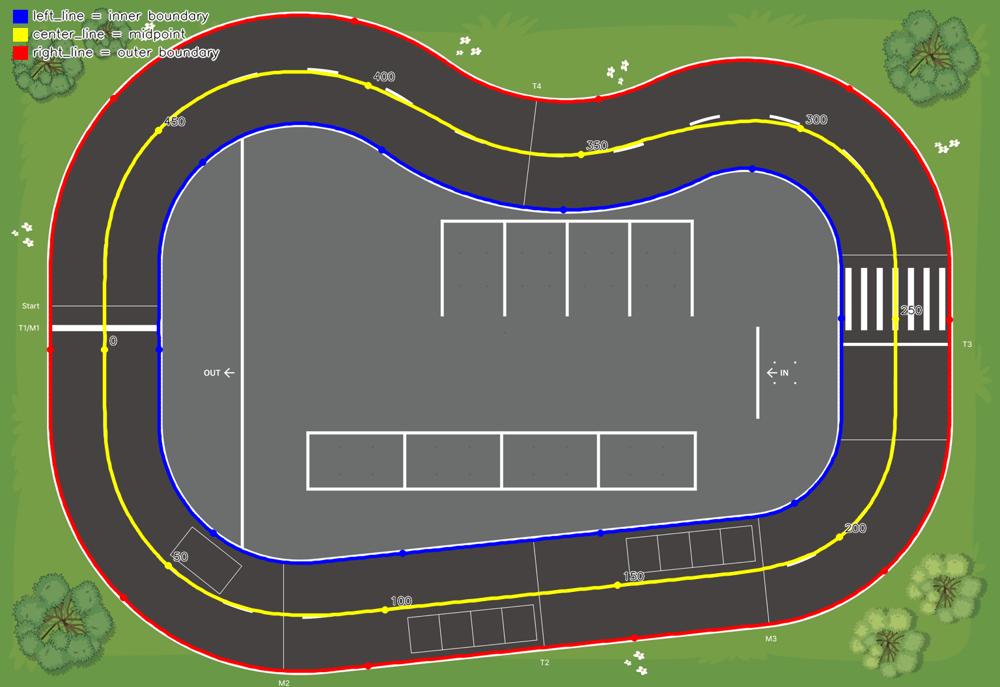

# `Lecture 06: HD Map Global Route Planning`
## Autoware Mission Planner와 Lanelet2 기반 경로 찾기

방산개방형아키텍처

---

# `1. 오늘의 범위`

오늘은 HD map 기반 global route planning을 다룬다.

다루는 것:

- Autoware planning stack에서 `Mission Planning`의 위치
- Lanelet2 HD map의 lane geometry, topology, traffic rules
- Lanelet2 routing graph와 shortest path
- Autoware `mission_planner`가 `LaneletRoute`를 만드는 흐름
- AAC2026의 `/path/center`가 이 구조를 어떻게 단순화한 것인지

다음 강의로 넘기는 것:

- local path planning
- path tracking
- pure pursuit

---

# `2. 오늘의 목표`

수업이 끝나면 다음 문장을 설명할 수 있어야 한다.

```text
Autoware의 global route planning은 ego pose와 goal을 HD map의 lanelet 위에 올리고,
Lanelet2 routing graph에서 주행 가능한 lane sequence를 찾는 문제다.
```

핵심 질문:

- HD map은 단순한 이미지 지도와 무엇이 다른가?
- Lanelet2에서 lane은 어떤 primitive로 표현되는가?
- routing graph는 map, traffic rules, routing cost로 어떻게 만들어지는가?
- Autoware `LaneletRoute`는 왜 geometry 자체보다 lane id와 route section을 담는가?

---

# `3. 시험/평가 없음`

오늘도 시험이나 정량 평가 없이 실습 체크포인트로 확인한다.

체크포인트:

- `Mission Planning`, `Behavior Planning`, `Motion Planning`을 구분한다.
- Lanelet2의 geometry와 topology를 분리해서 말한다.
- `succeeding`, `left/right`, `adjacent`, `conflicting` relation을 설명한다.
- Lanelet2 `shortestPath`가 routing cost 기반 shortest path임을 이해한다.
- AAC2026의 closed track centerline이 Lanelet2 route의 단순화임을 설명한다.

---

# `4. Autoware Planning Stack`



---

# `5. Mission Planning의 역할`

Autoware 문서 기준 planning stack은 크게 나뉜다.

| Layer | 질문 | 대표 출력 |
| --- | --- | --- |
| Mission Planning | 목적지까지 어떤 lane들을 지날까? | `LaneletRoute` |
| Behavior Planning | 그 route 안에서 차선 변경/정지/양보를 어떻게 할까? | path |
| Motion Planning | 안전하고 부드러운 궤적과 속도를 어떻게 만들까? | trajectory |
| Control | 지금 steering/speed를 얼마로 줄까? | vehicle command |

오늘은 첫 줄, Mission Planning만 깊게 본다.

---

# `6. Global Planning은 map frame 문제`



---

# `7. HD Map이 필요한 이유`

카메라 이미지나 occupancy grid만으로는 "도로 규칙"을 알기 어렵다.

HD vector map은 planning에 필요한 정적 의미 정보를 담는다.

- 차선 경계와 중심선
- 차선 연결 관계
- 차선 변경 가능 여부
- 정지선, 횡단보도, 신호등, 표지판
- 제한속도와 교통 규칙
- 교차로와 conflict 관계

Global route planner는 이 정보를 사용해 주행 가능한 lane sequence를 찾는다.

---

# `8. Lanelet2 HD Map Primitive`



---

# `9. Geometry와 Topology`

Lanelet2 map을 두 층으로 나눠 생각한다.

Geometry:

```text
left boundary / right boundary / centerline / point coordinates
```

Topology:

```text
어느 lanelet에서 어느 lanelet으로 갈 수 있는가?
차선 변경이 가능한가?
교차하거나 충돌하는 lanelet은 무엇인가?
```

Planning은 geometry만 읽지 않는다. Topology와 rule을 함께 읽는다.

---

# `10. Autoware Mission Planner`



---

# `11. Mission Planner 입력과 출력`

Autoware `mission_planner`의 대표 입출력:

| 구분 | 내용 |
| --- | --- |
| 입력 map | Lanelet2 vector map, `HADMapBin` |
| 입력 mission | goal pose, checkpoints |
| 내부 처리 | Lanelet2 routing graph에서 route 계산 |
| 출력 route | `/planning/mission_planning/route` |
| 출력 type | `autoware_planning_msgs/LaneletRoute` |
| debug | route marker, goal footprint |

route는 goal/checkpoints가 바뀔 때 계산되고, 새 요청이 오기 전까지 유지된다.

---

# `12. Start/Goal을 Lanelet에 올리기`

Pose만으로는 graph search를 시작할 수 없다.

```text
ego pose in map
  -> closest start lanelet

goal pose in map
  -> closest goal lanelet
```

이때 단순 거리만 보지 않는다.

- lanelet 방향과 goal yaw가 너무 다르면 goal을 거절할 수 있다.
- 차량 footprint가 lanelet 안에 들어가는지도 확인할 수 있다.
- 지도에 맞지 않는 goal은 route가 비거나 실패한다.

---

# `13. Routing Graph를 만드는 재료`

Lanelet2 routing graph는 다음 재료로 만들어진다.

```text
Lanelet Map
Traffic Rules
Routing Cost Modules
Routing Graph Configuration
```

각 재료의 의미:

- Lanelet Map: lanelet, area, regulatory element
- Traffic Rules: vehicle이 지나갈 수 있는 lanelet 판단
- Routing Cost: distance, travel time, lane change penalty
- Configuration: participant height 같은 graph 구성 조건

---

# `14. Lanelet2 Routing Relations`



---

# `15. Relation의 의미`

Lanelet2 routing graph에서 중요한 relation:

| Relation | 의미 |
| --- | --- |
| `succeeding` | 주행 방향으로 이어지는 다음 lanelet |
| `left`, `right` | 차선 변경으로 도달 가능한 lanelet |
| `adjacent left/right` | 옆에 있지만 차선 변경 가능하다고 보장되지는 않음 |
| `conflicting` | geometry가 교차하거나 충돌 가능성이 있는 lanelet/area |
| `area` | lanelet과 area 사이의 접근 관계 |

Global route는 이 relation graph 위에서 찾는다.

---

# `16. Route, Path, Sequence`

Lanelet2에서는 비슷해 보이는 단어가 서로 다르다.

| 용어 | 의미 |
| --- | --- |
| Route | destination까지 갈 때 사용할 수 있는 lanelet들의 route 영역 |
| Path | destination까지 이어지는 ordered lanelet/area list |
| Sequence | lane change 없이 이어지는 subsequent lanelet 묶음 |

Autoware의 `LaneletRoute`는 route를 downstream planner가 쓰기 좋게 section 단위로 표현한다.

---

# `17. Autoware Route Section`



---

# `18. Route Section의 의미`

Autoware route section은 `LaneletSegment`로 표현된다.

구성:

- `preferred_primitive`: goal 방향으로 따라갈 기본 lanelet
- `primitives`: 같은 방향의 이웃 lanelet들

왜 preferred lane만 주지 않을까?

- Behavior planner가 lane change를 판단해야 한다.
- 같은 route 구간 안에서 선택 가능한 lane들을 알아야 한다.
- route message가 map geometry 전체에 강하게 의존하지 않도록 lane id 중심으로 전달한다.

---

# `19. Lanelet2 Shortest Path`

Lanelet2 routing graph는 shortest path query를 제공한다.

```text
shortestPath(fromLanelet, toLanelet, routingCostId, withLaneChanges)
```

핵심:

- start lanelet에서 goal lanelet까지 ordered lanelet path를 찾는다.
- routing cost module이 계산한 비용을 사용한다.
- `withLaneChanges=false`이면 lane change를 포함하지 않는다.
- path가 없으면 optional/None 결과가 나온다.

Lanelet2 구현 문서에는 shortest path가 Dijkstra 기반이라고 설명되어 있다.

---

# `20. Dijkstra가 하는 일`

Dijkstra는 graph에서 누적 cost가 가장 작은 node부터 확정한다.

Notation:

```text
dist[v]: start에서 v까지 알려진 최소 cost
prev[v]: 최소 cost로 v에 도달하기 직전 node
Q: 아직 확정되지 않은 후보 node 집합
```

반복:

```text
u = argmin_{v in Q} dist[v]
for neighbor n of u:
  if dist[u] + c(u, n) < dist[n]:
    dist[n] = dist[u] + c(u, n)
    prev[n] = u
```

---

# `21. Routing Cost`

Lanelet2의 routing cost는 선택 가능하고 확장 가능하다.

기본 감각:

```text
c(edge) = distance
```

내비게이션에 가까운 감각:

```text
c(edge) = travel_time
        + lane_change_penalty
        + turn_or_rule_penalty
```

중요한 점:

- Traffic rules는 "갈 수 있는가"를 결정한다.
- Routing cost는 "갈 수 있다면 무엇이 더 좋은가"를 결정한다.

---

# `22. Autoware plan route 흐름`

Autoware `mission_planner`의 route planning 흐름:

```text
1. vector map callback에서 Lanelet2 routing graph를 만든다.
2. goal/checkpoints callback이 route planning trigger가 된다.
3. 현재 ego pose와 goal pose에 가까운 lanelet을 찾는다.
4. checkpoint 사이마다 shortest path를 계산한다.
5. planned path 주변의 lane-changeable neighbor를 route lanelet으로 확장한다.
6. preferred lanelet과 primitives를 route section으로 만든다.
```

이 결과가 `LaneletRoute`로 publish된다.

---

# `23. Autoware에서 Route와 Path`

Autoware planning interface 관점:

| 단계 | 출력 | 특징 |
| --- | --- | --- |
| Mission Planner | Route | lane id와 section 중심 |
| Behavior Path Planner | Path | route 안에서 주행할 rough path |
| Motion Planner | Trajectory | 시간, 속도, 안전 제약 반영 |

즉 `LaneletRoute`는 바로 steering command가 아니다.

```text
LaneletRoute -> Path -> Trajectory -> Control
```

---

# `24. A*는 어디에 들어갈 수 있나`

Lanelet2 `shortestPath`는 Dijkstra 기반으로 설명되어 있다.

하지만 global route planning 일반론에서는 A*도 자주 등장한다.

```text
f(n) = g(n) + h(n)
```

- `g(n)`: start에서 현재 lanelet까지 누적 cost
- `h(n)`: 현재 lanelet에서 goal까지 남은 cost 추정

goal이 하나로 명확하고 heuristic이 좋으면, A*는 Dijkstra보다 탐색을 goal 방향으로 줄일 수 있다.

---

# `25. 한계와 Rerouting`

Mission planner route planning의 중요한 한계:

- static map 기반 route planning이다.
- 보행자, 차량 같은 dynamic object는 route planning 단계에서 직접 고려하지 않는다.
- 공사로 막힌 lane 같은 dynamic map 정보도 별도 처리가 필요하다.
- looped route 지원에는 제약이 있을 수 있다.

주행 중 목적지 변경, emergency route, goal modification은 rerouting 문제로 이어진다.

---

# `26. AAC2026은 어떻게 단순화하나`

AAC2026 Gazebo track은 일반 도로망보다 훨씬 단순하다.

| Autoware + Lanelet2 | AAC2026 |
| --- | --- |
| Lanelet2 HD map | track image + extracted centerline |
| routing graph search | fixed closed-loop centerline |
| `LaneletRoute` | `/path/center` |
| traffic rules | track boundary convention |
| behavior/motion planning | 다음 강의에서 local path로 단순화 |

즉 `/path/center`는 global route/path 결과를 미리 만들어둔 형태다.

---

# `27. AAC2026 Global Path 추상화`



이 그림의 핵심:

```text
left/right boundary
  -> centerline
  -> sampled waypoints in map frame
  -> /path/center
```

Autoware로 비유하면:

```text
Lanelet centerline geometry를 이미 route 결과처럼 고정해둔 실습용 map
```

---

# `28. 좋은 Global Route의 체크리스트`

HD map route planning에서 먼저 확인할 것:

- ego pose와 goal이 올바른 lanelet에 매칭되는가?
- goal yaw가 lane 방향과 크게 어긋나지 않는가?
- traffic rules상 passable lanelet인가?
- start에서 goal까지 routing graph가 연결되어 있는가?
- lane change 가능/불가능 relation이 map에 맞는가?
- route section이 preferred lane과 neighbor lane을 잘 담는가?

이 문제가 틀리면 local planner나 controller 튜닝으로 해결되지 않는다.

---

# `29. 참고 자료`

공식 문서:

- Autoware Planning Component Design  
  https://tier4.github.io/autoware-documentation/latest/design/autoware-architecture/planning/
- Autoware Universe Mission Planner  
  https://autowarefoundation.github.io/autoware.universe/main/planning/mission_planner/
- Lanelet2 Routing README  
  https://github.com/fzi-forschungszentrum-informatik/Lanelet2/blob/master/lanelet2_routing/README.md
- Lanelet2 RoutingGraph API  
  https://github.com/fzi-forschungszentrum-informatik/Lanelet2/blob/master/lanelet2_routing/include/lanelet2_routing/RoutingGraph.h

다음 강의는 `/path/center`를 입력으로 받는 `local_path_planner_node`부터 시작한다.

