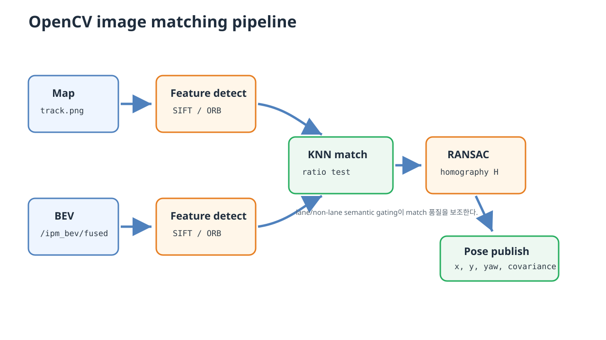
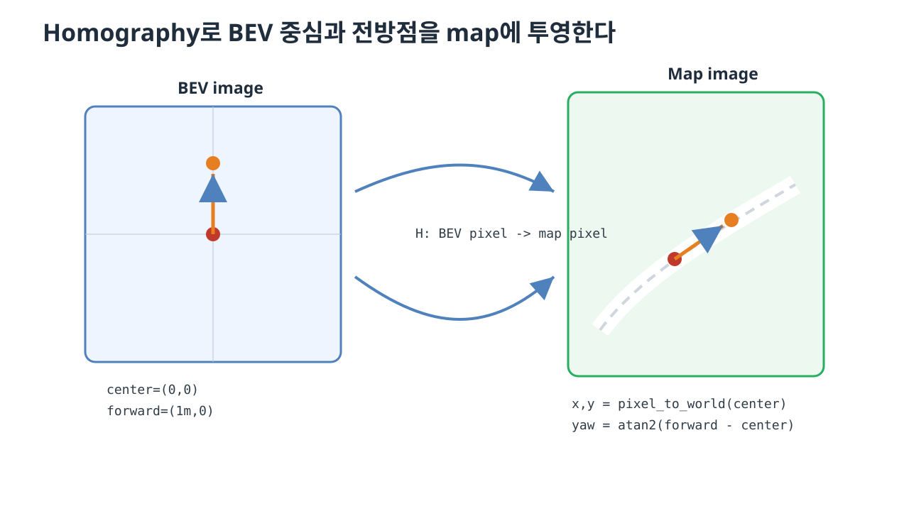
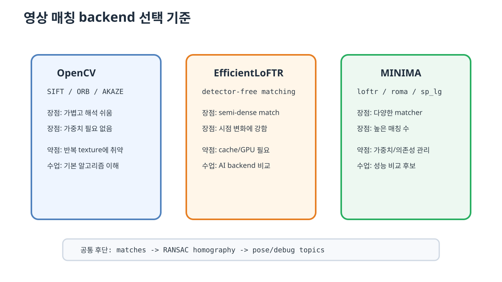

# `Lecture 06: Vision Navigation`
## IPM BEV + Image Matching 기반 전역 위치 추정

방산개방형아키텍처

---

# `1. 오늘의 목표`

오늘은 영상 기반 항법의 한 경로를 구현 코드와 함께 읽는다.

- `/ipm_bev/fused`가 왜 영상 항법 입력인지 설명한다.
- OpenCV SIFT/ORB/AKAZE + KNN ratio test + RANSAC homography 흐름을 이해한다.
- lane mask semantic gating이 왜 들어갔는지 본다.
- `image_match_node`가 pose, odometry, debug image를 publish하는 코드를 추적한다.
- EfficientLoFTR/MINIMA 같은 AI matching backend를 비교한다.

---

# `2. 오늘의 데이터 흐름`

<div class="flow">
  <div class="box">Camera<br>front/rear</div>
  <div class="arrow">→</div>
  <div class="box orange">IPM BEV<br>/ipm_bev/fused</div>
  <div class="arrow">→</div>
  <div class="box">Feature<br>Matching</div>
  <div class="arrow">→</div>
  <div class="box green">Pose<br>/visual_localization</div>
</div>

지도 이미지:

```text
simple_gazebo_track/models/simple_track/materials/textures/track.png
```

---

# `2-1. 그림: Image Matching Pipeline`



---

# `3. 수업 확인 방식`

오늘도 시험/평가 없이 실습 체크포인트로 확인한다.

확인할 것:

```text
/ipm_bev/fused 입력이 들어오는가?
/visual_localization/opencv/debug_matches가 보이는가?
match_count와 inlier_ratio가 publish되는가?
pose가 /odom_gt와 얼마나 비슷한가?
config를 바꾸면 결과가 어떻게 달라지는가?
```

---

# `4. 패키지 구조`

```text
navigation/image_match_node/
├── README.md
├── launch/opencv.launch.py
├── launch/efficientloftr.launch.py
├── launch/minima.launch.py
├── config/opencv_gazebo.yaml
├── config/efficientloftr_gazebo.yaml
├── config/minima_gazebo.yaml
└── opencv_node/
    ├── ros_wrapper.py
    ├── lane_mask.py
    ├── map_geometry.py
    └── chamfer.py
```

---

# `5. Build`

```bash
# 실행 위치: AAC Container
cd /ros_ws/src/aac_2026
./perception/setup_colcon_ignores.sh
cd /ros_ws
colcon build --base-paths src/* --packages-select image_match_node ipm_bev_node aac_vehicle
source install/setup.bash
```

확인:

```bash
# 실행 위치: AAC Container
ros2 pkg executables image_match_node
```

---

# `6. 입력 준비`

Gazebo 차량과 IPM BEV를 먼저 실행한다.

```bash
# 실행 위치: AAC Container
cd /ros_ws/src/aac_2026
./start.sh
```

확인:

```bash
# 실행 위치: AAC Container
ros2 topic hz /ipm_bev/fused
rqt_image_view /ipm_bev/debug
```

---

# `7. OpenCV backend 실행`

`start.sh`에 이미 포함되어 있지만 단독 실행도 가능하다.

```bash
# 실행 위치: AAC Container
source /ros_ws/install/setup.bash
ros2 launch image_match_node opencv.launch.py
```

config 직접 지정:

```bash
# 실행 위치: AAC Container
ros2 launch image_match_node opencv.launch.py \
  config:=/ros_ws/src/aac_2026/navigation/image_match_node/config/opencv_gazebo.yaml
```

---

# `8. 출력 topic`

```bash
# 실행 위치: AAC Container
ros2 topic list | grep visual_localization
```

주요 topic:

```text
/visual_localization/opencv/pose
/visual_localization/opencv/odometry
/visual_localization/opencv/debug_matches
/visual_localization/opencv/homography
/visual_localization/opencv/match_count
/visual_localization/opencv/inlier_ratio
```

---

# `9. 결과 확인`

```bash
# 실행 위치: AAC Container
ros2 topic echo /visual_localization/opencv/pose --once
ros2 topic echo /visual_localization/opencv/match_count --once
ros2 topic echo /visual_localization/opencv/inlier_ratio --once
```

debug image:

```bash
# 실행 위치: AAC Container
rqt_image_view /visual_localization/opencv/debug_matches
```

---

# `10. Pose와 Ground Truth 비교`

```bash
# 실행 위치: AAC Container
ros2 topic echo /visual_localization/opencv/pose --once
ros2 topic echo /odom_gt --once
```

주의:

```text
영상 매칭 pose는 전역 지도 기준 추정값이고,
/odom_gt는 Gazebo world pose 기반 비교값이다.
```

---

# `11. OpenCV config`

```yaml
feature_type: sift
max_features: 6000
ratio_test: 0.72
use_clahe: true
min_matches: 12
min_inliers: 8
min_inlier_ratio: 0.25
homography_method: usac_magsac
ransac_reproj_threshold: 5.0
```

실습에서 먼저 바꿔볼 값:

```text
feature_type: sift -> orb -> akaze
ratio_test: 0.72 -> 0.65 또는 0.80
```

---

# `12. 지도 좌표계`

```yaml
map_x_min: -6.0
map_x_max: 6.0
map_y_min: -8.0
map_y_max: 8.0
map_swap_xy: true
map_flip_x: true
map_flip_y: true
```

Gazebo texture의 U/V 방향이 world X/Y와 직관적으로 일치하지 않는다.

```text
좌표 변환을 틀리면 match는 좋아도 pose가 거울처럼 뒤집힌다.
```

---

# `13. BEV 좌표계`

```yaml
bev_x_min: -10.0
bev_x_max: 10.0
bev_y_min: -6.0
bev_y_max: 6.0
```

BEV 이미지에서:

```text
top    = vehicle front (+X)
left   = vehicle left (+Y)
center = vehicle origin
```

pose 계산은 BEV 중심점과 앞쪽 probe point를 지도에 투영해서 yaw를 만든다.

---

# `14. 알고리즘 흐름`

```text
1. map image load
2. map feature detect/describe
3. BEV image receive
4. BEV feature detect/describe
5. lane/non-lane 분리
6. descriptor KNN match + ratio test
7. RANSAC homography
8. BEV center/forward point projection
9. map-frame pose publish
```

---

# `15. 코드: map load`

`opencv_node/ros_wrapper.py`

```python
self._map_bgr = cv2.imread(self.map_image_path, cv2.IMREAD_COLOR)
if self._map_bgr is None:
    raise FileNotFoundError(
        f'Failed to load map image: {self.map_image_path}')
```

기본 map path는 `simple_gazebo_track` package share에서 찾는다.

---

# `16. 코드: detector 선택`

```python
def _create_detector(self):
    if self.feature_type == 'sift':
        return cv2.SIFT_create(nfeatures=self.max_features), cv2.NORM_L2
    if self.feature_type == 'orb':
        return cv2.ORB_create(nfeatures=self.max_features), cv2.NORM_HAMMING
    return cv2.AKAZE_create(), cv2.NORM_HAMMING
```

| feature | descriptor distance |
|---|---|
| SIFT | L2 |
| ORB | Hamming |
| AKAZE | Hamming |

---

# `17. 코드: grayscale/CLAHE`

```python
def _prepare_gray(self, image):
    gray = cv2.cvtColor(image, cv2.COLOR_BGR2GRAY)
    if self.use_clahe:
        clahe = cv2.createCLAHE(clipLimit=2.0, tileGridSize=(8, 8))
        gray = clahe.apply(gray)
    return gray
```

CLAHE는 조명 차이를 줄이기 위한 contrast 보정이다.

---

# `18. Lane Mask`

`lane_mask.py`

```python
hsv = cv2.cvtColor(bgr, cv2.COLOR_BGR2HSV)
mask = cv2.inRange(
    hsv,
    np.asarray(hsv_lower, dtype=np.uint8),
    np.asarray(hsv_upper, dtype=np.uint8),
)
```

흰색/밝은 차선 영역을 HSV threshold와 morphology로 뽑는다.

---

# `19. Lane Feature Gating`

```python
map_lane_labels = classify_lane_keypoints(
    self._map_keypoints,
    self._map_lane_mask,
    self.lane_feature_dilation_ratio,
)
```

의미:

```text
lane keypoint는 lane keypoint끼리,
non-lane keypoint는 non-lane keypoint끼리 match한다.
```

반복 texture에서 잘못된 대응을 줄이기 위한 장치다.

---

# `20. 코드: KNN match + ratio test`

```python
pairs = self._matcher.knnMatch(
    query_descriptors, map_descriptors, k=2)
good_matches = [
    first for first, second in pairs
    if first.distance < ratio_test * second.distance
]
```

ratio test:

```text
가장 가까운 match가 두 번째 match보다 충분히 더 좋아야 채택한다.
```

---

# `21. 중복 제거`

```python
best_by_map_feature = {}
for match in good_matches:
    previous = best_by_map_feature.get(match.trainIdx)
    if previous is None or match.distance < previous.distance:
        best_by_map_feature[match.trainIdx] = match
```

하나의 지도 feature에 여러 BEV feature가 몰리는 것을 줄인다.

---

# `22. Fallback`

```python
if (self.enable_lane_features
    and self.enable_global_match_fallback
    and semantic_match_count < self.min_matches):
    raw_bev_points, raw_map_points, raw_distances = (
        self._match_features(
            bev_keypoints, bev_descriptors,
            self._map_keypoints, self._map_descriptors,
            self.ratio_test))
```

lane semantic match가 너무 적으면 전체 feature matching으로 되돌아간다.

---

# `23. Homography`

```python
homography, inlier_mask = cv2.findHomography(
    bev_points,
    map_points,
    method,
    self.ransac_reproj_threshold,
)
```

Homography는 평면 위 점들을 다른 이미지 평면으로 보내는 3x3 변환이다.

```text
BEV pixel -> map pixel
```

---

# `23-1. 그림: Homography Pose Estimation`



---

# `24. RANSAC Inlier`

```python
inlier_count = int(np.count_nonzero(inlier_mask))
inlier_ratio = inlier_count / max(1, len(inlier_mask))
if inlier_count < self.min_inliers or inlier_ratio < self.min_inlier_ratio:
    return
```

publish gate:

```text
match 수가 많아도 RANSAC inlier가 부족하면 pose를 발행하지 않는다.
```

---

# `25. Pose 계산`

```python
bev_center = self._bev_metric_to_pixel(0.0, 0.0, width, height)
bev_forward = self._bev_metric_to_pixel(
    self.forward_probe_distance, 0.0, width, height)
projected = cv2.perspectiveTransform(
    np.array([[bev_center, bev_forward]], dtype=np.float32),
    homography,
)[0]
```

차량 중심과 앞쪽 점을 map으로 보낸다.

---

# `26. Yaw 계산`

```python
x, y = self._map_pixel_to_world(center_uv)
forward_x, forward_y = self._map_pixel_to_world(forward_uv)
yaw = math.atan2(forward_y - y, forward_x - x)
```

두 점:

```text
center point -> 위치
forward point -> heading
```

---

# `27. Pose publish`

```python
pose_msg = self._make_pose(source_msg, x, y, yaw, inlier_ratio)
self.pose_pub.publish(pose_msg)
self.odometry_pub.publish(self._make_odometry(pose_msg))
```

출력:

```text
PoseWithCovarianceStamped
Odometry
Homography
Debug image
Diagnostic counts
```

---

# `28. Covariance`

```python
position_variance = max(0.01, (1.0 - inlier_ratio) ** 2)
yaw_variance = max(0.01, (1.0 - inlier_ratio) * 0.5)
```

inlier ratio가 낮을수록 covariance를 크게 둔다.

```text
추정값이 불확실하면 downstream fusion에서 덜 믿게 해야 한다.
```

---

# `29. Debug Image 해석`

README 기준:

```text
lane mask 영역: 노란색 tint
일반 grayscale inlier: 녹색 line
lane 기반 inlier: 자홍색 line
차량 중심 투영점: 빨간 cross
```

확인:

```bash
# 실행 위치: AAC Container
rqt_image_view /visual_localization/opencv/debug_matches
```

---

# `30. Chamfer Refinement`

```yaml
enable_chamfer_refinement: false
chamfer_max_pts: 400
chamfer_score_gate: 20.0
chamfer_min_coverage: 0.8
```

아이디어:

```text
RANSAC homography 이후 BEV lane pixel이 map lane 위에 더 잘 놓이도록
작은 dx, dy, dtheta 보정을 탐색한다.
```

기본은 꺼져 있다.

---

# `31. Feature Type 비교 실습`

```yaml
feature_type: sift
```

다음으로 바꿔본다.

```yaml
feature_type: orb
```

재실행:

```bash
# 실행 위치: AAC Container
ros2 launch image_match_node opencv.launch.py \
  config:=/ros_ws/src/aac_2026/navigation/image_match_node/config/opencv_gazebo.yaml
```

---

# `32. Ratio Test 실습`

```yaml
ratio_test: 0.72
```

낮추면:

```text
더 엄격하다. match 수는 줄고 precision은 좋아질 수 있다.
```

높이면:

```text
더 관대하다. match 수는 늘지만 outlier도 늘 수 있다.
```

---

# `33. AI Backend: EfficientLoFTR`

EfficientLoFTR는 detector-free/semi-dense matching 계열이다.

실행 전 cache 준비:

```bash
# 실행 위치: AAC Container
cd /ros_ws
source install/setup.bash
ros2 run image_match_node prepare_efficientloftr_cache
```

실행:

```bash
# 실행 위치: AAC Container
ros2 launch image_match_node efficientloftr.launch.py
```

---

# `34. EfficientLoFTR cache`

기본 cache:

```text
/ros_ws/src/aac_2026/.hf_home
/ros_ws/src/aac_2026/.hf_home/hub
```

오프라인 확인:

```bash
# 실행 위치: AAC Container
ros2 run image_match_node prepare_efficientloftr_cache -- --local-files-only
```

Git에는 모델 cache를 올리지 않는다.

---

# `35. AI Backend: MINIMA`

MINIMA는 여러 matcher를 감싸 비교할 수 있다.

```yaml
method: sp_lg
ckpt_path: "minima_lightglue.pth"
```

가중치 다운로드:

```bash
# 실행 위치: AAC Container
cd /ros_ws/src/aac_2026/navigation/image_match_node/MINIMA/weights
bash download.sh
```

---

# `36. MINIMA 실행`

```bash
# 실행 위치: AAC Container
cd /ros_ws
source install/setup.bash
ros2 launch image_match_node minima.launch.py \
  config:=/ros_ws/src/aac_2026/navigation/image_match_node/config/minima_gazebo.yaml
```

확인:

```bash
# 실행 위치: AAC Container
ros2 topic echo /visual_localization/pose --once
rqt_image_view /visual_localization/debug_matches
```

---

# `37. Backend 비교`

| Backend | 장점 | 약점 |
|---|---|---|
| SIFT/ORB/AKAZE | 가볍고 해석 쉬움 | 반복 texture에 취약 |
| EfficientLoFTR | texture-poor/큰 시점 변화에 강함 | GPU/cache 필요 |
| MINIMA | 다양한 matcher 비교 가능 | 가중치와 dependency 관리 필요 |

수업에서는 먼저 OpenCV를 이해하고 AI backend를 비교한다.

---

# `37-1. 그림: Backend 선택 기준`



---

# `38. 한계`

현재 track texture는 유사한 차선과 도로 패턴이 반복된다.

가능한 실패:

```text
match_count와 inlier_ratio가 높아도
전역적으로 다른 위치에 잘못 정합될 수 있다.
```

보완 방향:

- 이전 pose 주변 ROI만 검색
- 차량 속도/방향으로 pose jump reject
- LiDAR/odom과 fusion
- map texture/landmark 개선

---

# `39. Dynamic map -> odom`

README의 관계:

```text
T_map_odom = T_map_base_visual * inverse(T_odom_base)
```

현재 기본 실험:

```text
static_tf_tree가 identity map -> odom을 발행한다.
opencv backend는 publish_tf=false.
```

동적 localization으로 바꾸려면 static `map_to_odom.enabled`를 꺼야 한다.

---

# `40. 흔한 실패`

| 증상 | 확인 |
|---|---|
| pose가 안 나옴 | `/ipm_bev/fused`, `min_matches`, `min_inliers` |
| debug image가 없음 | image topic QoS, node log |
| pose가 좌우 반전 | `map_flip_x`, `map_flip_y`, `map_swap_xy` |
| match가 너무 적음 | feature type, CLAHE, ratio test |
| AI backend 실패 | model cache, CUDA, dependency |
| TF 충돌 | `publish_tf`, `static_tf_tree` |

---

# `41. 디버깅 순서`

```text
1. /ipm_bev/fused가 들어오는가?
2. map image path가 올바른가?
3. BEV와 map에서 feature가 충분히 검출되는가?
4. ratio-test match가 min_matches 이상인가?
5. RANSAC inlier가 min_inliers 이상인가?
6. projected center/forward가 map 밖으로 나가지 않는가?
7. 좌표계 flip/swap이 맞는가?
8. /odom_gt와 비교했을 때 오차가 어디서 생기는가?
```

---

# `42. 캡처 후보`

<div class="capture">
<strong>[CAPTURE SLOT]</strong><br>
대상: `/visual_localization/opencv/debug_matches` 화면<br>
확인: map-BEV match line과 차량 중심 투영점을 보여준다.
</div>

<div class="capture">
<strong>[CAPTURE SLOT]</strong><br>
대상: `match_count`, `lane_match_count`, `inlier_ratio` echo 출력<br>
확인: pose publish gate를 수치로 설명한다.
</div>

---

# `43. 실습 체크포인트`

```text
OpenCV backend를 실행했다.
debug_matches 영상을 확인했다.
match_count와 inlier_ratio를 확인했다.
feature_type을 바꿔 결과를 비교했다.
map_flip 값을 바꾸면 pose가 어떻게 망가지는지 이해했다.
EfficientLoFTR cache 개념을 확인했다.
```

---

# `44. 다음 강의로 연결`

다음 강의에서는 LiDAR 기반 항법을 다룬다.

```text
/scan
  -> scan_frame_relay
  -> SLAM Toolbox
  -> /map, map -> odom_lidar
```

영상은 appearance 기반, LiDAR는 geometry 기반이다.

---

# `45. 참고 문서`

- OpenCV feature matching + homography: https://opencv24-python-tutorials.readthedocs.io/en/latest/py_tutorials/py_feature2d/py_feature_homography/py_feature_homography.html
- LoFTR paper: https://arxiv.org/abs/2104.00680
- EfficientLoFTR paper: https://arxiv.org/abs/2403.04765
- EfficientLoFTR project: https://zju3dv.github.io/efficientloftr/
- Hugging Face EfficientLoFTR docs: https://huggingface.co/docs/transformers/en/model_doc/efficientloftr
- Project package: `src/aac_2026/navigation/image_match_node`
