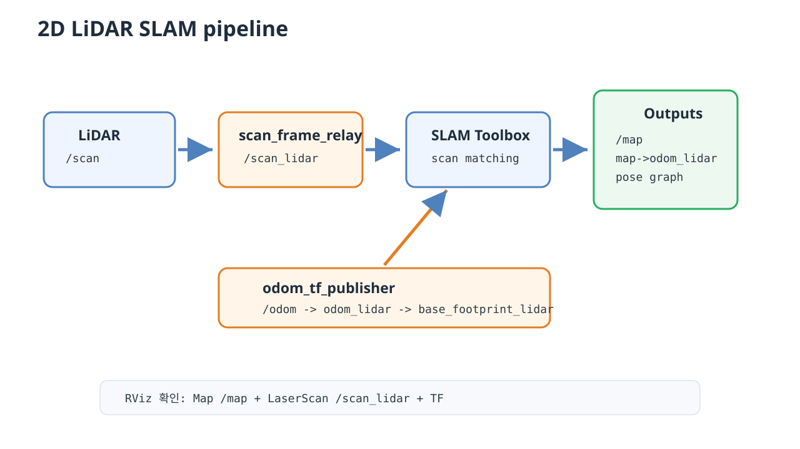
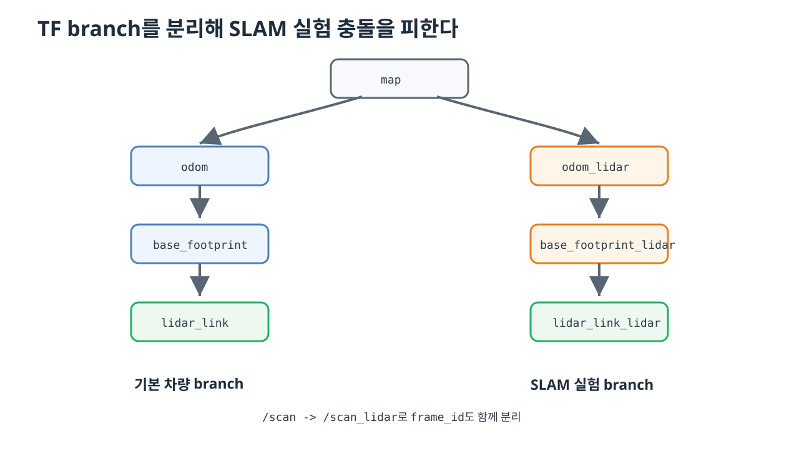
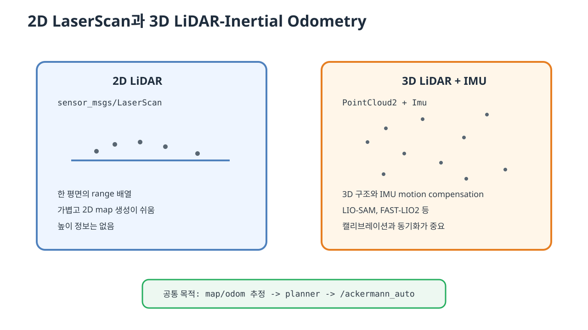

# `Lecture 07: LiDAR Navigation 2D/3D`
## LaserScan SLAM부터 3D LiDAR-Inertial Odometry까지

방산개방형아키텍처

---

# `1. 오늘의 목표`

오늘은 LiDAR 기반 항법을 2D와 3D로 나눠 이해한다.

- `LaserScan` 메시지와 `/scan` topic을 읽는다.
- AAC의 `slam_mapping.launch.py`가 SLAM Toolbox를 어떻게 실행하는지 본다.
- TF 충돌을 피하기 위한 `scan_frame_relay`, `odom_tf_publisher` 구조를 이해한다.
- 2D SLAM과 3D LiDAR odometry/SLAM의 차이를 설명한다.
- AAC2026에서 3D LiDAR를 붙인다면 어떤 인터페이스가 필요한지 정리한다.

---

# `2. 오늘의 큰 그림`

<div class="flow">
  <div class="box">LiDAR<br>/scan</div>
  <div class="arrow">→</div>
  <div class="box orange">Frame relay<br>/scan_lidar</div>
  <div class="arrow">→</div>
  <div class="box">SLAM Toolbox<br>2D map</div>
  <div class="arrow">→</div>
  <div class="box green">Navigation<br>map/odom</div>
</div>

확장:

```text
3D LiDAR + IMU -> LiDAR-Inertial Odometry -> local map / odometry / loop closure
```

---

# `2-1. 그림: 2D LiDAR SLAM Pipeline`



---

# `3. 수업 확인 방식`

이 강의도 시험/평가가 아니라 실습 체크포인트로 진행한다.

오늘 확인:

```text
/scan이 들어오는가?
/scan_lidar로 frame_id가 바뀌는가?
SLAM Toolbox node가 실행되는가?
/map topic이 publish되는가?
TF tree가 분리되어 충돌하지 않는가?
2D/3D LiDAR 항법의 선택 기준을 설명할 수 있는가?
```

---

# `4. LiDAR 메시지`

2D LiDAR는 보통 `sensor_msgs/LaserScan`을 쓴다.

```bash
# 실행 위치: AAC Container
ros2 interface show sensor_msgs/msg/LaserScan
```

핵심 필드:

```text
header.frame_id
angle_min, angle_max, angle_increment
range_min, range_max
ranges[]
intensities[]
```

---

# `5. /scan 확인`

Gazebo 또는 실차 LiDAR를 실행한 뒤:

```bash
# 실행 위치: AAC Container
ros2 topic echo /scan --once
ros2 topic hz /scan
```

frame 확인:

```bash
# 실행 위치: AAC Container
ros2 topic echo /scan --once --field header
```

`header.frame_id`는 TF tree에 반드시 있어야 한다.

---

# `6. Gazebo LiDAR 실행`

```bash
# 실행 위치: AAC Container
source /ros_ws/install/setup.bash
ros2 launch aac_vehicle spawn_vehicle.launch.py
```

확인:

```bash
# 실행 위치: AAC Container
ros2 topic list | grep scan
ros2 topic echo /scan --once
```

Gazebo LiDAR는 `sensors.urdf.xacro`의 `gpu_lidar`에서 나온다.

---

# `7. 실차 RPLiDAR 실행`

Host 장치:

```bash
# 실행 위치: Host Ubuntu
ls /dev/ttyUSB*
dmesg | grep tty | tail -10
```

Container 실행:

```bash
# 실행 위치: AAC Container
ros2 launch rplidar_ros rplidar_a3.launch.py
```

---

# `8. RPLiDAR 설정`

`sensors/rplidar_ros2/launch/rplidar_a3.launch.py`

```python
parameters=[{
    'serial_port': '/dev/ttyUSB0',
    'serial_baudrate': 256000,
    'frame_id': 'lidar_link',
    'inverted': False,
    'angle_compensate': True,
    'scan_mode': 'Sensitivity',
}]
```

A1/A2와 A3/S1은 baudrate가 다를 수 있다.

---

# `9. SLAM Toolbox 실행`

Gazebo vehicle이 실행 중이라면:

```bash
# 실행 위치: AAC Container
source /ros_ws/install/setup.bash
ros2 launch aac_vehicle slam_mapping.launch.py use_sim_time:=true
```

실차라면:

```bash
# 실행 위치: AAC Container
ros2 launch aac_vehicle slam_mapping.launch.py \
  use_sim_time:=false \
  input_odom_topic:=/odom \
  input_scan_topic:=/scan
```

---

# `10. slam_mapping.launch.py 구성`

실행 node:

| Node | 역할 |
|---|---|
| `odom_tf_publisher` | odom topic을 TF로 변환 |
| `scan_frame_relay` | `/scan` frame_id를 SLAM 전용 frame으로 변경 |
| `async_slam_toolbox_node` | 2D SLAM |

이 구조의 목적:

```text
차량 기본 TF와 SLAM 실험용 TF가 충돌하지 않도록 분리한다.
```

---

# `11. TF branch 분리`

기본 차량 branch:

```text
map -> odom -> base_footprint -> base_link -> lidar_link
```

SLAM 비교용 branch:

```text
map -> odom_lidar -> base_footprint_lidar -> lidar_link_lidar
```

같은 LiDAR 데이터를 쓰되 frame 이름을 분리해 SLAM Toolbox가 다시 TF를 발행해도 충돌을 줄인다.

---

# `12. static_tf_tree`

`system/static_tf_tree/config/static_tf_tree.yaml`

```yaml
lidar_slam_mount:
  enabled: true
  parent: base_footprint_lidar
  child: lidar_link_lidar
  xyz: [0.0, 0.0, 0.41]
  rpy: [0.0, 0.0, 0.0]
```

실차 LiDAR 장착 높이와 방향은 여기서 관리한다.

---

# `13. scan_frame_relay`

`system/aac_vehicle/src/scan_frame_relay.cpp`

```cpp
void scanCallback(const sensor_msgs::msg::LaserScan::SharedPtr message)
{
  auto relayed_scan = *message;
  relayed_scan.header.frame_id = output_frame_;
  publisher_->publish(relayed_scan);
}
```

입력:

```text
/scan, frame_id=lidar_link
```

출력:

```text
/scan_lidar, frame_id=lidar_link_lidar
```

---

# `14. scan_frame_relay 확인`

```bash
# 실행 위치: AAC Container
ros2 topic echo /scan --once --field header
ros2 topic echo /scan_lidar --once --field header
```

기대:

```text
/scan       -> lidar_link 계열
/scan_lidar -> lidar_link_lidar
```

SLAM Toolbox는 `/scan_lidar`를 사용한다.

---

# `14-1. 그림: TF Branch 분리`



---

# `15. odom_tf_publisher`

```cpp
transform.header.frame_id = odom_frame_;
transform.child_frame_id = base_frame_;
transform.transform.translation.x = message->pose.pose.position.x;
transform.transform.translation.y = message->pose.pose.position.y;
transform.transform.rotation = message->pose.pose.orientation;
tf_broadcaster_->sendTransform(transform);
```

odometry topic을 TF로 바꾼다.

```text
/odom -> odom_lidar -> base_footprint_lidar
```

---

# `16. SLAM parameter`

`slam_mapper_params.yaml`

```yaml
odom_frame: odom_lidar
map_frame: map
base_frame: base_footprint_lidar
scan_topic: /scan_lidar
mode: mapping
resolution: 0.05
max_laser_range: 12.0
do_loop_closing: true
```

수정 포인트:

- `resolution`
- `min_laser_range`, `max_laser_range`
- loop closure 관련 threshold

---

# `17. /map 확인`

SLAM 실행 후:

```bash
# 실행 위치: AAC Container
ros2 topic echo /map --once
ros2 topic hz /map
```

RViz:

```bash
# 실행 위치: AAC Container
rviz2
```

RViz display:

```text
Map: /map
LaserScan: /scan_lidar
TF
```

---

# `18. Map 저장`

SLAM Toolbox가 map을 만들면 map_saver로 저장할 수 있다.

```bash
# 실행 위치: AAC Container
mkdir -p /ros_ws/maps
ros2 run nav2_map_server map_saver_cli -f /ros_ws/maps/aac_slam_map
```

생성 파일:

```text
aac_slam_map.yaml
aac_slam_map.pgm
```

---

# `19. 2D SLAM이 가정하는 것`

2D LiDAR SLAM은 대체로 다음을 가정한다.

```text
환경은 2D 평면으로 충분히 표현 가능하다.
LiDAR는 수평으로 장착되어 있다.
차량 roll/pitch 변화가 작다.
scan matching이 쓸만한 구조물이 있다.
odometry가 완전히 엉망은 아니다.
```

차선만 있고 벽/구조물이 적은 넓은 평면에서는 약해질 수 있다.

---

# `20. Scan Matching 직관`

SLAM은 현재 scan을 이전 scan 또는 map에 맞춘다.

```text
현재 scan point cloud
  -> 이전 map과 가장 잘 겹치는 x, y, yaw 찾기
  -> odometry와 함께 pose graph에 추가
  -> loop closure로 누적 오차 보정
```

관찰:

```bash
# 실행 위치: AAC Container
ros2 topic list | grep -E "slam|map"
```

---

# `21. 2D LiDAR Navigation 구성`

완성형 항법 stack은 보통 다음 topic을 쓴다.

```text
/scan
/odom
/tf
/map
/cmd_vel 또는 /ackermann_drive
```

AAC는 Ackermann 차량이므로 최종 출력은:

```text
planner/controller -> /ackermann_auto -> joy_control_node -> /ackermann_drive
```

---

# `22. 2D vs 3D LiDAR`

| 항목 | 2D LiDAR | 3D LiDAR |
|---|---|---|
| 메시지 | `LaserScan` | `PointCloud2` |
| 정보 | 한 평면 거리 | 3D 구조 |
| 계산량 | 낮음 | 높음 |
| 장점 | 단순, 실시간 쉬움 | 복잡한 환경 구조 활용 |
| 약점 | 높이 정보 없음 | calibration/IMU/GPU 부담 |

---

# `22-1. 그림: 2D vs 3D LiDAR`



---

# `23. 3D LiDAR 메시지`

3D LiDAR는 보통 `sensor_msgs/PointCloud2`를 쓴다.

```bash
# 실행 위치: AAC Container
ros2 interface show sensor_msgs/msg/PointCloud2
```

주요 필드:

```text
height, width
fields
point_step, row_step
data
is_dense
```

---

# `24. 3D LiDAR Odometry 계열`

대표 흐름:

```text
point cloud preprocessing
  -> feature extraction 또는 direct registration
  -> scan-to-scan / scan-to-map matching
  -> IMU preintegration 또는 motion compensation
  -> local map update
  -> loop closure
```

대표 연구/구현:

- LOAM 계열
- LIO-SAM
- FAST-LIO2
- Cartographer 3D

---

# `25. LIO-SAM 개념`

LIO-SAM은 LiDAR와 IMU를 factor graph로 결합하는 LiDAR-Inertial Odometry/Mapping 계열이다.

필요 입력:

```text
3D LiDAR point cloud
IMU
extrinsic calibration
timestamp synchronization
optional GPS/loop closure
```

AAC에 적용하려면 3D LiDAR, IMU topic, frame calibration이 먼저 필요하다.

---

# `26. FAST-LIO2 개념`

FAST-LIO2는 빠른 LiDAR-Inertial Odometry 계열이다.

핵심 아이디어:

```text
raw point를 feature로 많이 버리지 않고,
효율적인 map structure와 iterated Kalman filter로 빠르게 scan-to-map 정합한다.
```

장점:

- 빠른 실시간성
- 3D 구조 활용

주의:

- 센서 timestamp와 IMU calibration 품질이 중요하다.

---

# `27. 3D LiDAR를 AAC에 붙인다면`

필요한 ROS interface:

```text
/points_raw          sensor_msgs/PointCloud2
/imu/data            sensor_msgs/Imu
/odom_lidar          nav_msgs/Odometry
/tf                  map -> odom_lidar -> base_link
/local_map           PointCloud2 또는 occupancy/grid
```

최종 navigation 연결:

```text
3D localization -> map/odom estimate -> planner -> /ackermann_auto
```

---

# `28. 3D LiDAR 적용 전 체크리스트`

```text
LiDAR frame과 base_link extrinsic
IMU frame과 base_link extrinsic
LiDAR-IMU 시간 동기
PointCloud2 field 이름과 ring/time field
차량 진동과 sensor mounting rigidity
실시간 CPU/GPU 예산
```

3D SLAM은 알고리즘보다 센서 셋업 품질에서 먼저 무너지는 경우가 많다.

---

# `29. AAC에서 지금 당장 가능한 실습`

현재 repository 기준으로 바로 할 수 있는 것은 2D LaserScan 기반 SLAM이다.

```bash
# 실행 위치: AAC Container
cd /ros_ws/src/aac_2026
./start.sh
```

확인:

```bash
# 실행 위치: AAC Container
ros2 topic list | grep -E "scan|map|slam"
rviz2
```

---

# `30. SLAM과 영상 항법 비교`

| 항목 | 영상 매칭 | LiDAR SLAM |
|---|---|---|
| 입력 | BEV image | LaserScan/PointCloud |
| 강점 | 차선/texture 활용 | geometry 활용 |
| 약점 | 조명/반복 texture | 구조물 부족/동적 객체 |
| 출력 | map-frame pose | map, pose graph, TF |
| AAC 역할 | 전역 visual localization | geometry 기반 map/localization |

두 방법은 경쟁이 아니라 상호 보완이다.

---

# `31. Planner와 연결`

LiDAR SLAM 결과는 planner의 입력이 된다.

```text
SLAM -> /map
odom/TF -> robot pose
global planner -> path
local planner/controller -> /ackermann_auto
joy_control_node -> /ackermann_drive
```

다음 강의 이후 path planning과 tracking에서 이 연결을 이어간다.

---

# `32. 흔한 실패`

| 증상 | 확인 |
|---|---|
| `/scan` 없음 | Gazebo/실차 LiDAR 실행 |
| `/scan_lidar` 없음 | `scan_frame_relay` 실행 |
| SLAM이 TF error | `odom_frame`, `base_frame`, static TF |
| map이 업데이트 안 됨 | scan range, odom, movement threshold |
| RViz fixed frame 오류 | `map`, `odom_lidar`, TF tree |
| 실차 LiDAR 연결 실패 | `/dev/ttyUSB*`, baudrate, udev |

---

# `33. 디버깅 순서`

```text
1. sensor_msgs/LaserScan이 들어오는가?
2. header.frame_id가 TF tree에 있는가?
3. /scan_lidar로 frame_id가 바뀌는가?
4. odom topic이 들어오는가?
5. odom -> base TF가 발행되는가?
6. SLAM Toolbox parameter의 frame 이름이 맞는가?
7. /map이 publish되는가?
8. RViz에서 Map/LaserScan/TF가 한 frame에서 보이는가?
```

---

# `34. 캡처 후보`

<div class="capture">
<strong>[CAPTURE SLOT]</strong><br>
대상: RViz에서 `/map`, `/scan_lidar`, TF가 함께 보이는 화면<br>
확인: scan이 map 위에 놓이고 차량 frame이 움직인다.
</div>

<div class="capture">
<strong>[CAPTURE SLOT]</strong><br>
대상: `/scan`과 `/scan_lidar` header 비교 terminal<br>
확인: frame relay가 왜 필요한지 보여준다.
</div>

---

# `35. 실습 체크포인트`

```text
/scan 메시지 구조를 확인했다.
Gazebo 또는 RPLiDAR로 LaserScan을 publish했다.
slam_mapping.launch.py를 실행했다.
/scan_lidar frame_id 변경을 확인했다.
/map topic을 확인했다.
RViz에서 map/scan/TF를 보았다.
2D SLAM과 3D LIO의 입력 차이를 설명했다.
```

---

# `36. 다음 강의로 연결`

다음 강의에서는 planner를 다룬다.

```text
map + robot pose
  -> global path planning
  -> local path planning
  -> path tracking
  -> /ackermann_auto
```

LiDAR 항법은 지도를 만들고 위치를 추정하는 입력이고, planning은 그 위에서 목표까지 가는 경로를 만든다.

---

# `37. 참고 문서`

- SLAM Toolbox ROS 2 Humble docs: https://docs.ros.org/en/humble/p/slam_toolbox/
- Nav2 SLAM tutorial: https://docs.nav2.org/tutorials/docs/navigation2_with_slam.html
- Cartographer ROS docs: https://google-cartographer-ros.readthedocs.io/
- LIO-SAM: https://github.com/TixiaoShan/LIO-SAM
- FAST-LIO2 paper: https://arxiv.org/abs/2107.06829
- Project files: `system/aac_vehicle/launch/slam_mapping.launch.py`, `system/aac_vehicle/config/slam_mapper_params.yaml`
