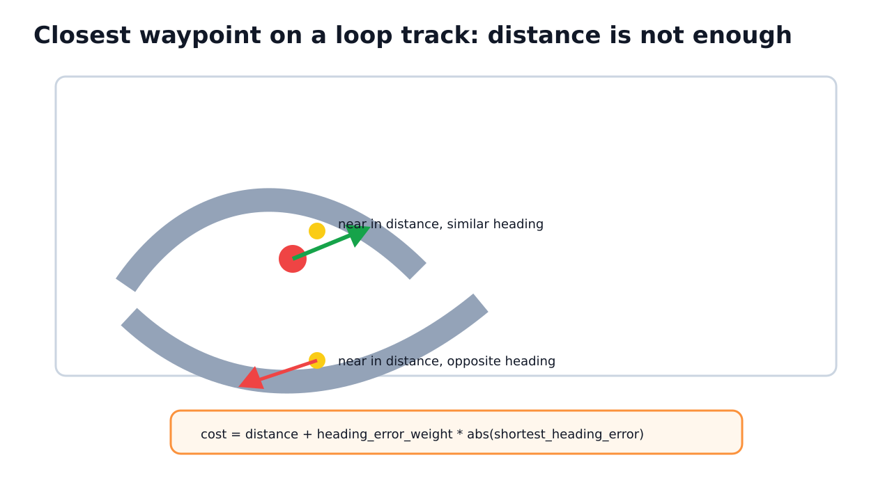
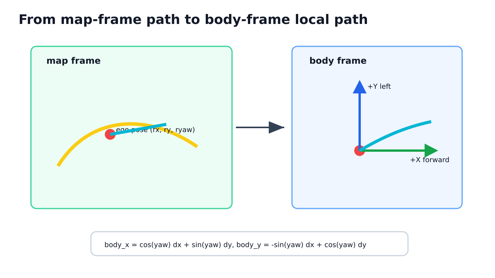
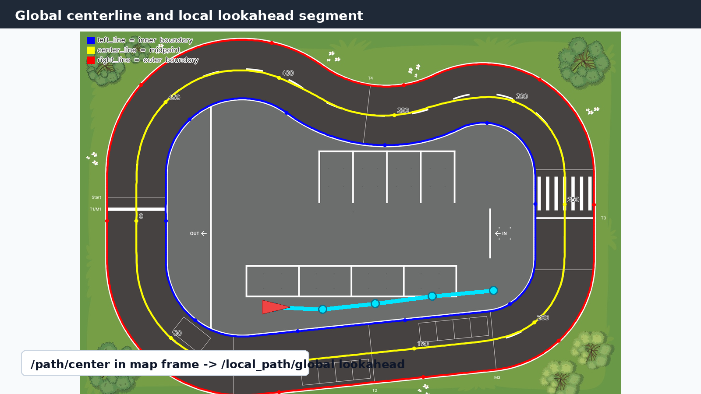
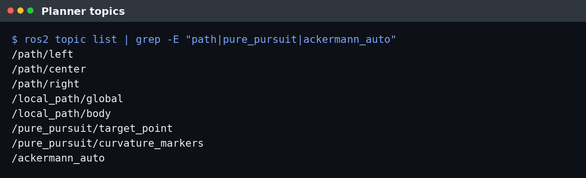

# `Lecture 07: Local Path Planner Node`
## global path에서 body-frame local path 만들기

방산개방형아키텍처

---

# `1. 오늘의 범위`

지난 강의:

```text
map frame global path를 만든다.
예: /path/center
```

오늘 강의:

```text
/path/center + odometry
  -> local_path_planner_node
  -> /local_path/global
  -> /local_path/body
```

Pure pursuit는 마지막에 "다음 연결점" 정도만 본다.

---

# `2. 오늘의 목표`

오늘은 global path를 controller가 쓰기 쉬운 짧은 local path로 바꾸는 코드를 읽는다.

- `/path/center`와 `/odom_gt`가 왜 함께 필요한지 설명한다.
- closest waypoint를 고르는 cost를 이해한다.
- global path에서 lookahead distance만큼 local segment를 자른다.
- map frame path를 body frame path로 변환한다.
- `/local_path/body`가 path tracking 입력이 되는 이유를 이해한다.

---

# `3. 시험/평가 없음`

오늘도 시험 없이 실습 체크포인트로 확인한다.

확인할 것:

- `/path/center`가 들어오는가?
- `/odom_gt` 또는 localization odometry가 들어오는가?
- `/local_path/global`이 차량 주변 짧은 구간으로 보이는가?
- `/local_path/body`에서 앞쪽 waypoint의 `x`가 양수인가?
- `lookahead_dist`, `heading_error_weight`를 바꾸면 결과가 어떻게 변하는가?

---

# `4. 큰 그림`

<div class="flow">
  <div class="box">Global Path<br>/path/center</div>
  <div class="arrow">→</div>
  <div class="box orange">Local Path Planner<br>extract + transform</div>
  <div class="arrow">→</div>
  <div class="box green">Local Path<br>/local_path/body</div>
  <div class="arrow">→</div>
  <div class="box gray">Path Tracking<br>next lecture</div>
</div>

오늘의 핵심은 orange box다.

---

# `5. 왜 local path가 필요한가`

Global path 전체는 너무 길고, 차량 기준으로 정리되어 있지 않다.

controller가 알고 싶은 것은 더 작다.

```text
지금 내 앞에 있는 짧은 경로는 어디인가?
그 경로가 내 차 기준으로 왼쪽인가 오른쪽인가?
얼마나 멀리 봐야 하는가?
```

그래서 global path 전체에서 현재 차량 주변 일부만 잘라낸다.

---

# `6. 입력과 출력`

| 구분 | Topic | Type | Frame |
| --- | --- | --- | --- |
| 입력 | `/path/center` | `nav_msgs/Path` | `map` |
| 입력 | `/odom_gt` | `nav_msgs/Odometry` | path와 같은 global frame |
| 출력 | `/local_path/global` | `nav_msgs/Path` | `map` |
| 출력 | `/local_path/body` | `nav_msgs/Path` | `base_footprint` |

`/local_path/global`은 RViz 확인에 좋다.

`/local_path/body`는 controller 입력이다.

---

# `7. 중요한 frame 가정`

`local_path_planner_node`는 TF lookup을 하지 않는다.

```text
global path frame == odometry pose frame
```

즉 odometry pose가 이미 `/path/center`와 같은 global frame에 있어야 한다.

simulation:

```text
odom_topic: /odom_gt
```

실차:

```text
odom_topic: /odom_estimated
```

---

# `8. 패키지 구조`

```text
planning/local_path_planner_node/
├── config/local_path_planner.yaml
├── launch/local_path_planner.launch.py
├── include/local_path_planner_node/local_path_planner.hpp
├── src/local_path_planner.cpp
└── src/local_path_planner_node.cpp
```

오늘 코드 리뷰:

```text
subscription -> closest waypoint -> local extraction -> body transform -> publish
```

---

# `9. Build`

```bash
# 실행 위치: AAC Container
cd /ros_ws/src/aac_2026
./build.sh --packages-select track_path_publisher local_path_planner_node
source /ros_ws/install/setup.bash
```

확인:

```bash
# 실행 위치: AAC Container
ros2 pkg prefix local_path_planner_node
ros2 pkg executables local_path_planner_node
```

---

# `10. Global path 먼저 실행`

local planner는 `/path/center`가 있어야 동작한다.

```bash
# 실행 위치: AAC Container
source /ros_ws/install/setup.bash
ros2 launch track_path_publisher track_path_publisher.launch.py
```

다른 terminal에서 확인:

```bash
# 실행 위치: Host Ubuntu에서 시작, 이후 AAC Container
aac_enter
# aac_enter 이후부터는 AAC Container
ros2 topic echo --once /path/center
```

---

# `11. local_path_planner 실행`

```bash
# 실행 위치: AAC Container
source /ros_ws/install/setup.bash
ros2 launch local_path_planner_node local_path_planner.launch.py
```

odometry topic을 바꿔 실행:

```bash
# 실행 위치: AAC Container
ros2 launch local_path_planner_node local_path_planner.launch.py \
  --ros-args -p odom_topic:=/odom_estimated
```

---

# `12. Quick Check`

```bash
# 실행 위치: AAC Container
ros2 topic echo --once /path/center
ros2 topic echo --once /odom_gt
ros2 topic echo --once /local_path/global
ros2 topic echo --once /local_path/body
```

성공 신호:

```text
/local_path/global header.frame_id: map
/local_path/body   header.frame_id: base_footprint
poses 배열이 비어 있지 않음
```

---

# `13. Node 초기화 코드`

```cpp
declare_parameter<double>("lookahead_dist", 5.0);
declare_parameter<double>("heading_error_weight", 0.5);
declare_parameter<std::string>("odom_topic", "");
declare_parameter<std::string>("global_path_topic", "/path/center");
declare_parameter<std::string>("local_global_topic", "/local_path/global");
declare_parameter<std::string>("local_body_topic", "/local_path/body");
```

학생이 자주 바꿔볼 값:

- `lookahead_dist`
- `heading_error_weight`
- `odom_topic`

---

# `14. Subscription과 Publisher`

```cpp
rclcpp::QoS latched_qos(1);
latched_qos.transient_local();

sub_odom_ = create_subscription<nav_msgs::msg::Odometry>(
  odom_topic_, rclcpp::SensorDataQoS(),
  std::bind(&LocalPathPlanner::onOdom, this, std::placeholders::_1));

sub_global_path_ = create_subscription<nav_msgs::msg::Path>(
  global_path_topic_, latched_qos,
  std::bind(&LocalPathPlanner::onGlobalPath, this, std::placeholders::_1));

pub_local_global_ = create_publisher<nav_msgs::msg::Path>(local_global_topic_, 10);
pub_local_body_   = create_publisher<nav_msgs::msg::Path>(local_body_topic_, 10);
```

---

# `15. 왜 path는 transient local인가`

`/path/center`는 static global path다.

```text
local_path_planner_node가 나중에 켜져도 마지막 path를 받아야 한다.
```

그래서 global path subscriber도 transient local QoS를 사용한다.

반대로 `/odom_gt`는 계속 변하는 센서성 데이터다.

```text
odom은 SensorDataQoS
path는 transient local QoS
```

---

# `16. Timer Callback 흐름`

```cpp
if (!has_path_) {
  return;
}

if (!has_odom_) {
  return;
}

const double rx = current_pose.position.x;
const double ry = current_pose.position.y;
const double ryaw = yawFromQuaternion(current_pose.orientation);

const size_t closest = findClosestIndex(rx, ry, ryaw);
extractLocalPath(closest, rx, ry, ryaw, ...);
```

입력이 둘 다 있어야 local path를 publish한다.

---

# `17. Closest Waypoint 문제`



---

# `18. Cost 수식`

차량 pose:

```text
r = (r_x, r_y, r_yaw)
```

global waypoint:

```text
p_i = (x_i, y_i, yaw_i)
```

각 waypoint의 cost:

```text
d_i = sqrt((x_i - r_x)^2 + (y_i - r_y)^2)
e_i = abs(shortest_angle(r_yaw, yaw_i))
cost_i = d_i + w_heading * e_i
```

---

# `19. Closest Waypoint 코드`

```cpp
for (size_t i = 0; i < n; ++i) {
  const double dx = global_path_.poses[i].pose.position.x - rx;
  const double dy = global_path_.poses[i].pose.position.y - ry;
  const double distance = std::hypot(dx, dy);

  const double path_yaw =
    yawFromQuaternion(global_path_.poses[i].pose.orientation);
  const double heading_error =
    std::fabs(shortestAngularDistance(ryaw, path_yaw));

  const double cost =
    distance + heading_error_weight_ * heading_error;
}
```

---

# `20. 왜 heading을 같이 보나`

Loop track에서는 위치만 가까운 waypoint가 잘못된 방향일 수 있다.

예:

```text
위치는 가깝지만 반대 차선 또는 반대 진행 방향
```

`heading_error_weight`를 키우면:

- 차량 heading과 path heading이 맞는 점을 더 선호한다.
- 반대편 segment로 튀는 현상이 줄어든다.

---

# `21. Local Path Extraction`

closest waypoint부터 앞으로 `lookahead_dist`만큼 복사한다.

```text
start index = closest waypoint
accumulated distance = 0

while accumulated < lookahead_dist:
  copy current waypoint
  accumulated += distance(current, next)
```

closed-loop track에서는 마지막 waypoint 다음이 첫 waypoint다.

---

# `22. Closed-loop index`

```cpp
for (size_t k = 0; k < n; ++k) {
  const size_t cur  = (start_idx + k)     % n;
  const size_t next = (start_idx + k + 1) % n;

  ...

  accumulated += std::hypot(nx - px, ny - py);
  if (accumulated >= lookahead_dist_) { break; }
}
```

`% n` 덕분에 track 마지막에서 처음으로 자연스럽게 이어진다.

---

# `23. 두 가지 local path`

같은 local segment를 두 좌표계로 publish한다.

```text
/local_path/global
  frame: map
  목적: RViz, marker, 사람이 보기 쉬움

/local_path/body
  frame: base_footprint
  목적: controller가 target을 선택하기 쉬움
```

같은 점들이지만 좌표계가 다르다.

---

# `24. Global에서 Body로`



---

# `25. Body 변환 수식`

먼저 차량 위치를 원점으로 옮긴다.

```text
dx = p_x - r_x
dy = p_y - r_y
```

그 다음 차량 yaw의 반대 방향으로 회전한다.

```text
x_body =  cos(r_yaw) * dx + sin(r_yaw) * dy
y_body = -sin(r_yaw) * dx + cos(r_yaw) * dy
```

이제 차량 앞쪽은 `x_body > 0`이다.

---

# `26. Body 변환 코드`

```cpp
const double cos_yaw = std::cos(ryaw);
const double sin_yaw = std::sin(ryaw);

const double dx = px - rx;
const double dy = py - ry;

ps_body.pose.position.x =  cos_yaw * dx + sin_yaw * dy;
ps_body.pose.position.y = -sin_yaw * dx + cos_yaw * dy;

const double byaw = pyaw - ryaw;
ps_body.pose.orientation.z = std::sin(byaw * 0.5);
ps_body.pose.orientation.w = std::cos(byaw * 0.5);
```

---

# `27. Config`

`planning/local_path_planner_node/config/local_path_planner.yaml`

```yaml
lookahead_dist: 5.0
heading_error_weight: 0.5
update_rate: 100.0
global_frame: "map"
body_frame: "base_footprint"
odom_topic: "/odom_gt"
global_path_topic: "/path/center"
local_global_topic: "/local_path/global"
local_body_topic: "/local_path/body"
```

---

# `28. Tuning 감각`

| Parameter | 키우면 | 줄이면 |
| --- | --- | --- |
| `lookahead_dist` | 더 긴 local segment | 짧고 민감한 segment |
| `heading_error_weight` | 방향 일치 우선 | 거리 우선 |
| `update_rate` | 더 자주 갱신 | 계산량 감소 |

추천 실습:

```text
lookahead_dist: 3.0, 5.0, 8.0을 비교
heading_error_weight: 0.0, 0.5, 2.0을 비교
```

---

# `29. RViz 확인`



봐야 할 것:

- 전체 global centerline 위에 짧은 local segment가 보이는가?
- local segment가 차량 앞쪽으로 이어지는가?
- loop 끝에서 segment가 끊기지 않는가?

---

# `30. RViz 실행`

```bash
# 실행 위치: AAC Container
rviz2 -d /ros_ws/src/aac_2026/rviz/planner.rviz
```

Display에서 확인:

- `/path/center`
- `/local_path/global`
- `/pure_pursuit/target_point`는 다음 연결 확인용
- Fixed frame은 `map`

---

# `31. 문제: local path가 안 나옴`

확인 순서:

```bash
# 실행 위치: AAC Container
ros2 topic echo --once /path/center
ros2 topic echo --once /odom_gt
ros2 node info /local_path_planner_node
ros2 topic echo --once /local_path/body
```

흔한 원인:

- global path publisher가 떠 있지 않음
- odometry topic 이름이 config와 다름
- odometry frame과 path frame이 다름

---

# `32. 문제: local path가 반대편으로 튐`

증상:

- RViz에서 local segment가 차량 앞이 아니라 트랙 반대편으로 잡힌다.
- loop track에서 가까운 다른 segment를 선택한다.

대응:

```yaml
heading_error_weight: 0.5
```

값을 키워서 heading 일치를 더 중요하게 만든다.

---

# `33. 문제: body path가 이상함`

확인:

```bash
# 실행 위치: AAC Container
ros2 topic echo --once /local_path/body
```

봐야 할 것:

- 차량 앞쪽 점은 보통 `pose.position.x > 0`
- 왼쪽 경로는 `pose.position.y > 0`
- 오른쪽 경로는 `pose.position.y < 0`

이 부호가 직관과 다르면 odometry yaw와 frame을 먼저 확인한다.

---

# `34. Pure Pursuit로 이어지는 위치`

<div class="flow">
  <div class="box">/local_path/body</div>
  <div class="arrow">→</div>
  <div class="box orange">pure_pursuit_node</div>
  <div class="arrow">→</div>
  <div class="box green">/ackermann_auto</div>
  <div class="arrow">→</div>
  <div class="box gray">joy_control_node</div>
</div>

오늘은 `/local_path/body`가 controller 입력이라는 점까지만 확실히 잡는다.

---

# `35. Pure Pursuit 미리보기`

body-frame local path에서 target point를 고른다.

```text
target = 처음으로 distance >= lookahead_distance인 forward point
```

steering:

```text
L_d^2 = target_x^2 + target_y^2
curvature = 2 * target_y / L_d^2
steering = atan(wheel_base * curvature)
```

이 수식은 path tracking 강의에서 자세히 다룬다.

---

# `36. 전체 stack 실행`

현재 tmux 설정에는 planner 관련 pane이 포함되어 있다.

```bash
# 실행 위치: AAC Container
cd /ros_ws/src/aac_2026
./start.sh
```

종료:

```bash
# 실행 위치: AAC Container
cd /ros_ws/src/aac_2026
./stop.sh
```

---

# `37. Terminal 캡처 예시`



---

# `38. CAPTURE / VIDEO SLOT`

<div class="capture">
CAPTURE SLOT<br>
대상: RViz에서 /path/center와 /local_path/global이 동시에 보이는 화면<br>
실행 위치: AAC Container<br>
성공 신호: global path 전체와 차량 앞 local segment가 명확히 구분된다.
</div>

```text
[VIDEO SLOT]
목적: 차량이 움직일 때 /local_path/global이 차량 주변에서 갱신되는 장면
추천 길이: 45-90초
삽입 위치: pptx export 후 수동 삽입
```

---

# `39. 오늘의 요약`

오늘의 핵심:

- global path 전체를 controller가 직접 쓰지는 않는다.
- 현재 차량 pose로 closest waypoint를 고른다.
- heading error를 함께 보면 loop track에서 더 안정적이다.
- `lookahead_dist`만큼 global path를 잘라 `/local_path/global`을 만든다.
- 같은 점들을 body frame으로 바꿔 `/local_path/body`를 만든다.
- `/local_path/body`가 path tracking의 입력이 된다.

---

# `40. 다음 강의`

다음 주제는 path tracking이다.

질문:

- `/local_path/body`에서 어떤 target point를 고를 것인가?
- target point를 조향각으로 어떻게 바꿀 것인가?
- 곡률이 큰 구간에서 속도를 어떻게 낮출 것인가?
- `/ackermann_auto`를 joystick gate와 어떻게 연결할 것인가?

---

# `41. 참고 자료`

로컬 자료:

- `planning/local_path_planner_node/README.md`
- `planning/local_path_planner_node/src/local_path_planner.cpp`
- `planning/local_path_planner_node/config/local_path_planner.yaml`
- `control/pure_pursuit_node/README.md`
- `rviz/planner.rviz`

