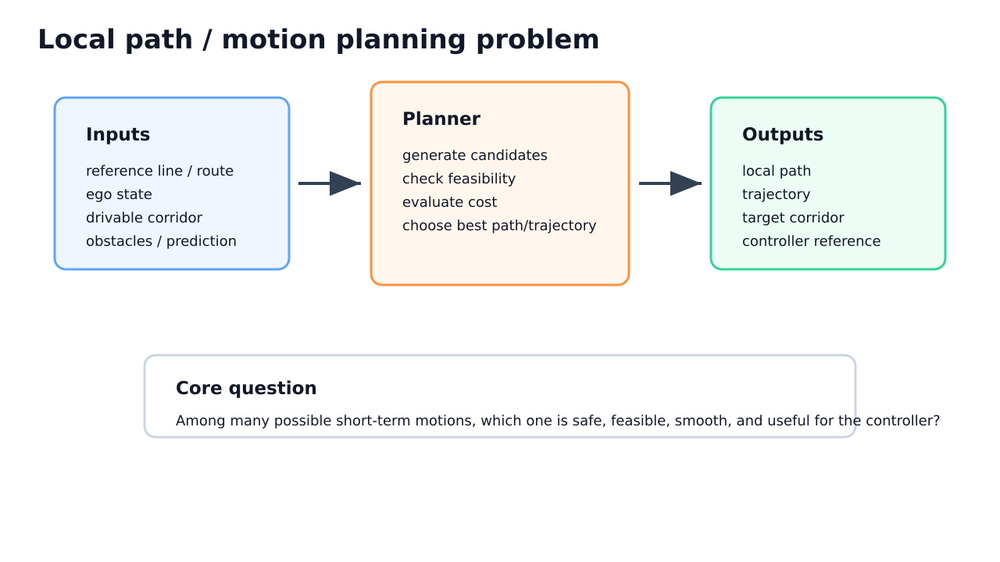
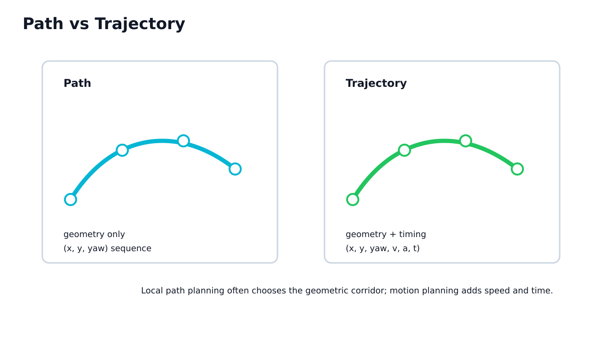
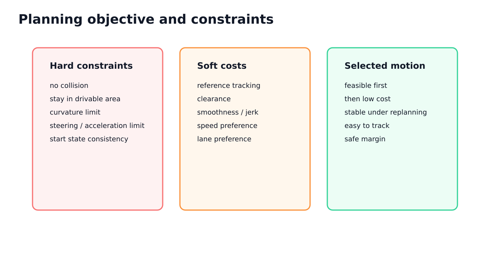
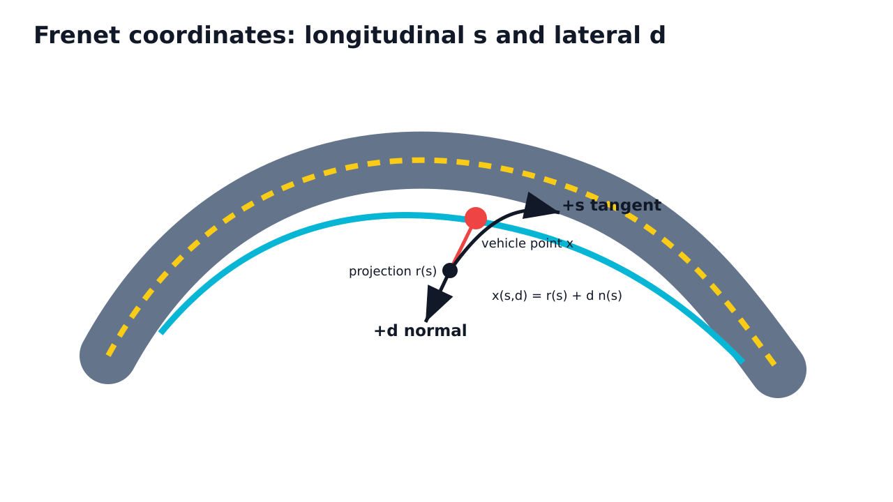
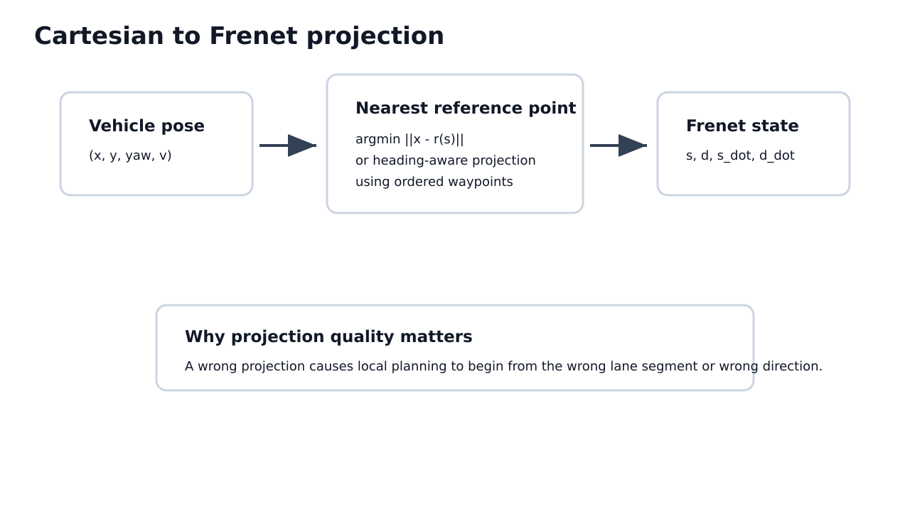
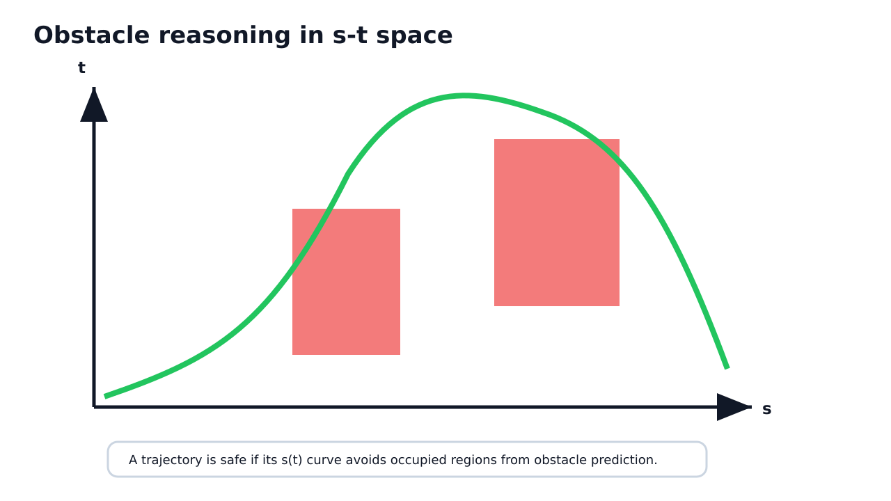
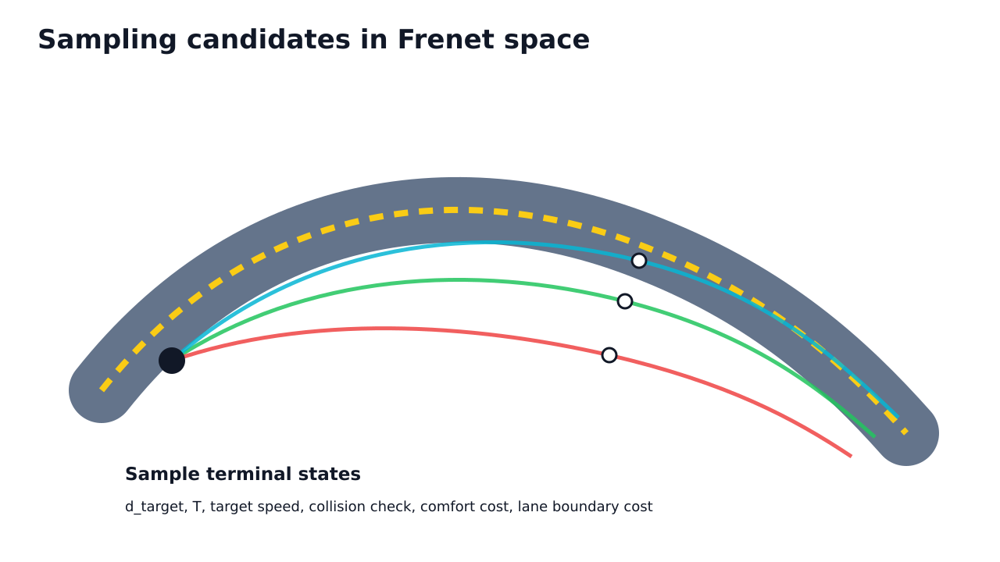
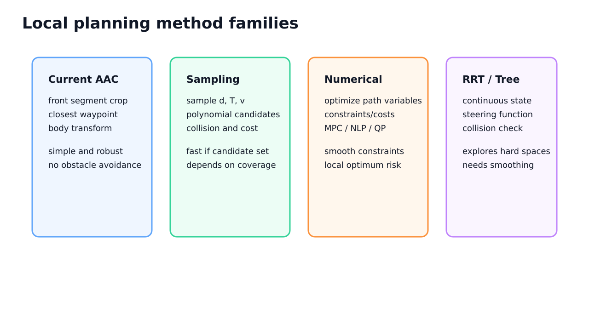
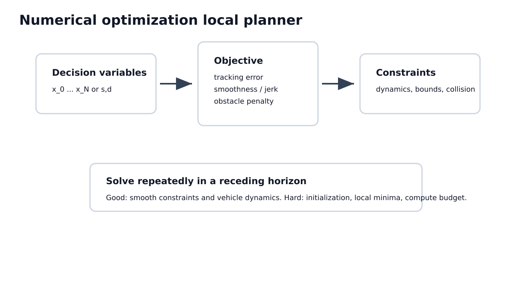
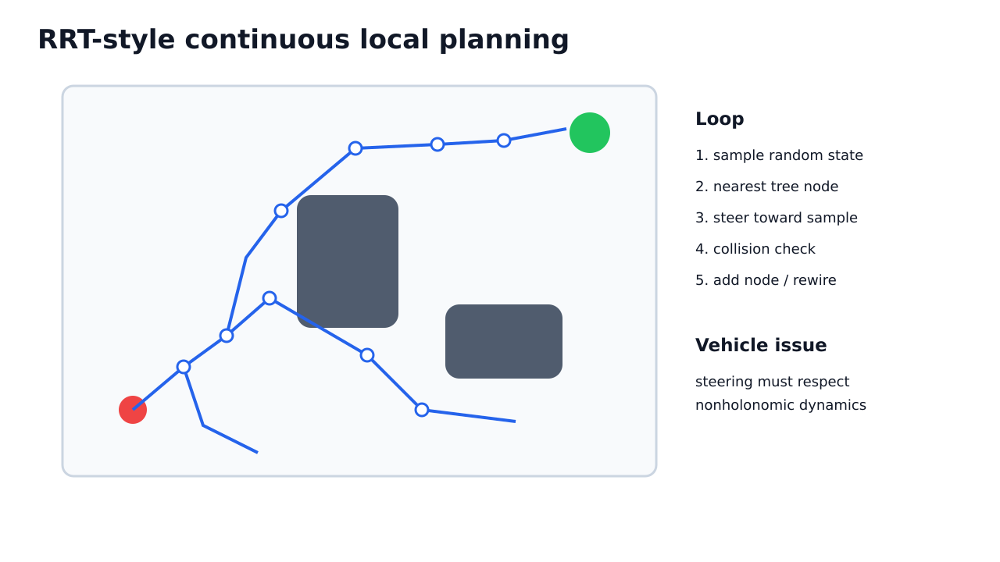

# `Lecture 07: Local Path & Motion Planning`
## Frenet coordinates, sampling, optimization, RRT

방산개방형아키텍처

---

# `1. 오늘의 범위`

지난 강의:

```text
HD map / LaneletRoute / global path
```

오늘 강의:

```text
global path를 reference line으로 보고,
현재 차량 주변에서 안전하고 추종 가능한 local path/motion을 만드는 문제
```

오늘은 구현 명령보다 local path/motion planning 개념과 Frenet 수식에 집중한다.

---

# `2. 오늘의 목표`

수업이 끝나면 다음을 설명할 수 있어야 한다.

- global path와 local path planning의 역할 차이
- local path와 trajectory의 차이
- Frenet coordinates의 `s`, `d` 의미
- projection, tangent, normal, curvature 관계
- polynomial candidate의 boundary condition과 jerk cost
- sampling, numerical optimization, RRT 계열 planner의 차이
- AAC2026 Frenet node가 개념적으로 어디에 붙는지

---

# `4. Planning 계층에서의 위치`

<div class="flow">
  <div class="box">Mission<br>Route</div>
  <div class="arrow">→</div>
  <div class="box gray">Behavior<br>Decision</div>
  <div class="arrow">→</div>
  <div class="box orange">Local Path / Motion<br>Planning</div>
  <div class="arrow">→</div>
  <div class="box green">Path Tracking<br>Control</div>
</div>

오늘은 orange box를 본다.

```text
Route는 큰 방향을 주고, local planning은 지금 몇 초/몇 m를 어떻게 갈지 정한다.
```

---

# `5. 문제 정의`



---

# `6. Local Path vs Motion Planning`

| 구분 | 질문 | 출력 |
| --- | --- | --- |
| local path planning | 어디를 지나갈 것인가? | `(x, y, yaw)` path |
| motion planning | 언제, 어떤 속도로 지날 것인가? | `(x, y, yaw, v, a, t)` trajectory |
| path tracking | 지금 조향/속도를 얼마로 줄 것인가? | steering, speed |

실제 시스템에서는 local path와 motion planning이 분리되기도 하고, 하나의 planner에서 함께 풀리기도 한다.

---

# `7. Path vs Trajectory`



---

# `8. Reference Line`

대부분의 도로 주행 local planner는 reference line을 가진다.

reference line의 예:

- Lanelet centerline
- global path waypoint
- behavior planner가 고른 lane center
- 이전 planning cycle의 smoothed path

reference line이 있으면 완전한 2D 탐색 대신 기준선 주변의 작은 corridor를 탐색할 수 있다.

---

# `9. Planning Horizon`

Local planner는 무한히 먼 미래를 풀지 않는다.

대표 horizon:

```text
distance horizon: 앞으로 5 m, 20 m, 50 m
time horizon: 앞으로 2 s, 5 s, 8 s
```

trade-off:

- 짧은 horizon: 빠르고 반응적이지만 멀리 보지 못한다.
- 긴 horizon: 더 부드럽고 예측적이지만 계산량과 불확실성이 증가한다.

---

# `10. 무엇을 만족해야 하나`



---

# `11. Hard Constraint와 Soft Cost`

Hard constraint:

```text
절대 위반하면 안 되는 조건
collision, lane boundary, steering limit, acceleration limit
```

Soft cost:

```text
낮을수록 좋은 선호도
centerline tracking, clearance, smoothness, travel time, comfort
```

planner는 보통 이렇게 생각한다.

```text
feasible한 후보만 남기고, 그중 cost가 가장 낮은 것을 선택한다.
```

---

# `12. Frenet Coordinates`



---

# `13. Reference Line`

reference line을 arc length `s`로 parameterize한다.

```text
r(s) = [x_r(s), y_r(s)]^T
s: reference line을 따라간 arc length
||dr/ds|| = 1
```

reference heading:

```text
theta_r(s) = atan2(dy_r/ds, dx_r/ds)
```

curvature:

```text
kappa_r(s) = d theta_r / ds
```

---

# `14. Tangent와 Normal`

tangent vector:

```text
t(s) = dr/ds = [cos theta_r(s), sin theta_r(s)]^T
```

left normal vector:

```text
n(s) = [-sin theta_r(s), cos theta_r(s)]^T
```

Frenet 위치 표현:

```text
x(s, d) = r(s) + d n(s)
```

`s`는 전진 거리, `d`는 기준선에서 옆으로 벗어난 거리다.

---

# `15. Cartesian에서 Frenet으로`



---

# `16. Projection 수식`

차량 위치 `x`를 reference line에 투영한다.

```text
s* = argmin_s || x - r(s) ||^2
d  = sign((x - r(s*)) · n(s*)) || x - r(s*) ||
```

projection이 잘 되면 오차 벡터는 tangent와 거의 수직이다.

```text
(x - r(s*)) · t(s*) ≈ 0
```

waypoint path에서는 `s_i`를 누적 arc length로 두고 가장 가까운 index를 discrete projection으로 쓴다.

---

# `17. Projection이 어려운 경우`

projection은 단순 거리만 보면 불안정할 수 있다.

불안정한 경우:

- loop track에서 반대편 segment가 위치상 더 가까움
- reference line이 self-intersection을 가짐
- waypoint 간격이 너무 큼
- 차량 heading과 reference tangent가 크게 다름

보완:

```text
cost = distance + w_heading * |heading_error|
```

또는 last projection index 주변의 search window만 본다.

---

# `18. Frenet 속도 관계`

차량 속도 크기를 `v`, 차량 heading을 `theta`라고 하자.

heading error:

```text
Delta theta = theta - theta_r(s)
```

자주 쓰는 관계:

```text
s_dot = v cos(Delta theta) / (1 - kappa_r d)
d_dot = v sin(Delta theta)
```

의미:

- `d = 0`, `Delta theta = 0`이면 `s_dot = v`
- curve에서 `1 - kappa_r d`는 좌표 변환의 scale factor다.

---

# `19. Frenet 가속도 감각`

Frenet planner는 보통 `s(t)`, `d(t)`를 직접 만든다.

```text
s_dot, d_dot      : longitudinal / lateral velocity
s_ddot, d_ddot    : longitudinal / lateral acceleration
s_dddot, d_dddot  : longitudinal / lateral jerk
```

승차감과 제어 난이도는 jerk와 curvature에 민감하다.

```text
jerk가 크다 -> 급격한 움직임
curvature가 크다 -> 큰 조향각 필요
```

---

# `20. Frenet을 쓰는 이유`

도로 주행 문제에서는 reference line이 강력한 prior다.

Frenet을 쓰면:

- lane centerline을 기준으로 lateral offset `d`를 직접 제어할 수 있다.
- lane change를 `d_target` 변화로 표현하기 쉽다.
- longitudinal progress `s(t)`와 lateral motion `d(t)`를 분리해서 설계할 수 있다.
- obstacle을 `s-d` 또는 `s-t` space에 투영해 후보 path를 평가할 수 있다.

단, projection이 불안정하면 Frenet planner도 불안정하다.

---

# `21. Obstacle in s-t Space`



---

# `22. Werling et al.의 Frenet 아이디어`

Werling et al.은 dynamic street scenario에서 Frenet-frame trajectory generation을 제안했다.

핵심 아이디어:

- center line을 reference로 둔다.
- lateral motion `d(t)`와 longitudinal motion `s(t)`를 나누어 생각한다.
- jerk, time, terminal offset 등을 cost로 둔다.
- 여러 terminal condition을 만들고 collision-free 후보 중 cost가 낮은 trajectory를 선택한다.

수업에서는 이 아이디어를 local path/motion planning 관점으로 단순화해 본다.

---

# `23. Lateral Polynomial`

Frenet candidate의 lateral motion은 quintic polynomial로 만들 수 있다.

```text
d(t) = a0 + a1 t + a2 t^2 + a3 t^3 + a4 t^4 + a5 t^5
```

boundary condition:

```text
d(0)      = d0
d_dot(0)  = d0_dot
d_ddot(0) = d0_ddot

d(T)      = dT
d_dot(T)  = 0
d_ddot(T) = 0
```

6개 조건으로 6개 계수 `a0 ... a5`를 결정한다.

---

# `24. Longitudinal Polynomial`

longitudinal motion은 목표에 따라 quartic 또는 quintic으로 둘 수 있다.

speed keeping 예:

```text
s(t) = b0 + b1 t + b2 t^2 + b3 t^3 + b4 t^4
```

boundary condition:

```text
s(0)      = s0
s_dot(0)  = v0
s_ddot(0) = a0

s_dot(T)  = v_target
s_ddot(T) = 0
```

정지/도착 위치를 정확히 맞추는 문제라면 `s(T)`까지 조건에 넣어 quintic을 쓸 수 있다.

---

# `25. Jerk와 Comfort Cost`

승차감은 jerk를 줄이는 문제로 자주 표현한다.

```text
jerk_d(t) = d'''(t)
jerk_s(t) = s'''(t)
```

lateral cost 예:

```text
J_d = K_J ∫_0^T jerk_d(t)^2 dt
    + K_T T
    + K_D d(T)^2
```

longitudinal cost 예:

```text
J_s = K_J ∫_0^T jerk_s(t)^2 dt
    + K_T T
    + K_V (s_dot(T) - v_target)^2
```

---

# `26. Total Cost`

Frenet candidate의 총 비용은 lateral과 longitudinal cost를 합친다.

```text
J_total = K_LAT J_d + K_LON J_s
```

실제 local planner에서는 여기에 항을 더 붙인다.

```text
J = J_total
  + K_obs J_obstacle
  + K_curv J_curvature
  + K_bound J_boundary
  + K_prev J_transient
```

Hard constraint를 위반한 후보는 cost 비교 전에 제거한다.

---

# `27. Sampling 후보 생성`



---

# `28. Sampling 기반 Planner`

후보를 많이 만들고, valid한 후보 중 가장 좋은 것을 고른다.

```text
for d_target in lateral_offsets:
  for T in time_horizons:
    for v_target in target_speeds:
      generate candidate s(t), d(t)
      convert to x,y
      collision check
      compute cost
choose min-cost valid candidate
```

장점:

- 구현이 직관적이다.
- candidate 수를 제한하면 실시간성이 좋다.
- Frenet reference line과 잘 맞는다.

---

# `29. Sampling의 한계`

sampling planner는 후보 set 밖의 solution을 찾지 못한다.

예:

- `d_target` grid가 너무 거칠면 좋은 path를 놓친다.
- time horizon이 부적절하면 후보가 모두 급하거나 느리다.
- obstacle이 복잡하면 후보 수가 급격히 늘어난다.

그래서 sampling planner는 좋은 candidate design, 빠른 collision checking, 적절한 replan frequency가 중요하다.

---

# `30. 방법 분류`



---

# `31. Paden et al. Survey의 관점`

사용자가 준 IEEE 7490340 논문은 self-driving urban vehicle의 planning/control survey다.

수업에서 가져올 관점:

- route planning, behavior decision, motion planning, control을 계층으로 나눈다.
- path planning과 trajectory planning을 구분한다.
- motion planning 방법을 variational/numerical, graph search, sampling-based, incremental search 등으로 비교한다.
- RRT/RRT*는 continuous 또는 high-dimensional state space를 탐색하는 대표적인 incremental tree 계열이다.

---

# `32. Numerical Optimization`



---

# `33. Numerical Planner 수식`

local motion을 직접 변수로 둔다.

```text
z = [x_0, y_0, yaw_0, v_0, ..., x_N, y_N, yaw_N, v_N]
```

목표:

```text
minimize J(z)
```

subject to:

```text
vehicle dynamics
lane boundary
obstacle clearance
curvature / steering / acceleration limits
initial state consistency
```

---

# `34. MPC와 Receding Horizon`

Motion planner가 trajectory와 control을 함께 풀면 MPC 구조와 가까워진다.

```text
1. 현재 state에서 horizon N까지 optimization
2. 첫 control 또는 첫 trajectory segment만 실행
3. 다음 cycle에서 새 state로 다시 optimization
```

장점:

- dynamics와 constraint를 직접 반영한다.
- replanning으로 새 obstacle과 state error에 반응한다.

어려운 점:

- solver 시간, infeasible 처리, 좋은 초기값이 중요하다.

---

# `35. RRT-style Continuous Planning`



---

# `36. RRT 알고리즘 감각`

RRT는 tree를 자라게 하며 reachable space를 탐색한다.

```text
V = {x_start}
E = {}

while time budget remains:
  x_rand = sample_free_state()
  x_near = nearest(V, x_rand)
  sigma = steer(x_near, x_rand)
  if collision_free(sigma):
    x_new = end(sigma)
    V.add(x_new)
    E.add(x_near -> x_new)
```

---

# `37. RRT에서 중요한 함수`

`sample()`:

- uniform, goal bias, lane corridor bias

`nearest()`:

- Euclidean distance, time-to-reach, vehicle-aware metric

`steer()`:

- 차량이 실제로 갈 수 있는 motion segment를 만드는가?
- Dubins, Reeds-Shepp, forward simulation, MPC steering

`collision_free()`:

- segment 전체가 obstacle과 충돌하지 않는가?

---

# `38. RRT와 RRT*`

RRT:

- feasible path를 빠르게 찾는 데 강하다.
- 결과 path가 거칠고 suboptimal일 수 있다.

RRT*:

- 새 node 주변을 다시 연결하는 rewiring을 한다.
- 시간이 충분하면 더 좋은 path로 수렴하는 성질을 목표로 한다.
- 계산량은 증가한다.

자율주행 local planner에서는 RRT 결과를 그대로 controller에 주기보다 smoothing/optimization을 붙이는 경우가 많다.

---

# `39. 어떤 방법을 고를까`

| 상황 | 어울리는 방법 |
| --- | --- |
| reference line이 좋고 도로 구조가 명확함 | Frenet sampling |
| dynamics와 comfort constraint가 중요함 | numerical optimization / MPC |
| 복잡한 obstacle 공간을 통과해야 함 | RRT/RRT* 계열 |
| 실시간 baseline이 필요함 | reference crop + tracking |
| 실차 안정성이 중요함 | 단순 baseline + fail-safe + 점진 확장 |

---

# `40. AAC2026과의 연결`

AAC2026은 다음 순서로 확장하기 좋다.

```text
global path crop baseline
  -> Frenet projection
  -> lateral candidate sampling
  -> lightweight cost selection
  -> obstacle/costmap term 추가
  -> selected local path를 controller 입력으로 사용
```

새 `frenet_local_planning_node`는 이 중 Frenet candidate sampling과 cost selection의 출발점에 해당한다.

---

# `41. 본문 요약`

오늘의 핵심:

- local path planning은 global route를 짧은 horizon의 주행 기준으로 바꾸는 문제다.
- motion planning은 path에 시간과 속도까지 붙이는 문제다.
- Frenet coordinates는 reference line 주변의 도로 주행 문제를 `s`, `d`로 단순화한다.
- projection, tangent/normal, curvature 관계가 Frenet planner 안정성의 핵심이다.
- polynomial candidate는 boundary condition과 jerk cost로 설계할 수 있다.
- sampling planner는 candidate를 만들고 collision/cost로 고른다.
- numerical planner와 RRT 계열은 더 복잡한 constraint와 탐색 문제를 다룬다.

---

# `42. 참고 자료`

논문과 자료:

- B. Paden et al., "A Survey of Motion Planning and Control Techniques for Self-driving Urban Vehicles", IEEE T-IV, 2016.  
  https://ieeexplore.ieee.org/document/7490340
- arXiv version of Paden et al.  
  https://arxiv.org/abs/1604.07446
- M. Werling et al., "Optimal Trajectory Generation for Dynamic Street Scenarios in a Frenet Frame", ICRA 2010.  
  https://doi.org/10.1109/ROBOT.2010.5509799

