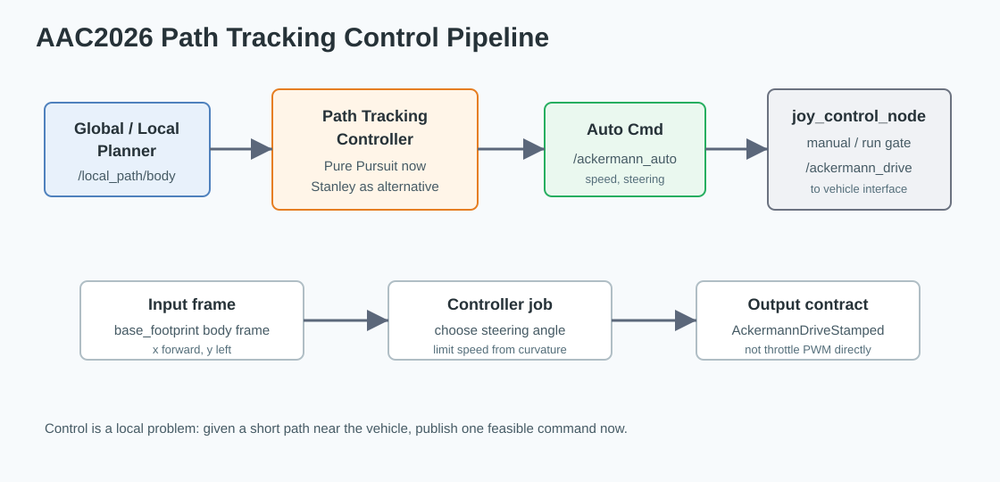
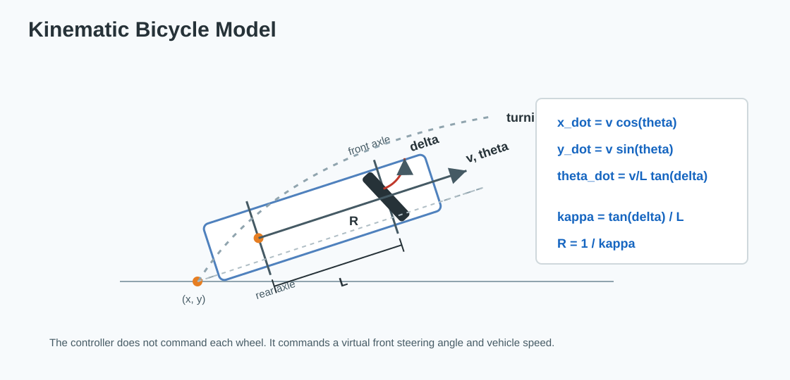
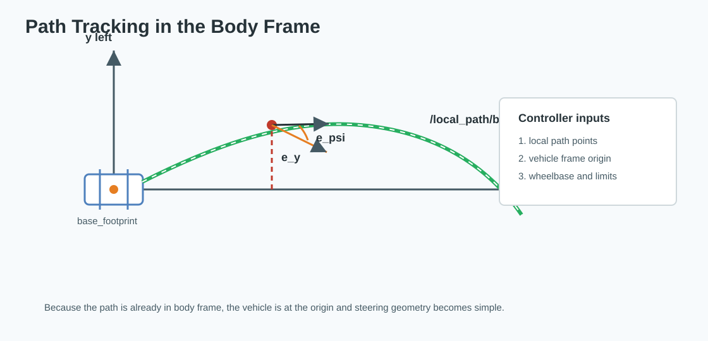
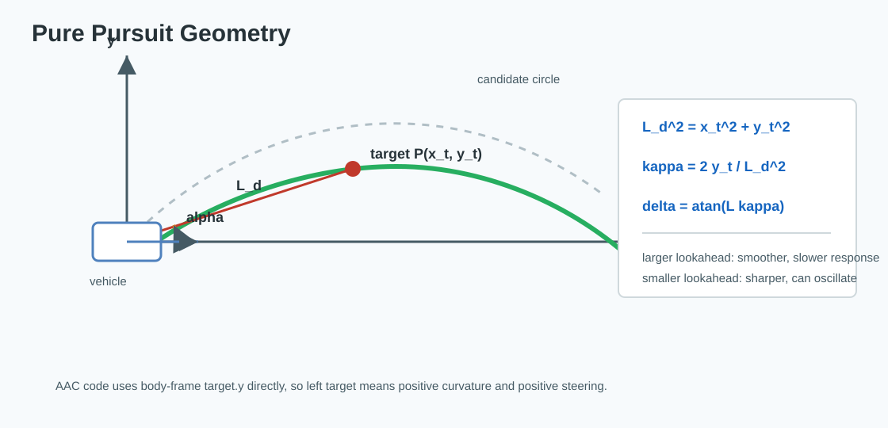
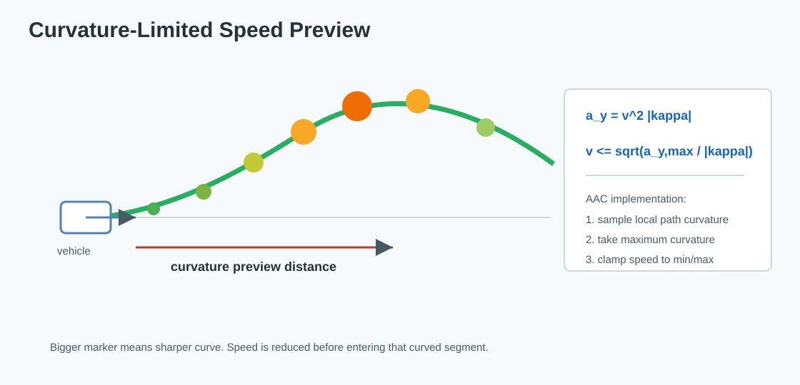
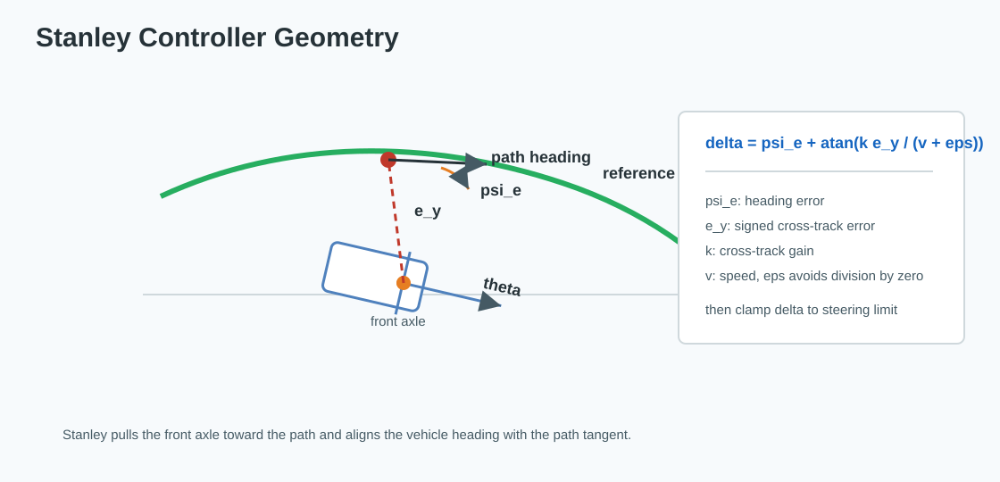
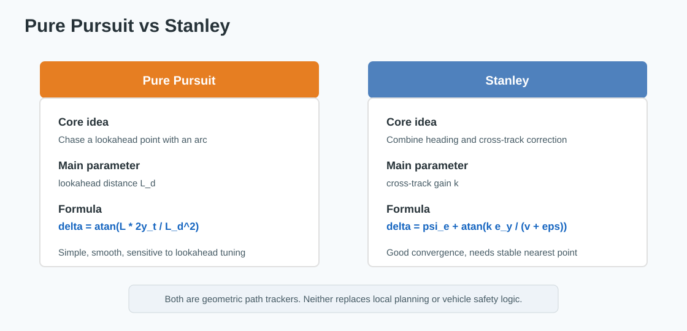

# `Lecture 08: Path Tracking Control`
## Kinematic bicycle model, Pure Pursuit, Stanley method

방산개방형아키텍처

---

# `1. 오늘의 범위`

지난 강의:

```text
global path planning -> local path / motion planning
```

오늘 강의:

```text
local path를 받아서 지금 당장 줄 조향각과 속도 명령을 계산한다.
```

오늘은 local path tracking control을 다룬다.

구현은 AAC2026의 `control/pure_pursuit_node`를 중심으로 본다.

---

# `2. 오늘의 목표`

수업이 끝나면 다음을 설명할 수 있어야 한다.

- 자율주행 제어에서 kinematic bicycle model을 쓰는 이유
- Ackermann 차량에서 curvature, steering angle, wheelbase의 관계
- Pure Pursuit의 lookahead target과 조향 수식
- Stanley method의 heading error와 cross-track error 항
- `pure_pursuit_node`가 `/local_path/body`를 `/ackermann_auto`로 바꾸는 과정
- lookahead, steering limit, speed limit을 어떻게 튜닝하는지

평가는 없고, 각 구간별로 실행 확인과 코드 읽기 checkpoint를 진행한다.

---

# `3. Planning에서 Control로`

<div class="flow">
  <div class="box">Global<br>Route</div>
  <div class="arrow">→</div>
  <div class="box orange">Local Path / Motion<br>Planning</div>
  <div class="arrow">→</div>
  <div class="box green">Path Tracking<br>Control</div>
  <div class="arrow">→</div>
  <div class="box gray">Vehicle<br>Interface</div>
</div>

오늘 보는 문제:

```text
path가 주어졌을 때, 차량이 그 path를 따라가도록 steering과 speed를 정한다.
```

Control은 planner를 대체하지 않는다.

---

# `4. AAC2026 제어 파이프라인`



---

# `5. Controller의 입력과 출력`

입력:

| Topic | Type | 의미 |
| --- | --- | --- |
| `/local_path/body` | `nav_msgs/msg/Path` | body frame local path, 실제 제어 입력 |
| `/local_path/global` | `nav_msgs/msg/Path` | RViz marker를 map frame에 그리기 위한 보조 입력 |

출력:

| Topic | Type | 의미 |
| --- | --- | --- |
| `/ackermann_auto` | `ackermann_msgs/msg/AckermannDriveStamped` | 자율주행용 속도/조향 명령 |
| `/pure_pursuit/target_point` | `visualization_msgs/msg/Marker` | lookahead target |
| `/pure_pursuit/curvature_markers` | `visualization_msgs/msg/MarkerArray` | preview curvature |

---

# `6. 오늘 다루지 않는 것`

Path tracking controller가 직접 해결하지 않는 문제:

- global route 선택
- obstacle avoidance candidate 생성
- lane change decision
- localization
- actuator calibration
- emergency stop safety

오늘의 controller는 이렇게 생각한다.

```text
주어진 local path가 이미 안전하고 주행 가능하다고 가정하고,
그 path를 최대한 잘 추종하는 command를 만든다.
```

---

# `7. Kinematic Model이 필요한 이유`

차량은 옆으로 미끄러지듯 움직일 수 없다.

따라서 controller는 다음 제약을 생각해야 한다.

```text
속도 v와 조향각 delta를 주면,
차량은 어떤 곡률 kappa로 회전하는가?
```

저속, 작은 slip, 일반적인 교육용 시뮬레이션에서는 kinematic model이 좋은 출발점이다.

---

# `8. Kinematic Bicycle Model`



---

# `9. Bicycle Model의 변수`

| 기호 | 의미 | AAC 예시 |
| --- | --- | --- |
| `x, y` | rear axle 또는 기준점의 위치 | `base_footprint` 근처 |
| `theta` | 차량 yaw heading | x축 방향이 전방 |
| `v` | 차량 속도 | m/s |
| `delta` | 가상 front wheel steering angle | rad |
| `L` | wheelbase | `0.80 m` |
| `kappa` | path curvature | `1/m` |

실제 네 바퀴의 steering geometry를 하나의 가상 앞바퀴로 단순화한다.

---

# `10. Bicycle Model 수식`

연속 시간 kinematic bicycle model:

```text
x_dot     = v cos(theta)
y_dot     = v sin(theta)
theta_dot = v / L * tan(delta)
```

curvature와 steering angle 관계:

```text
kappa = theta_dot / v = tan(delta) / L
delta = atan(L * kappa)
```

중요한 해석:

```text
조향각 delta를 크게 줄수록 curvature가 커지고, 회전 반경 R = 1 / kappa는 작아진다.
```

---

# `11. 조향각 제한`

AAC 차량 파라미터:

```yaml
wheelbase: 0.80
track_width: 0.46
wheel_radius: 0.08
max_steering_angle: 0.524  # rad, about 30 deg
max_speed: 3.0
publish_rate: 20.0
```

조향각은 항상 제한해야 한다.

```text
-delta_max <= delta <= delta_max
```

제한하지 않으면 controller가 모델 또는 actuator가 낼 수 없는 명령을 만들 수 있다.

---

# `12. Ackermann Command`

`pure_pursuit_node`는 직접 Gazebo joint나 PWM을 제어하지 않는다.

```text
AckermannDriveStamped
  header
  drive.speed
  drive.steering_angle
```

이 메시지를 `/ackermann_auto`로 발행하고, `joy_control_node`가 run mode에서 이를 `/ackermann_drive`로 넘긴다.

```text
controller -> autonomous command
joy_control_node -> manual/auto gate
vehicle interface -> actual actuator command
```

---

# `13. Body Frame에서 문제를 풀기`



---

# `14. 왜 `/local_path/body`가 중요한가`

`/local_path/body`는 차량 기준 좌표계의 path다.

```text
vehicle origin = (0, 0)
x > 0: 차량 앞
y > 0: 차량 왼쪽
y < 0: 차량 오른쪽
```

장점:

- target point의 `x, y`를 바로 steering geometry에 쓸 수 있다.
- controller가 map 좌표계에서 현재 차량 pose를 다시 계산할 필요가 줄어든다.
- local path planner와 controller의 책임이 분리된다.

---

# `15. Tracking Error`

Path tracking에서 자주 보는 오차:

```text
e_y   : cross-track error, path에서 옆으로 얼마나 벗어났는가
e_psi : heading error, path tangent와 차량 heading이 얼마나 다른가
```

Pure Pursuit는 명시적으로 `e_y`, `e_psi`를 분리해서 쓰기보다 target point geometry로 조향을 만든다.

Stanley는 두 항을 직접 더한다.

```text
delta = heading correction + cross-track correction
```

---

# `16. Lateral Acceleration`

곡률이 큰 path를 빠르게 달리면 lateral acceleration이 커진다.

```text
a_y = v^2 |kappa|
```

comfort와 안정성을 위해 다음 제한을 둔다.

```text
a_y <= a_y,max
```

따라서 곡률 기반 속도 제한:

```text
v <= sqrt(a_y,max / |kappa|)
```

AAC `pure_pursuit_node`는 이 아이디어로 속도를 낮춘다.

---

# `17. Pure Pursuit 개념`

Pure Pursuit는 매우 오래 쓰인 geometric path tracking 알고리즘이다.

핵심 아이디어:

```text
차량 앞쪽의 lookahead point를 하나 고르고,
차량이 그 점을 지나가는 원호를 따라간다고 가정한다.
```

입력:

- body-frame local path
- lookahead distance `L_d`
- wheelbase `L`

출력:

- steering angle `delta`

---

# `18. Pure Pursuit Geometry`



---

# `19. Lookahead Target`

AAC 구현의 target selection:

```text
1. local path point를 앞에서부터 본다.
2. x < min_forward_x인 점은 무시한다.
3. distance >= lookahead_distance인 첫 점을 target으로 고른다.
4. 없으면 마지막 forward point를 fallback target으로 쓴다.
```

의미:

- 너무 가까운 점은 조향을 불안정하게 만들 수 있다.
- 차량 뒤쪽 점을 따라가면 명령 방향이 이상해진다.
- lookahead가 커지면 부드럽지만 반응이 느려진다.

---

# `20. Pure Pursuit 수식 1`

target point:

```text
P = (x_t, y_t)
```

lookahead distance:

```text
L_d = sqrt(x_t^2 + y_t^2)
```

heading과 target 사이 각도:

```text
sin(alpha) = y_t / L_d
```

차량이 target을 지나는 원호를 따른다고 보면, 원호 curvature가 steering command의 기준이 된다.

---

# `21. Pure Pursuit 수식 2`

원호 curvature:

```text
kappa = 2 sin(alpha) / L_d
```

`sin(alpha) = y_t / L_d`를 대입하면:

```text
kappa = 2 y_t / L_d^2
      = 2 y_t / (x_t^2 + y_t^2)
```

steering angle:

```text
delta = atan(L * kappa)
```

---

# `22. Code Review: Target Selection`

`control/pure_pursuit_node/src/pure_pursuit.cpp`

```cpp
for (size_t i = 0; i < local_path_.poses.size(); ++i) {
  const auto & point = local_path_.poses[i].pose.position;
  if (point.x < min_forward_x_) {
    continue;
  }

  const double dist = std::hypot(point.x, point.y);
  if (dist >= lookahead_distance_) {
    target = point;
    target_index = i;
    return true;
  }
}
```

이 코드는 body-frame path라는 전제에 강하게 의존한다.

---

# `23. Code Review: Steering`

`control/pure_pursuit_node/src/pure_pursuit.cpp`

```cpp
double PurePursuit::computeSteeringAngle(
  const geometry_msgs::msg::Point & target) const
{
  const double lookahead_sq = target.x * target.x + target.y * target.y;
  if (lookahead_sq <= 1.0e-9) {
    return 0.0;
  }

  const double curvature = 2.0 * target.y / lookahead_sq;
  const double steering = std::atan(wheel_base_ * curvature);
  return clampValue(steering, -max_steering_angle_, max_steering_angle_);
}
```

---

# `24. Lookahead Tuning`

`lookahead_distance`는 Pure Pursuit의 핵심 파라미터다.

| 너무 작을 때 | 너무 클 때 |
| --- | --- |
| 빠르게 반응함 | 부드러움 |
| 좌우 흔들림 가능 | 코너를 늦게 돎 |
| waypoint noise에 민감 | tight curve 추종이 둔함 |

초기 튜닝 감각:

```text
저속/좁은 코스: 0.8 m ~ 1.5 m
중속/부드러운 코스: 1.5 m ~ 3.0 m
```

AAC 기본값은 `2.0 m`다.

---

# `25. Curvature Speed Preview`



---

# `26. Code Review: Speed Limit`

```cpp
double PurePursuit::computeCurvatureLimitedSpeed() const
{
  double max_curvature = 0.0;
  for (const auto & sample : collectCurvatureSamples()) {
    max_curvature = std::max(max_curvature, sample.curvature);
  }

  if (max_curvature <= curvature_epsilon_) {
    return max_speed_;
  }

  const double curve_speed = std::sqrt(lateral_accel_limit_ / max_curvature);
  return clampValue(curve_speed, min_speed_, max_speed_);
}
```

곡률이 작으면 `max_speed`, 곡률이 커지면 `sqrt(a_y,max / curvature)`로 감속한다.

---

# `27. Discrete Curvature`

Path point 세 개를 이용해 현재 점 근처의 곡률을 추정한다.

```text
prev, current, next
```

연속 곡선에서 curvature:

```text
kappa = |x' y'' - y' x''| / (x'^2 + y'^2)^(3/2)
```

AAC 코드는 waypoint 세 점으로 `x'`, `y'`, `x''`, `y''`를 근사한다.

이 값은 steering에는 직접 쓰지 않고, speed preview와 marker visualization에 사용된다.

---

# `28. Parameter File`

`control/pure_pursuit_node/config/pure_pursuit.yaml`

```yaml
pure_pursuit_node:
  ros__parameters:
    local_path_topic: "/local_path/body"
    global_path_topic: "/local_path/global"
    command_topic: "/ackermann_auto"
    wheel_base: 0.80
    lookahead_distance: 2.0
    max_steering_angle: 0.524
    max_speed: 1.0
    min_speed: 0.0
    lateral_accel_limit: 0.25
    curvature_preview_distance: 2.5
    curvature_preview_points: 30
```

---

# `29. Build`

```bash
# 실행 위치: AAC Container
cd /ros_ws/src/aac_2026
./build.sh --packages-select pure_pursuit_node
source /ros_ws/install/setup.bash
```

확인:

```bash
# 실행 위치: AAC Container
ros2 pkg executables pure_pursuit_node
ros2 pkg prefix pure_pursuit_node
```

예상:

```text
pure_pursuit_node pure_pursuit_exe
```

---

# `30. Run`

Pure Pursuit node 실행:

```bash
# 실행 위치: AAC Container
source /ros_ws/install/setup.bash
ros2 launch pure_pursuit_node pure_pursuit.launch.py
```

config override:

```bash
# 실행 위치: AAC Container
source /ros_ws/install/setup.bash
ros2 launch pure_pursuit_node pure_pursuit.launch.py \
  config:=/ros_ws/src/aac_2026/control/pure_pursuit_node/config/pure_pursuit.yaml
```

---

# `31. Topic Quick Check`

local path 입력 확인:

```bash
# 실행 위치: AAC Container
ros2 topic echo --once /local_path/body
```

auto command 출력 확인:

```bash
# 실행 위치: AAC Container
ros2 topic echo --once /ackermann_auto
```

marker 확인:

```bash
# 실행 위치: AAC Container
ros2 topic echo --once /pure_pursuit/target_point
ros2 topic echo --once /pure_pursuit/curvature_markers
```

---

# `32. RViz에서 볼 것`

RViz marker:

- `PurePursuit Target`: lookahead target point
- `PurePursuit Curvature`: preview curvature marker

marker가 보이지 않을 때:

```text
1. /local_path/global이 publish되는지 확인
2. RViz fixed frame이 map인지 확인
3. marker topic display가 켜져 있는지 확인
4. visualize_markers parameter가 true인지 확인
```

<div class="capture">
캡처 삽입 위치: RViz에서 local path, target sphere, curvature markers가 함께 보이는 화면
</div>

---

# `33. Runtime Parameter Tuning`

Pure Pursuit 튜닝:

```bash
# 실행 위치: AAC Container
ros2 param set /pure_pursuit_node lookahead_distance 1.5
ros2 param set /pure_pursuit_node max_speed 0.8
ros2 param set /pure_pursuit_node lateral_accel_limit 0.2
```

현재 parameter 확인:

```bash
# 실행 위치: AAC Container
ros2 param get /pure_pursuit_node lookahead_distance
ros2 param get /pure_pursuit_node max_speed
ros2 param get /pure_pursuit_node lateral_accel_limit
```

topic 이름 parameter는 restart가 필요하다.

---

# `34. Pure Pursuit Failure Modes`

흔한 문제와 원인:

| 현상 | 확인할 것 |
| --- | --- |
| 좌우로 흔들림 | lookahead가 너무 작음, path가 noisy함 |
| 코너를 크게 벗어남 | lookahead가 너무 큼, max steering이 부족함 |
| 명령이 0으로 멈춤 | local path가 비어 있음, forward point가 없음 |
| RViz marker가 안 보임 | global path frame, fixed frame, display 설정 |
| 너무 빠르게 코너 진입 | lateral_accel_limit 또는 curvature preview 설정 |

---

# `35. Stanley Method 개념`

Stanley method는 DARPA Grand Challenge 차량 Stanley에서 널리 알려진 path tracking controller다.

핵심 아이디어:

```text
front axle을 path 위로 끌어당기는 cross-track correction과
path tangent에 맞추는 heading correction을 더한다.
```

Pure Pursuit가 target point를 추적한다면, Stanley는 closest path point와 heading error를 직접 사용한다.

---

# `36. Stanley Geometry`



---

# `37. Stanley 수식`

대표적인 형태:

```text
delta = psi_e + atan(k e_y / (v + eps))
```

기호:

| 기호 | 의미 |
| --- | --- |
| `delta` | steering angle command |
| `psi_e` | path tangent heading과 vehicle heading의 차이 |
| `e_y` | signed cross-track error |
| `k` | cross-track gain |
| `v` | vehicle speed |
| `eps` | zero division 방지용 작은 값 |

마지막에는 항상 steering limit으로 clamp한다.

---

# `38. Stanley Heading Term`

heading term:

```text
psi_e = theta_path - theta_vehicle
```

의미:

```text
차량이 path와 같은 방향을 보도록 조향한다.
```

예시:

- 차량 heading이 path보다 오른쪽을 보고 있으면 왼쪽으로 조향
- 차량 heading이 path보다 왼쪽을 보고 있으면 오른쪽으로 조향

단, 실제 구현에서는 좌표계와 steering sign convention을 반드시 맞춰야 한다.

---

# `39. Stanley Cross-Track Term`

cross-track term:

```text
atan(k e_y / (v + eps))
```

의미:

- `e_y`가 크면 path 쪽으로 더 강하게 조향한다.
- `k`가 크면 lateral error 보정이 강해진다.
- `v`가 커지면 같은 error에 대한 correction이 작아져 고속에서 안정적이다.

저속에서 `v`가 0에 가까우면 term이 과도해질 수 있으므로 `eps`를 둔다.

---

# `40. Front Axle Reference`

Stanley는 일반적으로 front axle point의 cross-track error를 사용한다.

이유:

```text
조향으로 직접 움직이는 기준점이 front axle에 가깝기 때문이다.
```

rear axle 또는 `base_footprint` 기준 path를 쓰는 시스템에서는 변환이 필요하다.

```text
front_x = base_x + L_front * cos(theta)
front_y = base_y + L_front * sin(theta)
```

AAC의 `/local_path/body`를 그대로 쓸 때는 front axle 기준으로 해석할지, base 기준으로 단순화할지 설계를 정해야 한다.

---

# `41. Stanley 구현 Pseudocode`

```text
input: local path in body frame, speed v

1. choose closest path point to front axle
2. compute path heading theta_path from neighbor points
3. compute heading error psi_e
4. compute signed cross-track error e_y
5. delta = psi_e + atan(k * e_y / (v + eps))
6. clamp delta to steering limit
7. publish AckermannDriveStamped
```

Pure Pursuit보다 nearest point와 path heading 계산이 중요하다.

---

# `42. Body Frame에서 Stanley를 단순화하면`

차량 heading을 body frame x축으로 두면:

```text
theta_vehicle = 0
```

closest point 근처 path heading:

```text
theta_path = atan2(y_{i+1} - y_i, x_{i+1} - x_i)
```

signed cross-track error는 body frame에서 대략 `closest_y`로 볼 수 있다.

```text
e_y ~= closest_y
```

정확한 구현에서는 path tangent의 normal vector에 error vector를 projection한다.

---

# `43. Stanley Tuning`

주요 parameter:

| Parameter | 커지면 | 작아지면 |
| --- | --- | --- |
| `k` | path로 더 강하게 복귀 | 복귀가 느림 |
| `eps` | 저속 correction 완화 | 저속에서 조향 급변 가능 |
| speed filter | 안정적 | 반응 빠름 |
| heading smoothing | 노이즈 감소 | 코너 반응 둔화 |

Stanley는 closest point와 heading 계산이 noisy하면 조향도 noisy해진다.

---

# `44. Pure Pursuit vs Stanley`



---

# `45. 어떤 Controller를 고를까`

Pure Pursuit가 좋은 경우:

- local path가 매끄럽고 waypoint가 충분히 촘촘함
- 빠르게 구현하고 안정적인 baseline이 필요함
- lookahead tuning으로 주행 감각을 맞추고 싶음

Stanley가 좋은 경우:

- cross-track error를 명시적으로 줄이고 싶음
- heading alignment를 강하게 반영하고 싶음
- closest point와 path heading을 안정적으로 계산할 수 있음

교육용 baseline은 Pure Pursuit가 직관적이고 코드 리뷰가 쉽다.

---

# `46. AAC Pure Pursuit Node 구조`

`control/pure_pursuit_node/include/pure_pursuit/pure_pursuit.h`

```cpp
void localPathCallback(const nav_msgs::msg::Path::SharedPtr msg);
bool makeCommand(ackermann_msgs::msg::AckermannDriveStamped & cmd);
bool selectTargetPoint(geometry_msgs::msg::Point & target, size_t & target_index) const;
double computeSteeringAngle(const geometry_msgs::msg::Point & target) const;
double computeCurvatureLimitedSpeed() const;
std::vector<CurvatureSample> collectCurvatureSamples() const;
```

읽는 순서:

```text
localPathCallback -> makeCommand -> selectTargetPoint
                  -> computeSteeringAngle
                  -> computeCurvatureLimitedSpeed
```

---

# `47. Callback Driven 구조`

`pure_pursuit_node`는 timer 기반으로 오래된 path를 재사용하지 않는다.

```text
새로운 /local_path/body가 들어오면 바로 command를 하나 계산한다.
```

장점:

- local planner 출력과 command가 자연스럽게 동기화된다.
- stale path를 계속 따라가는 위험이 줄어든다.

주의:

- local path publish가 멈추면 command도 새로 나오지 않는다.
- 실제 차량에서는 watchdog 또는 stop policy가 별도로 필요하다.

---

# `48. Empty Path 처리`

local path가 비어 있으면 stop command를 발행한다.

```cpp
if (local_path_.poses.empty()) {
  RCLCPP_WARN_THROTTLE(
    get_logger(), *get_clock(), 2000,
    "Received empty local body path on '%s'", local_path_topic_.c_str());
  publishStop(frame_id);
  return;
}
```

controller는 path가 없을 때 임의로 직진하면 안 된다.

---

# `49. Auto Command Gate`

`pure_pursuit_node` 출력:

```text
/ackermann_auto
```

`joy_control_node` 역할:

```text
run mode이고 수동 입력이 없으면 /ackermann_auto를 /ackermann_drive로 넘긴다.
```

즉, controller가 command를 만든다고 항상 차량이 움직이는 것은 아니다.

manual stop/run state도 함께 봐야 한다.

---

# `50. 전체 실행 순서 예시`

local planner와 controller가 이미 build되어 있다고 가정한다.

```bash
# 실행 위치: AAC Container
source /ros_ws/install/setup.bash
ros2 launch pure_pursuit_node pure_pursuit.launch.py
```

다른 terminal에서 topic graph 확인:

```bash
# 실행 위치: AAC Container
source /ros_ws/install/setup.bash
rqt_graph
```

<div class="capture">
캡처 삽입 위치: rqt_graph에서 /local_path/body -> pure_pursuit_node -> /ackermann_auto 흐름
</div>

---

# `51. Command 값을 직접 보기`

```bash
# 실행 위치: AAC Container
ros2 topic echo /ackermann_auto --field drive
```

예상 형태:

```text
steering_angle: 0.08
steering_angle_velocity: 0.0
speed: 0.75
acceleration: 0.0
jerk: 0.0
```

확인 포인트:

- 직선에서는 steering angle이 0에 가까운가?
- 코너에서는 steering sign이 예상 방향과 맞는가?
- 곡률이 커질 때 speed가 줄어드는가?

---

# `52. Parameter Sweep 실습`

lookahead를 바꾸며 주행 감각 비교:

```bash
# 실행 위치: AAC Container
ros2 param set /pure_pursuit_node lookahead_distance 1.0
ros2 param set /pure_pursuit_node lookahead_distance 2.0
ros2 param set /pure_pursuit_node lookahead_distance 3.0
```

lateral acceleration limit 비교:

```bash
# 실행 위치: AAC Container
ros2 param set /pure_pursuit_node lateral_accel_limit 0.15
ros2 param set /pure_pursuit_node lateral_accel_limit 0.25
ros2 param set /pure_pursuit_node lateral_accel_limit 0.50
```

---

# `53. 실험 기록 양식`

각 조는 아래처럼 기록한다.

| 실험 | lookahead | lateral accel limit | 관찰 |
| --- | ---: | ---: | --- |
| A | `1.0` | `0.25` | 흔들림, 빠른 반응 |
| B | `2.0` | `0.25` | baseline |
| C | `3.0` | `0.25` | 부드럽지만 코너 반응 느림 |
| D | `2.0` | `0.15` | 코너에서 더 느림 |

평가 제출용이 아니라 controller 튜닝 감각을 잡는 기록이다.

---

# `54. 화면 캡처 추천`

슬라이드나 실습 노트에 넣으면 좋은 화면:

- RViz local path와 Pure Pursuit target point
- curvature marker가 코너에서 커지는 화면
- `/ackermann_auto`의 steering/speed echo
- `rqt_graph` 제어 파이프라인
- parameter 변경 전후의 주행 비교 영상

<div class="capture">
영상 삽입 위치: lookahead 1.0 / 2.0 / 3.0 주행 비교
</div>

---

# `55. Stanley를 AAC에 붙인다면`

Pure Pursuit와 동일한 output contract를 유지한다.

```text
/local_path/body -> stanley_controller_node -> /ackermann_auto
```

필요한 추가 정보:

- 현재 속도 `v`, 또는 command speed estimate
- closest point 계산
- local path heading 계산
- cross-track gain `k`
- steering sign convention 검증

출력 topic은 바꾸지 않으면 `joy_control_node`와 vehicle interface는 그대로 쓸 수 있다.

---

# `56. Stanley Node Skeleton`

```cpp
// input: nav_msgs::msg::Path local_path
// output: ackermann_msgs::msg::AckermannDriveStamped

closest = findClosestPoint(local_path, front_axle);
theta_path = headingFromNeighborPoints(local_path, closest.index);
psi_e = normalizeAngle(theta_path - theta_vehicle);
e_y = signedCrossTrackError(front_axle, closest, theta_path);

delta = psi_e + std::atan(k * e_y / (speed + eps));
cmd.drive.steering_angle = clamp(delta, -max_steering_angle, max_steering_angle);
cmd.drive.speed = desired_speed;
```

강의에서는 개념 비교만 하고, 실제 구현은 별도 실습으로 분리할 수 있다.

---

# `57. Controller Safety Checklist`

실제 주행 또는 고속 시뮬레이션으로 갈수록 필요한 것:

- stale path timeout
- command timeout
- emergency stop topic
- speed source validation
- steering rate limit
- acceleration limit
- path frame validation
- actuator saturation logging

오늘 구현은 교육용 baseline이므로, 안전 계층은 별도 node 또는 vehicle interface에서 보강해야 한다.

---

# `58. Checkpoint 1`

다음을 말로 설명해 본다.

```text
왜 delta = atan(L * kappa)인가?
```

힌트:

```text
kappa = tan(delta) / L
```

그리고 Pure Pursuit에서:

```text
kappa = 2 y_t / (x_t^2 + y_t^2)
```

---

# `59. Checkpoint 2`

다음을 코드에서 찾는다.

- `/local_path/body` subscription 생성 위치
- `/ackermann_auto` publisher 생성 위치
- target point 선택 함수
- steering angle 계산 함수
- curvature-limited speed 계산 함수
- dynamic parameter callback

코드를 찾은 뒤, 각 함수가 어느 수식 또는 시스템 역할과 연결되는지 설명한다.

---

# `60. Checkpoint 3`

다음 질문에 답해 본다.

```text
Pure Pursuit에서 lookahead를 너무 크게 하면 왜 코너를 늦게 돌까?
```

```text
Stanley에서 speed v가 커지면 cross-track correction이 왜 작아질까?
```

```text
두 controller 모두 왜 steering clamp가 필요한가?
```

---

# `61. 정리`

오늘의 핵심:

- Kinematic bicycle model은 `v`, `delta`, `kappa`를 연결한다.
- Pure Pursuit는 lookahead target을 지나는 원호를 만들고 `delta = atan(L kappa)`를 계산한다.
- Stanley는 heading error와 cross-track error를 더해 steering을 만든다.
- AAC2026의 현재 구현은 `/local_path/body`를 받아 `/ackermann_auto`를 발행하는 Pure Pursuit baseline이다.
- 제어는 planner가 만든 path의 품질, frame convention, vehicle limit에 강하게 의존한다.

---

# `62. 다음 강의로 이어지는 질문`

다음 단계에서 생각할 문제:

- local planner가 path뿐 아니라 target speed profile도 주면 controller는 어떻게 바뀔까?
- steering rate limit을 넣으면 Pure Pursuit command가 어떻게 smoothing될까?
- simulation과 실제 차량에서 wheelbase, steering offset이 다르면 어떻게 calibration할까?
- Stanley나 MPC를 같은 `/ackermann_auto` contract로 교체할 수 있을까?

---

# `63. References`

- R. Craig Coulter, "Implementation of the Pure Pursuit Path Tracking Algorithm", CMU-RI-TR-92-01, Robotics Institute, Carnegie Mellon University, 1992.  
  https://publications.ri.cmu.edu/storage/publications/pub_files/pub3/coulter_r_craig_1992_1/coulter_r_craig_1992_1.pdf

- Gabriel M. Hoffmann, Claire J. Tomlin, Michael Montemerlo, Sebastian Thrun, "Autonomous Automobile Trajectory Tracking for Off-Road Driving", 2007.  
  https://ai.stanford.edu/~gabeh/papers/hoffmann_stanley_control07.pdf

- Sebastian Thrun et al., "Stanley: The Robot that Won the DARPA Grand Challenge", Journal of Field Robotics, 2006.  
  https://www.sci.brooklyn.cuny.edu/~parsons/courses/325-fall-2006/notes/thrun-stanley.pdf

---

# `64. Appendix: Export`

Marp Markdown을 PPTX로 변환:

```bash
# 실행 위치: Host
cd /home/leedk/ros_ws/src/aac_2026
marp lecture/lecture08_path_tracking_control.md \
  --pptx \
  --allow-local-files \
  -o lecture/lecture08_path_tracking_control.pptx
```

Marp CLI가 없다면:

```bash
# 실행 위치: Host
npm install -g @marp-team/marp-cli
```

