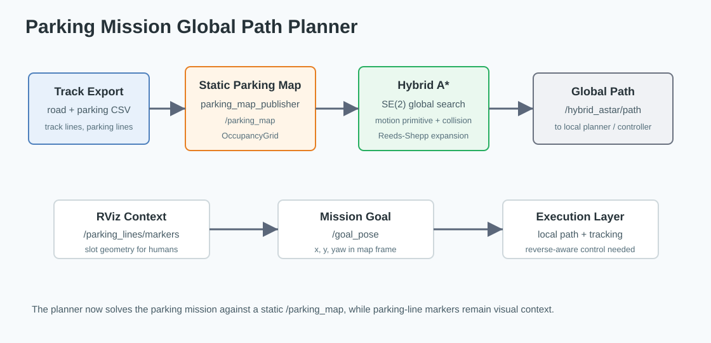
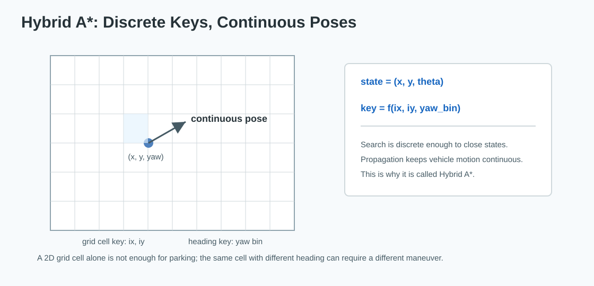
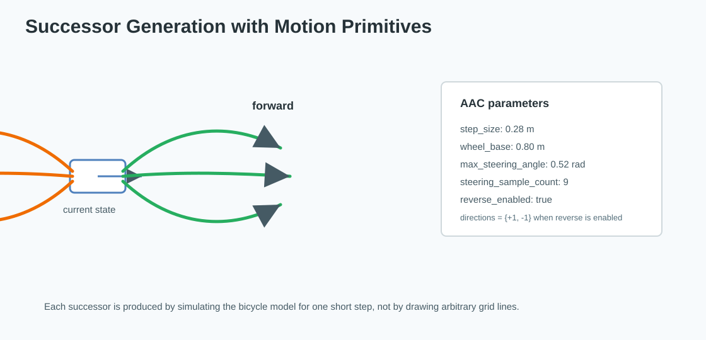
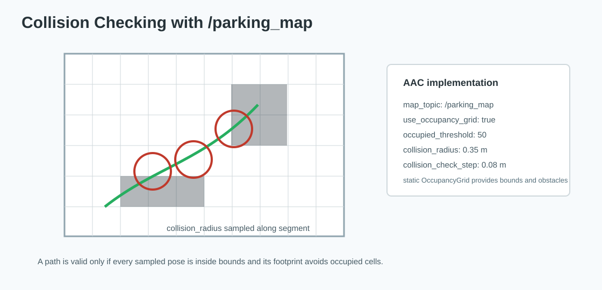
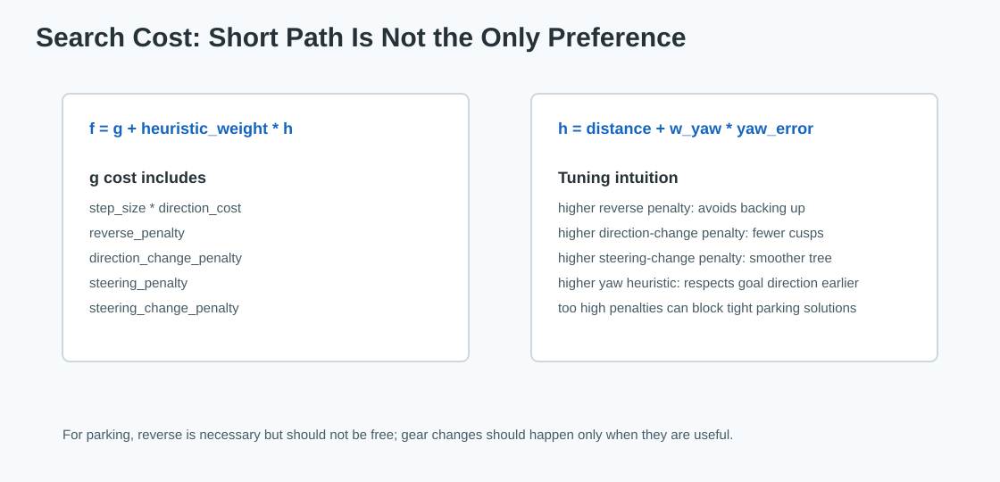
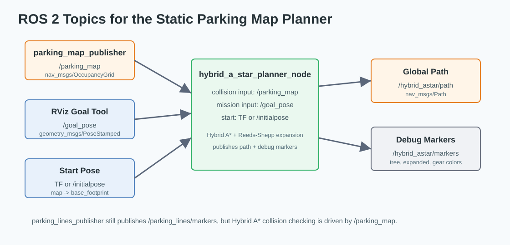
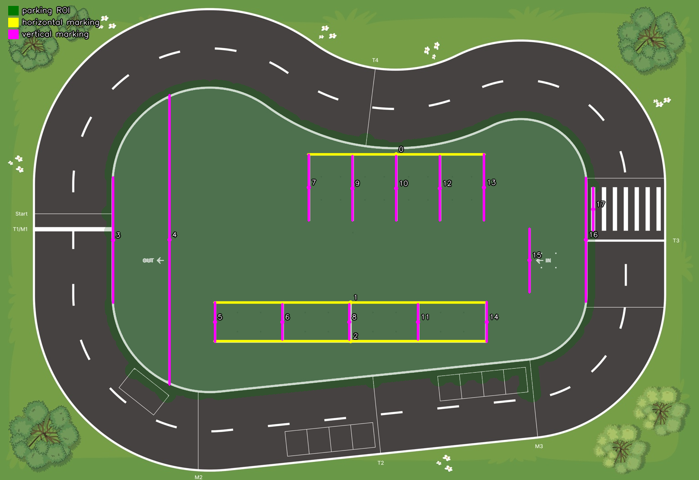
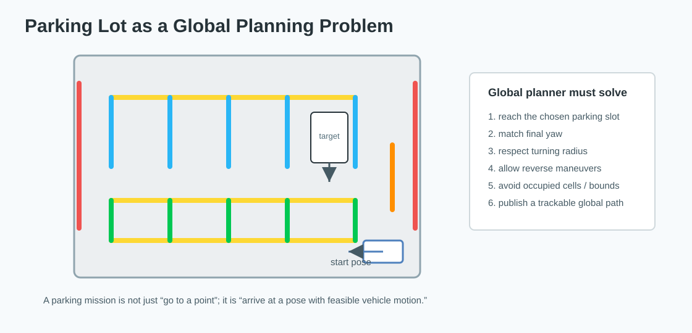
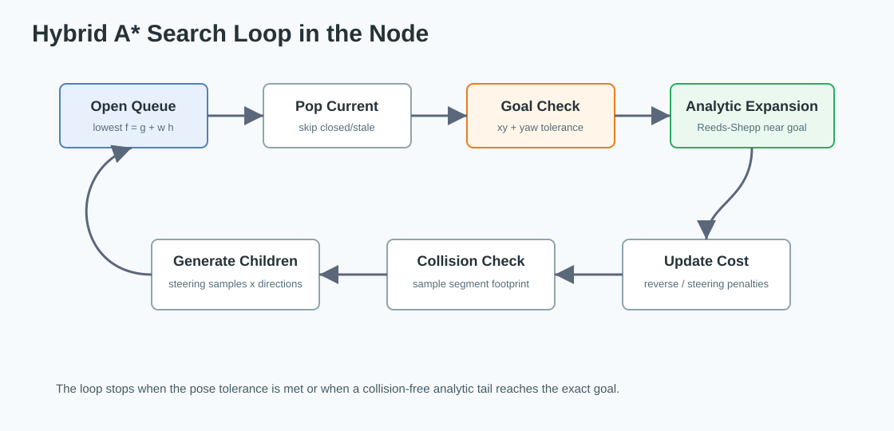
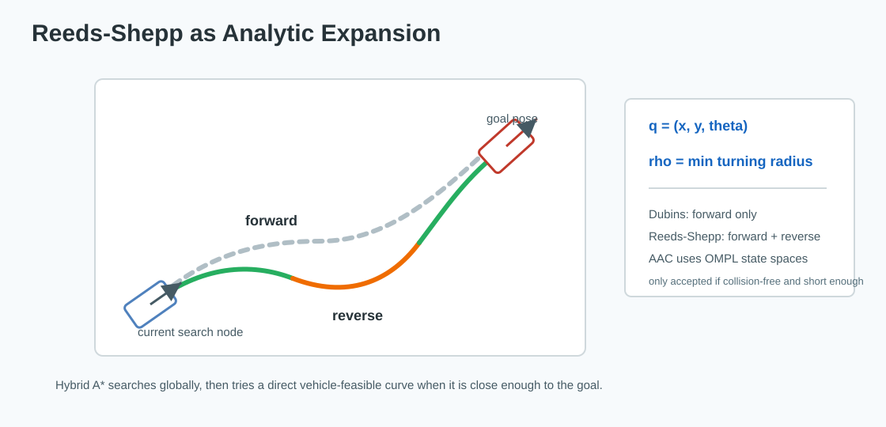

# `Lecture 09: Parking Mission Global Planner`
## Hybrid A*, Reeds-Shepp analytic expansion, static `/parking_map`

방산개방형아키텍처

---

# `1. 오늘의 핵심 질문`

이번 강의의 중심 질문:

```text
static /parking_map 위에서
시작 자세부터 목표 주차 자세까지 갈 수 있는 global path를 어떻게 만들 것인가?
```

오늘은 구현 내부를 깊게 파기보다 다음 개념을 먼저 잡는다.

- 주차 미션은 `x, y`가 아니라 `x, y, yaw`를 찾는 문제다.
- Hybrid A*는 grid search와 차량 기구학을 결합한다.
- Reeds-Shepp은 목표 근처에서 후진 가능한 연결을 제공한다.
- `/parking_map`은 collision checking의 기준 지도다.

평가는 없고, 수업 중 질문과 실행 확인 중심으로 진행한다.

---

# `2. Parking Global Planner Pipeline`



---

# `3. 주차장 미션의 입력과 출력`

입력:

| 입력 | AAC 구현 | 역할 |
| --- | --- | --- |
| static parking map | `/parking_map` | Hybrid A* collision checking |
| 주차선 marker | `/parking_lines/markers` | RViz에서 목표 slot 선택 |
| 시작 pose | TF 또는 `/initialpose` | 현재 차량 자세 |
| 목표 pose | `/goal_pose` | 주차 목표 자세 |

출력:

| 출력 | Type | 역할 |
| --- | --- | --- |
| `/hybrid_astar/path` | `nav_msgs/msg/Path` | global path |
| `/hybrid_astar/markers` | `visualization_msgs/msg/MarkerArray` | search/debug visualization |

---

# `4. /parking_map과 parking line marker`

주차장 미션에서는 같은 CSV 자산을 두 가지 방식으로 사용한다.

```text
track_texture_lines_wide.csv + parking_lot_lines.csv
  -> parking_map_publisher
  -> /parking_map

parking_lot_lines.csv
  -> parking_lines_publisher
  -> /parking_lines/markers
```

역할 구분:

- `/parking_map`: planner가 실제로 피해야 할 occupied cell을 담는 static `OccupancyGrid`
- `/parking_lines/markers`: 사람이 slot 구조를 보고 목표 pose를 정하는 RViz 시각화

즉, 주차선 marker는 "설명용 지도"에 가깝고, `/parking_map`은 "계획용 지도"다.

---

# `5. 문제 정의: SE(2) Global Planning`

주차장 global planning 문제:

```text
given:
  start pose q_s = (x_s, y_s, theta_s)
  goal pose  q_g = (x_g, y_g, theta_g)
  static /parking_map occupancy grid
  vehicle minimum turning radius

find:
  collision-free path q_0, q_1, ..., q_N
```

핵심 제약:

- 차량은 옆으로 순간 이동할 수 없다.
- 목표는 점이 아니라 `pose = position + heading`이다.
- 좁은 주차장에서는 전진과 후진 maneuver가 모두 필요하다.

---

# `6. 왜 2D A*로 부족한가`

일반 grid A*:

```text
state = (x, y)
neighbor = 상하좌우 또는 8방향 cell
```

주차 미션:

```text
state = (x, y, theta)
neighbor = 차량이 실제로 갈 수 있는 짧은 원호/직선
```

같은 위치라도 heading이 다르면 완전히 다른 상태다.

```text
slot을 향해 정렬된 차량
slot과 수직으로 서 있는 차량
slot 밖을 향해 있는 차량
```

따라서 `visited(x, y)`가 아니라 `visited(x, y, yaw_bin)`이 필요하다.

---

# `7. Hybrid A*의 핵심 아이디어`

Hybrid A*는 A*의 search 구조를 유지하면서 차량 기구학을 반영한다.

```text
discrete:
  grid cell ix, iy
  yaw bin

continuous:
  actual pose x, y, yaw
  bicycle model propagation
```

그래서 이름이 Hybrid다.

```text
닫힌 상태 관리는 discrete key로 하고,
자식 상태 생성은 continuous vehicle motion으로 한다.
```

---

# `8. SE(2) State Discretization`



---

# `9. Motion Primitive`



---

# `10. Bicycle Propagation`

조향각 `delta`와 이동 거리 `s`로 다음 pose를 예측한다.

```text
kappa = tan(delta) / L

theta_next = theta + s kappa
x_next     = x + integral cos(theta) ds
y_next     = y + integral sin(theta) ds
```

강의에서 기억할 점:

- `L`: wheelbase
- `delta`: steering angle
- `kappa`: curvature
- `s > 0`: forward
- `s < 0`: reverse

즉, planner의 edge는 임의의 선분이 아니라 차량이 실제로 만들 수 있는 짧은 움직임이다.

---

# `11. Forward와 Reverse`

주차 미션에서는 후진이 planning 공간의 일부다.

```yaml
reverse_enabled: true
reverse_penalty: 1.25
direction_change_penalty: 0.50
```

해석:

- `reverse_enabled`: 전진 edge와 후진 edge를 모두 생성할지
- `reverse_penalty`: 후진을 얼마나 비싸게 볼지
- `direction_change_penalty`: 전진/후진 전환을 얼마나 억제할지

후진을 금지하면 많은 주차 상황이 불가능해지고, 후진을 너무 싸게 두면 path가 앞뒤로 흔들릴 수 있다.

---

# `12. Collision Checking`



---

# `13. Static /parking_map의 의미`

`parking_map_publisher`는 static 주차장 지도를 만든다.

```text
track center/road boundary CSV + parking line CSV
  -> drivable region
  -> occupied line obstacles
  -> nav_msgs/OccupancyGrid
  -> /parking_map
```

기본 해석:

```text
free:
  road loop 내부
  parking-lot hull 주변 drivable region

occupied:
  outer road boundary
  selected parking slot separator markings
  non-drivable outside region
```

Hybrid A*는 `/parking_map`의 metadata를 bounds로 쓰고, occupied cell을 피하도록 탐색한다.

---

# `14. Search Loop`

Hybrid A* search loop:

```text
1. open queue에서 가장 promising한 상태를 꺼낸다.
2. 이미 닫힌 상태이면 건너뛴다.
3. 목표 tolerance 안에 들어왔는지 확인한다.
4. 목표 근처라면 analytic expansion을 시도한다.
5. steering sample과 direction 조합으로 child를 만든다.
6. child primitive가 collision-free인지 확인한다.
7. cost가 더 좋으면 open queue에 다시 넣는다.
```

일반 A*와 다른 점:

```text
neighbor = grid neighbor
가 아니라
neighbor = vehicle-feasible primitive
```

---

# `15. Cost Function`



---

# `16. Heuristic과 Goal Region`

heuristic은 search에게 방향 감각을 준다.

```text
h = goal까지의 거리 + yaw_error 가중치
```

목표는 정확한 한 점이라기보다 tolerance region이다.

```text
distance_to_goal <= goal_xy_tolerance
yaw_error        <= goal_yaw_tolerance
```

주차에서는 두 tolerance가 모두 중요하다.

- `xy` tolerance가 크면 slot 중앙에서 벗어날 수 있다.
- `yaw` tolerance가 크면 차량 방향이 slot과 맞지 않을 수 있다.
- 너무 작으면 search가 오래 걸리거나 실패할 수 있다.

---

# `17. Analytic Expansion`

Hybrid A*가 목표에 가까워지면 직접 연결을 시도한다.

```text
current search node
  -> Reeds-Shepp or Dubins curve
  -> exact goal pose
```

장점:

- grid search를 끝까지 끌고 가지 않아도 된다.
- 목표 pose의 yaw를 더 정확히 맞출 수 있다.
- 주차처럼 후진이 필요한 maneuver에서 짧은 tail을 만들 수 있다.

단, analytic curve도 `/parking_map` 위에서 collision-free여야 한다.

---

# `18. Reeds-Shepp의 역할`

이 강의에서 Reeds-Shepp는 단독 planner라기보다:

```text
Hybrid A*의 near-goal connector
```

로 이해한다.

Reeds-Shepp path는 다음 primitive 조합으로 구성된다.

```text
L: 좌회전 최대 곡률 원호
R: 우회전 최대 곡률 원호
S: 직선
```

각 primitive는 전진 또는 후진 gear를 가질 수 있다.

```text
L+ S+ R-
```

주차장에서는 이 후진 가능한 connector가 목표 pose 정렬에 특히 중요하다.

---

# `19. Dubins vs Reeds-Shepp`

| 구분 | Dubins | Reeds-Shepp |
| --- | --- | --- |
| 전진 | 가능 | 가능 |
| 후진 | 불가능 | 가능 |
| 최소 회전반경 | 고려 | 고려 |
| 주차 maneuver | 제한적 | 적합 |
| AAC analytic type | `dubins` | `reed_shepp` |

주차장 미션에서 핵심 비교:

```text
Dubins: 앞으로만 가는 차량형 연결
Reeds-Shepp: 앞뒤로 움직일 수 있는 차량형 연결
```

---

# `20. Turning Radius`

최소 회전반경은 steering limit과 wheelbase에서 계산할 수 있다.

```text
R_min = L / tan(delta_max)
```

AAC 기본 해석:

```yaml
wheel_base: 0.80
max_steering_angle: 0.52
```

```text
R_min ~= 0.80 / tan(0.52) ~= 1.38 m
```

주차 slot과 회전반경이 맞지 않으면 경로가 실패하거나 많은 전후진 maneuver가 필요하다.

---

# `21. 최종 Path와 한계`

검색이 성공하면 planner는 두 부분을 연결한다.

```text
1. Hybrid A*가 찾은 coarse search path
2. 목표 근처에서 성공한 Reeds-Shepp analytic tail
```

출력은 `nav_msgs/Path`다.

```text
/hybrid_astar/path
```

중요한 한계:

```text
nav_msgs/Path에는 gear 또는 진행 방향 field가 없다.
```

따라서 주차 미션을 실제로 닫으려면 reverse-aware controller 또는 별도의 direction 정보가 필요하다.

---

# `22. ROS Topic Graph`



---

# `23. AAC Package Roles`

강의에서 연결해서 볼 패키지 역할:

```text
planning/
  track_line_export/
    주차선 추출과 CSV/preview 생성

  parking_map_publisher/
    track/parking CSV로 /parking_map 발행

  parking_lines_publisher/
    CSV 주차선을 RViz marker로 발행

  hybrid_a_star_planner_node/
    /parking_map과 /goal_pose를 받아 SE(2) global path 생성
```

오늘의 중심은 파일 내부 구현보다 패키지 사이의 역할 분담과 planner 개념이다.

---

# `24. 핵심 정리`

오늘의 핵심:

- 주차장 미션은 global `SE(2)` pose planning 문제다.
- `/parking_map`은 Hybrid A*가 collision checking에 사용하는 static occupancy grid다.
- Hybrid A*는 discrete search와 continuous vehicle propagation을 결합한다.
- 주차에서는 reverse motion과 direction-change cost가 중요하다.
- Reeds-Shepp는 목표 근처에서 후진 가능한 analytic tail을 붙이는 데 유용하다.
- path output은 `nav_msgs/Path`이므로 reverse-aware execution은 별도 설계가 필요하다.

다음 장부터는 실행 방법, 세부 파라미터, 디버깅을 Appendix로 확인한다.

---

# `Appendix`
## 세부 실행, 튜닝, 디버깅 자료

앞 25페이지 정도는 강의 핵심 흐름만 담았다.

뒤쪽 Appendix는 다음 용도로 사용한다.

- 수업 중 실습 명령 확인
- 파라미터 튜닝 기준 확인
- 주차선 추출 결과와 CSV 구조 확인
- RViz/debug marker 해석
- PPTX export 재생성

---

# `A1. 주차선 추출 결과`

`planning/track_line_export/parking_lot_lines.csv`

현재 추출 결과 요약:

| 항목 | 값 |
| --- | ---: |
| segment rows | `18` |
| horizontal lines | `3` |
| vertical lines | `15` |
| world x bounds | `[-3.3125, 3.3333] m` |
| world y bounds | `[-5.5682, 5.4207] m` |

주차선은 path 자체가 아니라, 주차장 구조와 목표 slot을 정의하는 map context다.

---

# `A2. Parking Line Preview`



---

# `A3. CSV Column을 어떻게 읽을까`

`parking_lot_lines.csv`는 한 row가 하나의 line segment다.

중요 column:

| Column | 의미 |
| --- | --- |
| `line_id` | segment id |
| `line_role` | top separator, bottom edge, boundary 등 |
| `orientation` | horizontal 또는 vertical |
| `x1_m, y1_m, x2_m, y2_m` | map 좌표계 endpoint |
| `center_x_m, center_y_m` | segment 중심 |
| `length_m` | segment 길이 |

이 정보로 주차 slot 후보, boundary, approach direction을 계산할 수 있다.

---

# `A4. track_line_export의 처리 흐름`

`extract_texture_parking_lines.py`의 주요 단계:

```text
1. parking gray surface mask 생성
2. parking ROI 근처 white marking 추출
3. Canny + HoughLinesP로 선분 후보 검출
4. horizontal / vertical axis segment만 남김
5. 가까운 segment merge
6. role 추론
7. pixel -> mm -> map 좌표 변환
8. CSV와 preview image 저장
```

강의 포인트:

```text
비전/지도 전처리는 planner가 쓰기 좋은 구조화 데이터로 바뀌어야 한다.
```

---

# `A5. Parking Lot World Model`



---

# `A6. Heading Discretization Detail`

Hybrid A*는 yaw를 연속값 그대로 무한히 저장하지 않고 heading bin으로 묶는다.

AAC 기본값:

```yaml
heading_bins: 96
```

해석:

```text
360 deg / 96 = 3.75 deg per bin
```

trade-off:

| heading bin 수 | 장점 | 단점 |
| ---: | --- | --- |
| 적음 | 빠름, memory 절약 | 주차 방향이 거칠게 표현됨 |
| 많음 | 목표 yaw를 정교하게 맞춤 | search state 수 증가 |

---

# `A7. Steering Sample Detail`

Hybrid A*는 모든 조향각을 연속적으로 탐색하지 않는다.

대신 조향각 후보를 몇 개로 샘플링한다.

```text
steering samples = [-delta_max, ..., 0, ..., +delta_max]
```

AAC 기본값:

```yaml
max_steering_angle: 0.52
steering_sample_count: 9
```

각 조향 후보를 forward/reverse 방향과 조합하면 다음 search edge가 된다.

---

# `A8. Primitive Collision Sampling`

motion primitive 하나는 다음을 의미한다.

```text
현재 pose에서
특정 steering angle을 고정하고
짧은 거리 step_size만큼
전진 또는 후진해 본다.
```

이때 planner는 endpoint만 보지 않는다.

```text
primitive 중간 지점들도 샘플링하여 collision을 검사한다.
```

왜 필요한가?

- 시작점과 끝점은 안전해 보여도 중간 원호가 장애물과 닿을 수 있다.
- 주차장에서는 boundary와 slot separator가 가까워 작은 충돌도 중요하다.
- `step_size`가 커질수록 중간 샘플링의 중요성이 커진다.

---

# `A9. Footprint Model`

현재 planner는 보수적인 circular footprint 개념으로 collision을 본다.

```yaml
collision_radius: 0.35
collision_check_step: 0.08
```

의미:

```text
차량 중심 주변 반경 0.35 m 안에 occupied cell이 있으면 collision으로 본다.
```

장점:

- 구현이 단순하다.
- 회전 방향에 따라 footprint가 변하지 않는다.
- 교육용 planner에서 빠르게 안정성을 확보할 수 있다.

한계:

- 실제 차량은 원형이 아니라 직사각형이다.
- 좁은 주차 slot에서는 원형 footprint가 너무 보수적일 수 있다.
- 실차 적용에는 oriented rectangle footprint가 더 적합하다.

---

# `A10. Hybrid A* Search Loop`



---

# `A11. Search Loop를 말로 풀면`

Hybrid A* search loop:

```text
1. open queue에서 가장 promising한 상태를 꺼낸다.
2. 이미 닫힌 상태이면 건너뛴다.
3. 목표 tolerance 안에 들어왔는지 확인한다.
4. 목표 근처라면 analytic expansion을 시도한다.
5. steering sample과 direction 조합으로 child를 만든다.
6. child primitive가 collision-free인지 확인한다.
7. cost가 더 좋으면 open queue에 다시 넣는다.
```

일반 A*와 가장 큰 차이:

```text
neighbor = 상하좌우 grid cell
이 아니라
neighbor = 차량이 실제로 움직일 수 있는 짧은 원호/직선
```

---

# `A12. Cost Function`


---

# `A13. Cost가 표현하는 선호`

주차 planner는 단순히 가장 짧은 path만 고르면 안 된다.

비용에 담고 싶은 선호:

| 비용 항 | 의미 |
| --- | --- |
| path length | 짧은 경로 선호 |
| reverse penalty | 불필요한 후진 억제 |
| direction change penalty | 앞뒤 반복 maneuver 억제 |
| steering penalty | 큰 조향 억제 |
| steering change penalty | 급격한 조향 변화 억제 |

주차에서는 reverse가 필요하지만, reverse가 지나치게 싸면 경로가 앞뒤로 흔들릴 수 있다.

---

# `A14. Heuristic의 역할`

heuristic은 search에게 방향 감각을 준다.

현재 강의에서 이해할 기본 형태:

```text
h = goal까지의 거리 + yaw_error 가중치
```

의미:

- 목표에 가까운 상태를 우선 탐색한다.
- 목표 방향과 비슷한 heading을 조금 더 선호한다.
- 하지만 장애물과 차량 기구학을 완전히 예측하지는 않는다.

더 강력한 Hybrid A*에서는 다음 heuristic을 조합하기도 한다.

- obstacle-aware 2D grid heuristic
- Dubins distance
- Reeds-Shepp distance
- Voronoi 또는 clearance-aware heuristic

---

# `A15. Goal Region`

목표는 수학적으로 정확한 한 점이라기보다 tolerance region이다.

```text
distance_to_goal <= goal_xy_tolerance
yaw_error        <= goal_yaw_tolerance
```

기본값:

```yaml
goal_xy_tolerance: 0.20
goal_yaw_tolerance: 0.25
```

주차는 yaw tolerance가 너무 크면 slot 방향과 맞지 않고, 너무 작으면 search가 오래 걸릴 수 있다.

개념적으로는 목표 pose 주변에 작은 “도착 허용 영역”을 둔다고 보면 된다.

---

# `A16. Analytic Expansion`

Hybrid A*가 목표에 가까워지면 직접 연결을 시도한다.

```text
current search node -> Reeds-Shepp or Dubins curve -> exact goal pose
```

장점:

- grid search를 끝까지 끌고 가지 않아도 된다.
- 목표 pose의 yaw를 더 정확히 맞출 수 있다.
- 주차처럼 후진이 필요한 maneuver에서 짧은 tail을 만들 수 있다.

단, collision-free이고 max length 조건을 만족할 때만 붙인다.

---

# `A17. Reeds-Shepp Analytic Expansion`



---

# `A18. Reeds-Shepp의 위치`

이 강의에서 Reeds-Shepp는 단독 global planner라기보다:

```text
Hybrid A*의 near-goal connector
```

로 이해한다.

요약:

- 상태는 `(x, y, yaw)`다.
- 차량은 최소 회전반경을 가진다.
- path는 좌회전, 우회전, 직진 primitive 조합이다.
- Dubins는 전진만 허용한다.
- Reeds-Shepp는 전진과 후진을 허용한다.
- 주차장에서는 후진 가능한 connector가 중요하다.

---

# `A19. Dubins vs Reeds-Shepp`

| 구분 | Dubins | Reeds-Shepp |
| --- | --- | --- |
| 전진 | 가능 | 가능 |
| 후진 | 불가능 | 가능 |
| 최소 회전반경 | 고려 | 고려 |
| 주차 maneuver | 제한적 | 적합 |
| AAC analytic type | `dubins` | `reed_shepp` |

실습 관점:

```text
reverse_enabled=false, analytic_expansion_type=dubins
```

로 바꾸면 주차 경로가 얼마나 어려워지는지 비교할 수 있다.

---

# `A20. Reeds-Shepp Path Family`

Reeds-Shepp 경로는 임의의 곡선이 아니다.

기본 primitive:

```text
L: 최대 곡률 좌회전 원호
R: 최대 곡률 우회전 원호
S: 직선
```

각 primitive는 전진 또는 후진 gear를 가질 수 있다.

예:

```text
L+ S+ R-
```

해석:

```text
전진 좌회전 -> 전진 직진 -> 후진 우회전
```

gear가 바뀌는 지점은 cusp이며, 실제 차량에서는 정지 후 방향 전환 지점이다.

---

# `A21. Turning Radius`

최소 회전반경은 steering limit과 wheelbase에서 계산할 수 있다.

```text
R_min = L / tan(delta_max)
```

AAC 기본값:

```yaml
wheel_base: 0.80
max_steering_angle: 0.52
minimum_turning_radius: 0.0
```

`minimum_turning_radius: 0.0`이면 자동 계산:

```text
0.80 / tan(0.52) ≈ 1.38 m
```

주차 slot과 회전반경이 맞지 않으면 경로가 실패하거나 많은 후진 maneuver가 필요하다.

---

# `A22. Analytic Expansion Parameter`

```yaml
analytic_expansion_type: "reed_shepp"
analytic_expansion_distance: 4.0
analytic_expansion_yaw_tolerance: 3.15
analytic_expansion_max_length: 8.0
analytic_curve_sample_distance: 0.08
```

의미:

- `distance`: 목표 근처 몇 m부터 직접 연결을 시도할지
- `yaw_tolerance`: straight expansion에서 yaw 차이 허용
- `max_length`: 너무 긴 connector는 거절
- `sample_distance`: connector collision check 밀도

---

# `A23. 최종 Path가 만들어지는 방식`

검색이 성공하면 planner는 다음 두 부분을 연결한다.

```text
1. Hybrid A*가 찾은 coarse search path
2. 목표 근처에서 성공한 Reeds-Shepp analytic tail
```

그 뒤 tracking controller가 쓰기 좋도록 path point를 더 촘촘하게 만든다.

```text
coarse path -> interpolated nav_msgs/Path
```

개념적으로는:

```text
거친 탐색으로 주차장 안의 큰 maneuver를 찾고,
목표 근처에서는 차량형 최단 연결로 마무리한다.
```

---

# `A24. Path Output의 한계`

`/hybrid_astar/path`는 `nav_msgs/Path`다.

문제:

```text
nav_msgs/Path에는 gear 또는 진행 방향 field가 없다.
```

현재 node는 marker에서 진행 방향을 추정해 색을 나눈다.

```text
heading_dot >= 0 -> forward segment
heading_dot < 0  -> reverse segment
```

실제 주차 제어까지 가려면 downstream controller가 reverse command를 낼 수 있어야 한다.

---

# `A25. ROS Topic Graph`


---

# `A26. Package Structure`

강의에서 연결해서 볼 패키지 역할:

```text
planning/
  track_line_export/
    주차선 추출과 CSV/preview 생성

  parking_lines_publisher/
    CSV 주차선을 RViz marker로 발행

  parking_map_publisher/
    track/parking CSV로 /parking_map 발행

  hybrid_a_star_planner_node/
    /parking_map과 /goal_pose를 받아 SE(2) global path 생성
```

오늘은 파일 내부 구현보다 패키지 사이의 역할 분담과 planner 개념을 중심으로 본다.

---

# `A27. Parking Line Extraction 실행`

주차선 CSV와 preview를 다시 만들 때:

```bash
# 실행 위치: Host
cd /home/leedk/ros_ws/src/aac_2026/planning/track_line_export
python3 -m pip install -r requirements.txt
python3 extract_texture_parking_lines.py \
  --input input_track_texture.png \
  --output-csv parking_lot_lines.csv \
  --preview parking_lot_lines_preview.png
```

출력 확인:

```bash
# 실행 위치: Host
head -n 5 parking_lot_lines.csv
cat parking_lot_lines_validation_summary.txt
```

---

# `A28. Build`

```bash
# 실행 위치: AAC Container
cd /ros_ws/src/aac_2026
./build.sh --packages-select \
  parking_map_publisher \
  parking_lines_publisher \
  hybrid_a_star_planner_node
source /ros_ws/install/setup.bash
```

확인:

```bash
# 실행 위치: AAC Container
ros2 pkg executables parking_map_publisher
ros2 pkg executables parking_lines_publisher
ros2 pkg executables hybrid_a_star_planner_node
```

---

# `A29. Run: Static Parking Map & Lines`

static occupancy map:

```bash
# 실행 위치: AAC Container
source /ros_ws/install/setup.bash
ros2 launch parking_map_publisher parking_map_publisher.launch.py \
  use_sim_time:=true
```

parking line visualization:

```bash
# 실행 위치: AAC Container
source /ros_ws/install/setup.bash
ros2 launch parking_lines_publisher parking_lines_publisher.launch.py \
  use_sim_time:=true
```

custom CSV를 직접 지정할 수도 있다.

```bash
# 실행 위치: AAC Container
source /ros_ws/install/setup.bash
ros2 launch parking_map_publisher parking_map_publisher.launch.py \
  use_sim_time:=true \
  track_csv_path:=/ros_ws/src/aac_2026/planning/track_line_export/track_texture_lines_wide.csv \
  parking_csv_path:=/ros_ws/src/aac_2026/planning/track_line_export/parking_lot_lines.csv
```

---

# `A30. Run: Hybrid A* Planner`

기본 실행:

```bash
# 실행 위치: AAC Container
source /ros_ws/install/setup.bash
ros2 launch hybrid_a_star_planner_node hybrid_a_star_planner.launch.py \
  use_sim_time:=true
```

기본 `map_topic`은 `/parking_map`이다.

```yaml
map_topic: "/parking_map"
use_occupancy_grid: true
```

`/parking_map` 없이 알고리즘 동작만 확인하는 디버깅 모드:

```bash
# 실행 위치: AAC Container
source /ros_ws/install/setup.bash
ros2 launch hybrid_a_star_planner_node hybrid_a_star_planner.launch.py \
  use_sim_time:=true \
  use_occupancy_grid:=false
```

---

# `A31. Start Pose Source`

기본 시작 pose:

```text
TF: map -> base_footprint
```

TF 없이 RViz `2D Pose Estimate`를 시작점으로 쓸 때:

```bash
# 실행 위치: AAC Container
source /ros_ws/install/setup.bash
ros2 launch hybrid_a_star_planner_node hybrid_a_star_planner.launch.py \
  use_sim_time:=true \
  start_pose_source:=initialpose
```

RViz에서:

```text
2D Pose Estimate -> /initialpose
2D Goal Pose     -> /goal_pose
```

---

# `A32. RViz`

```bash
# 실행 위치: AAC Container
source /ros_ws/install/setup.bash
rviz2 -d /ros_ws/src/aac_2026/rviz/planner.rviz
```

확인할 display:

- `ParkingMap`: `/parking_map`
- `ParkingLines`: `/parking_lines/markers`
- `HybridAStarPath`: `/hybrid_astar/path`
- `HybridVis`: `/hybrid_astar/markers`
- `Tool Properties`: `2D Goal Pose` topic이 `/goal_pose`인지 확인

<div class="capture">
캡처 삽입 위치: RViz에서 `/parking_map`, 주차선, search tree, forward/reverse path가 함께 보이는 화면
</div>

---

# `A33. Goal Pose 직접 Publish`

RViz 대신 topic으로 목표를 줄 수도 있다.

```bash
# 실행 위치: AAC Container
ros2 topic pub --once /goal_pose geometry_msgs/msg/PoseStamped "{
  header: {frame_id: 'map'},
  pose: {
    position: {x: 1.2, y: -1.6, z: 0.0},
    orientation: {x: 0.0, y: 0.0, z: 0.0, w: 1.0}
  }
}"
```

실제 목표 pose는 RViz의 `/parking_map`과 주차선 marker를 함께 보고 slot 중앙과 최종 yaw를 맞춰 조정한다.

---

# `A34. Topic Quick Check`

static parking map:

```bash
# 실행 위치: AAC Container
ros2 topic echo --once /parking_map --field info
```

주차선 marker:

```bash
# 실행 위치: AAC Container
ros2 topic echo --once /parking_lines/markers
```

Hybrid A* path:

```bash
# 실행 위치: AAC Container
ros2 topic echo --once /hybrid_astar/path
```

debug marker:

```bash
# 실행 위치: AAC Container
ros2 topic echo --once /hybrid_astar/markers
```

---

# `A35. Forward-only 모드와 비교`

주차 미션에서 후진의 중요성을 보려면:

```bash
# 실행 위치: AAC Container
source /ros_ws/install/setup.bash
ros2 launch hybrid_a_star_planner_node hybrid_a_star_planner.launch.py \
  use_sim_time:=true \
  reverse_enabled:=false \
  analytic_expansion_type:=dubins
```

비교 포인트:

- path가 더 길어지는가?
- 목표 yaw를 맞추기 어려워지는가?
- search tree가 더 넓어지는가?
- tight parking slot에서 실패하는가?

---

# `A36. Planner Config 핵심`

`hybrid_a_star_planner.yaml`

```yaml
step_size: 0.28
map_topic: "/parking_map"
use_occupancy_grid: true
wheel_base: 0.80
max_steering_angle: 0.52
steering_sample_count: 9
heading_bins: 96
reverse_enabled: true
collision_radius: 0.35
goal_xy_tolerance: 0.20
goal_yaw_tolerance: 0.25
analytic_expansion_type: "reed_shepp"
max_iterations: 50000
```

이 값들은 경로 품질, 계산량, 성공률을 함께 바꾼다.

---

# `A37. Tuning: Resolution`

| Parameter | 커지면 | 작아지면 |
| --- | --- | --- |
| `step_size` | 빠르지만 거칠어짐 | 부드럽지만 느려짐 |
| `heading_bins` | 방향 표현이 촘촘함 | 상태 수 감소 |
| `steering_sample_count` | maneuver 후보 증가 | search가 단순해짐 |
| `collision_check_step` | collision check가 듬성듬성 | 더 안전하지만 계산량 증가 |

실습에서는 한 번에 하나씩만 바꿔야 원인을 해석할 수 있다.

---

# `A38. Tuning: Parking Behavior`

| Parameter | 효과 |
| --- | --- |
| `reverse_penalty` | 후진을 얼마나 꺼릴지 |
| `direction_change_penalty` | gear change 횟수를 얼마나 줄일지 |
| `steering_penalty` | 큰 조향을 얼마나 꺼릴지 |
| `steering_change_penalty` | 조향 변화가 큰 path를 얼마나 꺼릴지 |
| `yaw_heuristic_weight` | 목표 방향을 얼마나 일찍 고려할지 |

주차에서는 후진을 금지하면 안 되지만, 너무 쉽게 쓰게 해도 경로가 지저분해진다.

---

# `A39. Tuning: Analytic Expansion`

Analytic expansion이 너무 공격적이면:

```text
목표 근처에서 무리한 직접 연결을 자주 시도한다.
```

너무 보수적이면:

```text
grid search가 목표 pose까지 오래 탐색한다.
```

확인할 값:

```yaml
analytic_expansion_distance
analytic_expansion_max_length
analytic_curve_sample_distance
minimum_turning_radius
```

RViz marker로 search tree가 어디까지 가는지 확인한다.

---

# `A40. Local Planner와 연결`

Hybrid A* output을 기존 local planner의 global path로 쓰려면:

```text
/hybrid_astar/path -> local_path_planner_node -> /local_path/body
```

현재 `local_path_planner_node` 기본 입력은:

```yaml
global_path_topic: "/path/center"
```

parking mission에서는 custom config에서:

```yaml
global_path_topic: "/hybrid_astar/path"
```

로 바꿔 실행한다.

---

# `A41. 중요한 한계: Reverse Tracking`

Hybrid A*는 forward/reverse가 섞인 path를 만들 수 있다.

하지만 기존 path tracking stack은 다음을 확인해야 한다.

- `nav_msgs/Path`만으로 reverse 구간을 명확히 알 수 있는가?
- pure pursuit 또는 Stanley가 후진을 안정적으로 추종하는가?
- `/ackermann_auto`에 음수 speed를 낼 것인가?
- `joy_control_node`와 vehicle interface가 reverse command를 허용하는가?

주차 미션 완성에는 planner뿐 아니라 reverse-aware controller가 필요하다.

---

# `A42. Debugging: 계획 실패`

계획이 실패할 때 확인:

| 증상 | 확인할 것 |
| --- | --- |
| start invalid | TF frame, bounds, collision radius |
| goal invalid | goal이 bounds 밖인지, occupied cell인지 |
| search exhausted | max_iterations, heuristic, step size |
| path가 벽을 통과 | `/parking_map`, collision_radius, map resolution |
| 후진이 너무 많음 | reverse penalty, direction change penalty |
| 목표 방향이 틀림 | goal_yaw_tolerance, goal pose orientation |

---

# `A43. Debugging: Marker 해석`

`/hybrid_astar/markers`에서 볼 것:

- blue sphere: start
- red sphere: goal
- green path: final path
- green line list: forward segments
- orange line list: reverse segments
- gray tree: explored transitions
- cyan points: expanded states

<div class="capture">
캡처 삽입 위치: forward/reverse segment 색상이 다른 Hybrid A* marker 화면
</div>

---

# `A44. Checkpoint 1`

다음을 말로 설명해 본다.

```text
왜 주차장 미션에서 state = (x, y)가 아니라 state = (x, y, yaw)인가?
```

힌트:

```text
같은 위치라도 차량 방향이 다르면 주차 slot 진입 가능성이 달라진다.
```

---

# `A45. Checkpoint 2`

다음을 그림으로 설명해 본다.

- 시작 pose와 goal pose가 planner로 들어오는 흐름
- `x, y, yaw` 상태가 grid cell과 heading bin으로 묶이는 방식
- steering sample과 forward/reverse direction이 motion primitive가 되는 방식
- collision check가 endpoint만이 아니라 primitive 중간점까지 보는 이유
- Reeds-Shepp analytic expansion이 goal 근처에서 search를 마무리하는 방식
- `/hybrid_astar/path`가 local planner와 controller로 이어질 때 생기는 reverse tracking 문제

---

# `A46. Checkpoint 3`

파라미터를 바꿔 비교한다.

```bash
# 실행 위치: AAC Container
ros2 launch hybrid_a_star_planner_node hybrid_a_star_planner.launch.py \
  use_sim_time:=true \
  use_occupancy_grid:=false \
  reverse_penalty:=1.0 \
  direction_change_penalty:=0.0
```

다시 실행:

```bash
# 실행 위치: AAC Container
ros2 launch hybrid_a_star_planner_node hybrid_a_star_planner.launch.py \
  use_sim_time:=true \
  use_occupancy_grid:=false \
  reverse_penalty:=2.0 \
  direction_change_penalty:=1.0
```

경로 길이, gear change, search tree를 비교한다.

---

# `A47. 실습 기록 양식`

| 실험 | reverse | analytic | penalty 설정 | 관찰 |
| --- | --- | --- | --- | --- |
| A | true | reed_shepp | default | baseline |
| B | false | dubins | default | forward-only |
| C | true | reed_shepp | reverse 낮음 | 후진 증가 여부 |
| D | true | reed_shepp | direction change 높음 | gear change 감소 여부 |

평가 제출용이 아니라 planner tuning 감각을 잡는 기록이다.

---

# `A48. 정리`

오늘의 핵심:

- 주차장 미션은 global `SE(2)` pose planning 문제다.
- 주차선 추출 결과는 slot/boundary를 이해하고 목표 pose를 정하는 map context다.
- Hybrid A*는 discrete search와 continuous vehicle propagation을 결합한다.
- 주차에서는 reverse motion과 direction-change cost가 중요하다.
- Reeds-Shepp는 목표 근처에서 후진 가능한 analytic tail을 붙이는 데 유용하다.
- 현재 path output은 `nav_msgs/Path`이므로 reverse-aware execution은 별도 설계가 필요하다.

---

# `A49. References`

- Dmitri Dolgov, Sebastian Thrun, Michael Montemerlo, James Diebel, "Practical Search Techniques in Path Planning for Autonomous Driving", STAIR, 2008.  
  https://ai.stanford.edu/~ddolgov/papers/dolgov_gpp_stair08.pdf

- J. A. Reeds and L. A. Shepp, "Optimal paths for a car that goes both forwards and backwards", Pacific Journal of Mathematics, 1990.  
  https://projecteuclid.org/journals/pacific-journal-of-mathematics/volume-145/issue-2/Optimal-paths-for-a-car-that-goes-both-forwards-and/pjm/1102645450.pdf

- Nav2 documentation, "Smac Hybrid-A* Planner".  
  https://docs.nav2.org/configuration/packages/smac/configuring-smac-hybrid.html

- OMPL geometric planning state spaces: DubinsStateSpace and ReedsSheppStateSpace.  
  https://ompl.kavrakilab.org/

---

# `A50. Appendix: Export`

Marp Markdown을 PPTX로 변환:

```bash
# 실행 위치: Host
cd /home/leedk/ros_ws/src/aac_2026
docker run --rm \
  -v /home/leedk/ros_ws/src/aac_2026:/home/marp/app/ \
  -e MARP_USER="$(id -u):$(id -g)" \
  marpteam/marp-cli \
  lecture/lecture09_parking_global_planner_hybrid_astar.md \
  --pptx \
  --allow-local-files \
  -o lecture/lecture09_parking_global_planner_hybrid_astar.pptx
```
